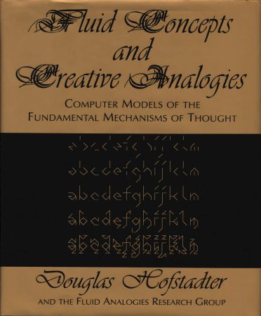
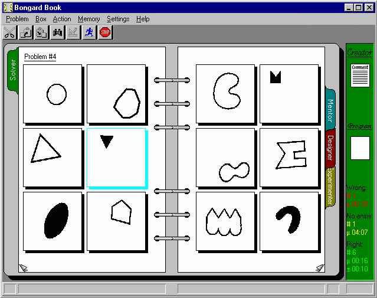
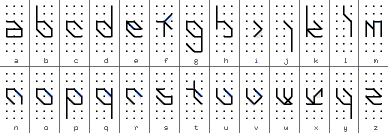
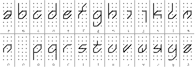

# FARGonautica

a project in loving memory of Helga Keller

---

**Repository News: Metacat runs again, in Racket and Python, alongside the classic version. Numbo source-code just added. Seek-Whence runs again too: Meredith's 1986 program, reconstructed in Python from her thesis!**

[**Hofstadter, D., and FARG (1995) Fluid Concepts and Creative Analogies, Basic Books.**](https://cogsci.indiana.edu/book.html)

[Fuid Concepts & Creative Analogies at the Internet Archive](https://archive.org/details/fluidconceptscre0000hofs_w7o9/mode/2up).

Research carried out at the Center of Research on Concepts and Cognition (CRCC) has been described in detail in the book _Fluid Concepts and Creative Analogies: Computer Models of the Fundamental Mechanisms of Thought_, written by Douglas Hofstadter and members of the Fluid Analogies Research Group. Hofstadter's first two books, _Gödel, Escher, Bach_ and _Metamagical Themas_ previously discussed a number of ideas relevant to artificial intelligence and cognitive science, such as recursivity, subcognition, and emergent behavior, but this new book looks back from the perspective of having grappled with those ideas in the course of implementing actual computer models. Programs that model creativity and analogy-making have been designed by Hofstadter and his graduate students, and the story of their past, present and future development is the subject of the book, co-authored by the students in the Fluid Analogies Research Group (FARG).

---

This repository has a number of goals:  

    i) we want to collect all the (open-source) computational architectures that have been developed in
    Douglas Hofstadter's group's research in Fluid Concepts & Creative Analogies; from Numbo to Copycat to
    Tabletop to Letter Spirit, Metacat, Musicat, etc, alongside the info on how to install and run it;
    ii) we want to collect all the literature:
     - unpublished papers,
     - CRCC reports related to FARG architectures,
     - published papers,
     - Theses, etc
    iii) we want to archive all materials for an online course on Fluid Concepts & Creative Analogies
    (also called "Fluid Concepts", "FARG architectures", "Copycat Architecture", "Hofstadter School",
    "Active Symbols", etc).  By proposing this course, ideally, **every single undergraduate program**
    would be able to study the principles of this school of thought, **see those principles in action**,
    and **compare those principles with different approaches**.   Moving to more advanced stuff,
    Graduate students, now with easy access to the code, could have a complete course on the computer
    science of building these architectures; they might, for instance, play with their own ideas, and
    find out whether or not they make sense.

We hope that, after this repository is complete (or close to), it will be cloned and hosted at a [Indiana University Github:IU page](https://kb.iu.edu/d/bagk), where it will be easily found by the interested community.

Welcome!  Join us.  This will be insanely fun.  

REPOSITORY VERSION & HOW YOU CAN CONTRIBUTE
---

As of right now, this repo is considered, in open-source fashion, to be in version **0.2.1**:

**Goals for version 1.0.0**:
- Each project should contain:
    - **Source code** of all major projects, complete and running
    - **Literature** of all major projects, complete with links to books
    - **Exercises** for undergraduate courses
    - **Programming challenges** large or small
    - **Research challenges** for graduate students (each challenge being able to lead to a publication, in principle)

This repo can not only be a library but also a source for undergraduate courses and a set of research questions... hopefully this will enable wider discussions of the scientific concepts presented in this project. An ambitious long-term goal would be to have these projects running in a browser, as recommended by [Bob French](http://onlinelibrary.wiley.com/doi/10.1111/j.1756-8765.2012.01206.x/full)--hopefully in [Jupyter Notebooks](https://www.nature.com/news/interactive-notebooks-sharing-the-code-1.16261) and the upcoming [Jupyter Lab](https://medium.com/@boyanangelov/is-this-the-best-data-science-ide-jupyter-lab-review-fdd165470f13). Well, here's where we are and here's [where we're going!](repo-version.md)

Here's how you can [contribute to this repository](contributing.md).

PROJECTS TO JOIN HERE (desiderata)
---

The ambition is to catalogue and archive the sourcecode and literature involved in building new Fluid Concepts Architectures to new domains.  Eventually we hope to have a complete set of archived projects (or linked from here when being maintained).

 | Project | Author | Language | Available? |
 |---------| --------- | ----------| ----------|
 | Seek-Whence | [Marsha Meredith](https://scholar.google.com.br/scholar?hl=en&q=marsha+meredith&btnG=&as_sdt=1%2C5&as_sdtp=) | Franz Lisp (lost); Python reconstruction | **Yes** (reconstructed from the thesis, [`Software/SeekWhence/`](Software/SeekWhence/)) |
 | Numbo | [Daniel Defays](http://www.ulg.ac.be/cms/c_6099593/fr/repertoires?uid=U011369) | Lisp (also SBCL port, Python & Clojure) | **Yes** (Finally!) |
 | Copycat | [Melanie Mitchell](http://web.cecs.pdx.edu/~mm/) | Lisp (also Java & Python) | **Yes** |  
 | Tabletop | [Robert M. French](http://leadserv.u-bourgogne.fr/en/members/robert-m-french) | Lisp (lost; a Python reconstruction with a Qt GUI) | **Yes** (reconstructed from the specification, 2026: [fargonauts/Tabletop](https://github.com/fargonauts/Tabletop) and [`Software/Tabletop/`](Software/Tabletop/)) |
 | Letter Spirit | [Gary McGraw](https://www.garymcgraw.com/) | Scheme |  **Yes** (McGraw's work was extended by Rehling) |
 | Letter Spirit | [John Rehling](https://scholar.google.com.br/scholar?hl=en&q=john+rehling&btnG=&as_sdt=1%2C5&as_sdtp=) |  Scheme |  **Yes** |
 | Metacat | [James Marshall](https://www.sarahlawrence.edu/faculty/marshall-james.html) | Scheme (also Racket & Python ports) |  **Yes** (runs again!) |
 | Phaeaco | [Harry Foundalis](http://www.foundalis.com/) | C++ | Closed-source |
 | Musicat | [Eric Nichols](https://github.com/eraoul) | C# | **Yes** |
 | Capyblanca | [Alex Linhares](https://github.com/Alex-Linhares) | Delphi | **Yes** |
 | George | [Francisco Lara-Dammer](https://www.linkedin.com/in/francisco-lara-dammer-ba5a3ab2/) | Java | **(asap)** Dr. Lara-Dammer desires to clean up the code prior to release (2017-08-29) |
 | SeqSee | [Abhijit Mahabal](https://github.com/amahabal) | Perl; Python port | **Yes** (Perl original and Python port in `Software/Seqsee/`) |

PROJECT: COPYCAT
---

*Hager's blackboard at the end of `abc abd xyz`, seed 36: the strings with their bonds (arcs, with the direction's arrowhead), groups (boxes), the correspondences between `abc` and `xyz` with the concept mappings that justify them, the rule and its translation, and the answer `wyz`. Below, the Slipnet's activations and the Coderack's codelets.* Hager's own 2009 video of the program: [youtu.be/v7Eotp-XKVA](https://youtu.be/v7Eotp-XKVA).

[Melanie Mitchell](http://web.cecs.pdx.edu/~mm/) & [Douglas Hofstadter](http://www.cogs.indiana.edu/people/profile.php?u=dughof)

Find Dr. Mitchell in  [Homepage](http://web.cecs.pdx.edu/~mm/)  |  [Wikipedia](https://en.wikipedia.org/wiki/Melanie_Mitchell)  |  [Google Scholar](https://scholar.google.com.br/citations?user=k4gbv2AAAAAJ&hl=en&oi=ao)  |  [Academia.edu](https://pdx.academia.edu/MelanieMitchell)

Copycat is a model of analogy making and human cognition based on the concept of the parallel terraced scan, developed in 1988 by Douglas Hofstadter, Melanie Mitchell, and others at the Center for Research on Concepts and Cognition, Indiana University Bloomington.

Copycat produces answers to such problems as "abc is to abd as ijk is to what?" (abc:abd :: ijk:?). Hofstadter and Mitchell consider analogy making as the core of high-level cognition, or high-level perception, as Hofstadter calls it, basic to recognition and categorization. High-level perception emerges from the spreading activity of many independent processes, called codelets, running in parallel, competing or cooperating. They create and destroy temporary perceptual constructs, probabilistically trying out variations to eventually produce an answer. The codelets rely on an associative
network, slipnet, built on pre-programmed concepts and their associations (a long-term memory). The changing activation levels of the concepts make a conceptual overlap with neighboring concepts.

Copycat's architecture is tripartite, consisting of a slipnet, a working area (also called workspace, similar to blackboard systems), and the coderack (with the codelets). The slipnet is a network composed of nodes, which represent permanent concepts, and weighted links, which are relations, between them. It differs from traditional semantic networks as the effective weight associated with a particular link may vary through time according to the activation level of specific concepts (nodes). The codelets build structures in the working area and modify activations in the slipnet accordingly (bottom-up processes), and the current state of slipnet determines probabilistically which codelets must be run (top-down influences).

**Implementations of the Copycat project:**

| Author  |  Language/Sourcecode |  Note  |
|--------|------------------------|-------|
| Melanie Mitchell |  [LISP](http://web.cecs.pdx.edu/~mm/how-to-get-copycat.html), archived here: [`Software/Copycat/Melanie-Mitchell-[LISP]/`](/Software/Copycat/Melanie-Mitchell-%5BLISP%5D/) | The original (Lucid Common Lisp + Flavors); runs again, see the next two rows |  
| Scott Burson (& Melanie Mitchell) |  [LISP](https://github.com/slburson/copycat) | Mitchell's original, revived in modern Common Lisp (SBCL, Flavors on CLOS): runs; no license file, so read here only as a reference |  
| Melanie Mitchell, **running on SBCL** (2026) | [LISP](/Software/Copycat/melanies-copycat/): [`Software/Copycat/melanies-copycat/`](/Software/Copycat/melanies-copycat/) | Her files unchanged (`src/`), with a Lucid and Flavors compatibility layer written for this archive (`compat/`); headless, seeded and reproducible; `RESULTS.md` compares six problems × 100 seeds with the figures in FCCA chapter 5 (xyd 78% vs 77%). Graphics not ported. `./run-copycat.sh abc abd ijk 7` |
| Melanie Mitchell's engine in Hager's GUI (2026) | [Lisp + Python](/Software/Copycat/melanies-opengl/): [`Software/Copycat/melanies-opengl/`](/Software/Copycat/melanies-opengl/) | Her original program, running unchanged on SBCL, displayed live in Hager's OpenGL window: a JSON trace per codelet from the Lisp side, an adapter on the Python side. `python3 -m melanies_opengl abc abd xyz --seed 36`; runs can be recorded and replayed without SBCL |
| Scott Boland  | [Java](/Software/Copycat/Scott-Boland-implementation%20in%20JAVA/JavaCopycat.zip) | (SB's email lost?) |
| ["speakeasy"](https://github.com/speakeasy)  |  [Java](https://github.com/speakeasy/CopyCat)  |  fork of Scott Boland's code |
| [Greg Detre](https://github.com/gregdetre) | [Clojure](https://github.com/gregdetre/copycat-clojure)  | Not tested  |
| [Arthur O'Dwyer](https://github.com/Quuxplusone), [J Alan Brogan](https://github.com/jalanb),others | [Python 2](https://github.com/Quuxplusone/co.py.cat)  | Multiple forks, no graphics  |
| [Lucas Saldyt](https://github.com/LSaldyt) | [Python 3](https://github.com/fargonauts/copycat)  | Above repo patch to Python 3  |
| [Joseph Aaron Hager](https://github.com/ajhager) | [Python 3](https://github.com/ajhager/copycat), archived and repaired here: [`Software/Copycat/copycat-opengl/`](/Software/Copycat/copycat-opengl/) | [OpenGL graphics](https://youtu.be/v7Eotp-XKVA) (pyglet). Runs again on Python 3.12 (2026): the Python 3 crashes and two engine bugs fixed, runs reproducible per seed, and the blackboard now draws the bonds, groups, correspondences, rule and answer |
| [Paul Geiger](https://github.com/Paul-G2) | [JavaScript](https://github.com/Paul-G2/copycat-js) | [Demo runs in a browser](https://paul-g2.github.io/copycat-js/) |

**Hager's Copycat runs again (2026).** Its code is archived in [`Software/Copycat/copycat-opengl/`](/Software/Copycat/copycat-opengl/) with the fixes it needed for Python 3.12 and pyglet 2 ([`PORTING_NOTES.md`](/Software/Copycat/copycat-opengl/PORTING_NOTES.md) lists each one), tests, and a workspace view that now draws what the program builds. The engine is standard-library Python: `python3 Copycat.py --quiet abc abd xyz --seed 36` prints the rule and the answer; without `--quiet` it opens the window below.

Please see [Mitchell](http://web.cecs.pdx.edu/~mm/)'s [Copycat page](http://web.cecs.pdx.edu/~mm/how-to-get-copycat.html). Scott Boland's re-implementation in Java is 404'ing at The University of Queensland, but it is available [here in this repo](/Software/Copycat/Scott-Boland-implementation%20in%20JAVA/JavaCopycat.zip) and in [archive.org](https://archive.org/details/JavaCopycat).

Selected publications regarding Copycat:
 - FCCA (see above)
 - [**Mitchell, M. (1992) Analogy-Making as Perception. MIT Press.**](http://web.cecs.pdx.edu/~mm/books.html)
 - Mitchell, M. and Hofstadter, D. R. (1990). [The emergence of understanding in a computer model of concepts and analogy-making](/Literature/Copycat-Mitchell.and.Hofstadter-1990-Physica%20D%20Nonlinear%20Phenomena.pdf). Physica D, 42, 322--334, https://doi.org/10.1016/0167-2789(90)90086-5.
 - Chalmers, French, and Hofstadter (1992) [High-level perception, representation, and analogy: a critique of artificial intelligence methodology](/Literature/Foundations-Chalmers.French.and.Hofstadter-1992-Journal%20of%20Experimental%20and%20Theoretical%20Artificial%20Intelligence.pdf), Journal of Experimental and Theoretical Artificial Intelligence 4  185--211.
 - **The CRCC's own report series**, 72 papers, theses and reports once served from cogsci.indiana.edu (Hofstadter's 1987 FCCA technical report and his geometry papers, the Letter Spirit, Metacat and Tabletop-era papers, French, Chalmers, Pei Wang's NARS), recovered from the Wayback Machine in 2026: [`Literature/CRCC-reports/`](/Literature/CRCC-reports/), with a catalogue.

Our recommended version is the one currently maintained by [Lucas Saldyt](https://github.com/LSaldyt); For more information on the code, please see the [project's page](copycat.md).

PROJECT: METACAT
---

[James Marshall](https://www.sarahlawrence.edu/faculty/marshall-james.html) & [Douglas Hofstadter](http://www.cogs.indiana.edu/people/profile.php?u=dughof)

Find Dr. Marshall in [Sarah Lawrence College](https://www.sarahlawrence.edu/faculty/marshall-james.html)  |  [Personal Website](http://science.slc.edu/~jmarshall/)  |  [Google Scholar](https://scholar.google.com.br/scholar?q=james+marshall+metacat&btnG=&hl=en&as_sdt=0%2C5&oq=james+marshall+)

Dr. Marshall is maintaining [the Metacat Project page](http://science.slc.edu/~jmarshall/metacat/).

*Above: the classic Metacat GUI (Chez Scheme and SWL on macOS), answering `abc → abd; rkkccc → ?` with `rkkddd`.*

Metacat runs again on today's systems. The classic distribution is still in
[`Software/Metacat/`](Software/Metacat/), and next to it are two faithful ports of
Marshall's last release, **Metacat 1.2**:

- **[A Racket port](Software/Metacat/racket/)** with a native `racket/gui` interface, in
  separate windows like the original's or in a single window.
- **[A Python port](Software/Metacat/python/)**, translated test-first, using only the
  standard library. It has a tkinter GUI and a one-window Qt (PySide6) GUI.

Given the same seed, both ports make exactly the same run as the original: the same
codelets, structures, temperatures, answers and commentary. This was checked event for event
against Metacat 1.2 itself, running headless under Chez Scheme 10, on 109 recorded runs plus
720 more seeds. See [`Software/Metacat/README.md`](Software/Metacat/README.md) for how to
run them. The full repository, with all its test data, is
[github.com/fargonauts/metacat](https://github.com/fargonauts/metacat).

> *"The answer "wyz" occurs to me. I think this answer is great!"*
>
> — Metacat, Run 7 of the dissertation, in the Python port's one-window Qt GUI

*The same run in the Racket port, with the original's separate windows.*

> *"Aha! I see why this answer makes sense. I think it's a pretty dumb answer."*
>
> — Metacat, asked to justify `ijk → abd` for `abc → abd`

PROJECT: TABLETOP
---
Analogy-making in a microworld of table settings

[Robert M. French](http://leadserv.u-bourgogne.fr/en/members/robert-m-french) & [Douglas Hofstadter](http://www.cogs.indiana.edu/people/profile.php?u=dughof)

Find Bob French [Homepage](http://leadserv.u-bourgogne.fr/en/members/robert-m-french) | [Google Scholar](https://scholar.google.com/citations?user=38ihKBAAAAAJ&hl=en) | [Wikipedia](https://en.wikipedia.org/wiki/Robert_M._French)

Read [The Subtlety of Sameness](https://archive.org/details/subtletyofsamene0000fren/page/n5/mode/2up) on the Internet Archive!

French asks us to imagine two people, Henry and Eliza, seated at a small table facing each other. Henry touches an object on the table and says "Do this!", and Eliza must respond by doing "the same thing" from her side. The program plays Eliza. Its architecture is Copycat's (a Slipnet, a Workspace and a Coderack), plus a *Worldview* of correspondences that don't contradict one another and a computational temperature that decides when a run ends. The book above, chapters 8 and 9 of *Fluid Concepts and Creative Analogies*, and a 1991 Cognitive Science Society paper describe it.

French's program, over 26,000 lines of Lisp, is lost. **[`Software/Tabletop/`](Software/Tabletop/)** (also on its own at [fargonauts/Tabletop](https://github.com/fargonauts/Tabletop)) is a **reconstruction from the specification** in Python 3, like this repo's reconstruction of Seek-Whence: every module cites the pages it implements, every choice the sources leave open is a numbered decision, and every experiment French reports is replayed by a bench with his numbers beside ours (`RESULTS.md`; the numbers are honest misses more often than matches). All 53 table configurations from the book are digitized and run to an answer. It comes with a command line that prints one line per codelet and ends with French's own report of a run, twelve benches, and a PySide6 GUI that shows a run as it happens: the table, the thermometer, the Slipnet, the Coderack and the Worldview, as French's own screen showed them, with an editor for new tables and a batch pane. The engine needs only the standard library; `pip install -e '.[gui]'` adds the GUI (`tabletop-gui`).

*Surround 5, the configuration French follows through his chapter 4. Henry (top) touches his cup, which sits in a row of silverware; on Eliza's side a matching row has a small glass where the cup would be, and a cup stands alone at the far right. In this run Eliza touches the lone cup; French's program chose the glass in 86 percent of its runs, this reconstruction in about 30 percent. Left to right: the problem and the table editor, the table with Henry's touch and Eliza's answer, the thermometer, the Slipnet and the Worldview; below, the Coderack's bars, the trace, and the event timeline that replays the run.*

PROJECT: NUMBO
---

Find Dr. Defays in [Homepage](http://www.ulg.ac.be/cms/c_6099593/fr/repertoires?uid=U011369)  |  [Google Scholar](https://scholar.google.com.br/scholar?hl=en&q=daniel+defays&btnG=&as_sdt=1%2C5&as_sdtp=)

Daniel Defays sent in 2006 a [printed version of the sourcecode to Alex Linhares](/Software/Numbo/numbo.Daniel.Defays.1987.pdf).  This has been just scanned and archived in this repo, and a [digitized version](Software/Numbo/numbo-digitized/) is now available.

Numbo finally runs again, in two implementations that live in [`Software/Numbo/`](Software/Numbo/):

- **[A port of the 1987 Lisp to SBCL](Software/Numbo/lisp/)**: the original Franz Lisp + Flavors source, running almost exactly as printed. It needed compatibility layers for Franz Lisp and Flavors, and a coderack reconstructed from Defays' chapter, since that part is missing from the printout. Every change is logged in [`PORTING_NOTES.md`](Software/Numbo/lisp/src/PORTING_NOTES.md). On the chapter's puzzles it behaves as the chapter reports: it solves the easy ones, and like the 1987 program, it rarely solves 31 from 3 5 24 3 14.
- **[A Python implementation](Software/Numbo/python/)**, translated test-first against the SBCL port: given the same seed, the two make the same codelet choices, build the same nodes and print the same text, checked on all of the chapter's 11 puzzles × 20 seeds. It comes with a PySide6 GUI that redraws the cytoplasm's arithmetic trees after every event, alongside the Pnet, the coderack and an event log, and that can replay saved runs.

There is also a [version in Clojure](https://github.com/twhume/numbo), by [Tom Hume](https://www.tomhume.org/numbo/), but it has not been tested by me.

PROJECT: SEEK-WHENCE
---
A Model of Pattern Perception

[Marsha J. Ekstrom Meredith](https://scholar.google.com.br/scholar?hl=en&q=marsha+meredith&btnG=&as_sdt=1%2C5&as_sdtp=) & [Douglas Hofstadter](http://www.cogs.indiana.edu/people/profile.php?u=dughof)

Read [Meredith's dissertation](Literature/Ph.D.%20Theses/Meredith-Seek.whence.pdf) (Indiana University, 1986) and her [historical notes on Seek-Whence](Literature/Meredith-Historical-Notes-on-Seek-Whence.pdf) in this repo. Chapter 1 of *Fluid Concepts and Creative Analogies*, "To Seek Whence Cometh a Sequence", is Hofstadter's account of the project.

Seek-Whence is the first of the FARG architectures, built in Hofstadter's group before Copycat. It is shown the terms of an integer sequence one at a time (`3`, `7`, `3`, `7`, ...). As the terms arrive it looks for structure among them, forms a hypothesis out of eight primitive concepts (Constant, Countup, C-group, S-group, P-group, Y-group, Cycle and Tuple, which nest: `(Cycle 3 2 (3 7))` for `3 7 3 7 ...`, `(S-group 1 (Countup 2))` for `1 2 1 2 3 1 2 3 4 ...`), checks each new term against the hypothesis, reformulates it when a term refutes it, and, once it is confident, shows the user its guess at the next terms. The user answers `ok` or `no`. Its three levels, the *cytoplasm* of glints, sparks, bonds and gloms, the *socratoplasm* of gnoths and the *platoplasm* of ideal concepts, and its *taskrack* of small tasks chosen at random by urgency, are the ancestors of Copycat's Workspace, Slipnet and Coderack. The twelve test sequences, the "Blackburn dozen", were first given to students at Blackburn College.

Meredith's program, about 5,400 lines of Franz Lisp, is lost. **[`Software/SeekWhence/`](Software/SeekWhence/)** is a **reconstruction from the specification** in Python 3 (standard library only), the first of this repo's reconstructions, followed by Tabletop's: `SPEC.md` distills the thesis with page citations, every module cites the pages it implements, every choice the thesis leaves open is a numbered decision in `DECISIONS.md`, and `RESULTS.md` replays the thesis's three appendix runs and the Blackburn dozen over many seeds with Meredith's results beside ours. It reproduces her limitations rather than repairing them. On the Blackburn dozen it solves the three sequences her program solved on every seed, plus two more. It comes with a command line that prints traces in the style of her transcripts, and a PySide6 GUI that draws every step of a run: `pip install -e '.[gui]'` in `Software/SeekWhence/python/`, then `python3 -m seekwhence.gui`.

*The GUI at the moment of its guess on `3 7 3 7`, the first run in the thesis's appendix. Top centre: the four terms, and under them the predicted next block `3 7 3 7` as ghost cells, with the OK and No buttons for the user's answer. Centre: the cytoplasm, where the glints 3, 7, 3, 7 have been bonded and glommed into a Cycle, with a Same bond arcing between the two 3s. Right: the taskrack, the socratoplasm with its two gnoths, and the hypothesis `(Cycle 3 2 (3 7))` with the terms it predicted beside the terms entered. Bottom: the platoplasm, the eight ideal concepts with the slip links between them, and the console with the transcript as the command line prints it. The timeline under everything replays the run.*

PROJECT: SEQSEE
---
A Concept-centered Architecture for Sequence Perception

[Abhijit A. Mahabal](https://github.com/amahabal) & [Douglas Hofstadter](http://www.cogs.indiana.edu/people/profile.php?u=dughof)

Find Dr. Mahabal in  [Google Scholar](https://scholar.google.com.br/citations?user=67MnndUAAAAJ&hl=en&oi=ao)  |  [Academia.edu](https://google.academia.edu/AbhijitMahabal)

One of the goals of this project is to design and implement a computer program that can extend integer sequences intelligently, and the project has resulted in the creation of the program named ―Seqsee‖ (pronounced ―sexy‖). Seqsee can extend a wide range of cognitively interesting sequences, including the following sequence (Seqsee is presented the sequence without the groupings indicated by the parentheses):

    ( (1) ) ( (1) (1 2) ) ( (1) (1 2) (1 2 3) )

If people are shown this sequence (without the parentheses), they quickly form a group consisting of the three initial ―1‖s, but then realize that each plays a slightly different role in the sequence. Like people, Seqsee is initially distracted by the three consecutive ―1‖s, but gradually figures out that the second ―1‖ is an ascending group, and that the initial ―1‖ is an ascending group made up of one ascending group.

Architecturally, Seqsee is a descendant of Hofstadter & Mitchell‘s computer program Copycat, and adds several novel features that allow it to easily modify behavior in response to its recent perceptions, to form specific expectations such as an ascending group is likely to be located here, to more quickly understand sequences having previously seen similar sequences, to see an entity as something else, and to do all this without the use of brute force.

Seqsee uses several ideas in achieving its goals: William James‘ notions of the fringe and the stream of thought; analogies between objects; categorization and labeling of objects and of situations, and the detection of categories without using brute-force
tests for all sorts of categories; the notion of context which influences and is influenced by perception; the notion, similar to affordances, of the action fringe of an object; and a category-based long-term memory.

The dissertation (Available [here](/Literature) and in [Dr. Mahabal's website](http://www.amahabal.com/files/Seqsee--doublesided.pdf)
describes the program and its principles, which are much more general than integer-sequence extrapolation, and compares its performance with human
performance.

Seqsee is written in Perl, and Dr. Mahabal maintains its code and a newer Python framework, PySeqsee. **This repository now holds a copy of the Perl original and a faithful Python port of it** in [`Software/Seqsee/`](Software/Seqsee/): the port keeps Perl's quirks (marked `# PERL-QUIRK:`), is tested against golden data recorded from the real Perl, and has a Qt GUI checked against the Perl/Tk display (see [`Software/Seqsee/python/README.md`](Software/Seqsee/python/README.md)). Dr. Mahabal's own repositories:

[Perl version, original project](https://github.com/amahabal/Seqsee)

[PySeqsee, the Python framework](https://github.com/amahabal/PySeqsee)

*Mahabal's original Perl/Tk Seqsee, run unchanged on `1 1 2 1 2 3`, after 830 steps. In the Workspace it has seen the sequence as the blocks 1, 1 2, 1 2 3, 1 2 3 4 and 1 2 3 4 5, all inside one green group. The Slipnet's active concepts (succ, ascending, …) are on the right, and the Groups list is under the Workspace. In the Commentary at the bottom it describes its solution. Mahabal switched off the rule description in 2010, hence "RULE DESCRIPTION CURRENTLY BROKEN!!".*

*The same sequence in [the Python port in this repo](Software/Seqsee/), with a PySide6 (Qt) GUI that redraws the original's views. With seed 7 it reaches the same solution after 677 steps. The Commentary shows the questions Seqsee asked and the answers (in red): "Is the next term 4?" no; "Are the next 4 terms 1, 2, 3, and 4?" yes; "Are the next 5 terms 1, 2, 3, 4, and 5?" yes; then it describes the solution and asks for confirmation.*

PROJECT: George
---
Modeling Human Discoverativity in Geometry

[Francisco Lara-Dammer](https://www.linkedin.com/in/francisco-lara-dammer-ba5a3ab2/)  &  [Douglas Hofstadter](http://www.cogs.indiana.edu/people/profile.php?u=dughof)

Find Dr. Lara-Dammer at [LinkedIn](https://www.linkedin.com/in/francisco-lara-dammer-ba5a3ab2/)  |  [Homepage at IU](https://www.cs.indiana.edu/~flaradam/)  |  [Google Scholar](https://scholar.google.com.br/scholar?hl=en&q=Francisco+Lara-Dammer&btnG=&as_sdt=1%2C5&as_sdtp=&oq=francisco+)  |  [Academia.edu (?)](https://independent.academia.edu/FranciscoLaraDammer)

I propose a psychologically plausible mental representation of simple geometric entities such as points, lines, and circles as they are imagined by people (as opposed to being drawn on an external medium such as paper). The representation is simulated with a computer program whose purpose is to model geometric discovery. A consequence of the construction of mental figures is that it facilitates some tasks (such as analogy-making and remembering) while making other tasks difficult (it makes humans susceptible to illusions, errors, and uncertainty). The mental plane, as I call the place in the brain where this imagery occurs, has some similarities to other systems of the brain, such as the auditory system and the tactile system.
I have exploited these similarities in my attempt to model the mental plane computationally. Also, I propose that much of geometric discovery takes place in the mental plane, and I have described mechanisms, based on analogy-making and on a sense of symmetry and esthetics, which underlie human mathematical curiosity and the propensity to make geometrical discoveries.

Publications:
- Lara-Dammer, F. (2009) Modeling Human Discoverativity in Geometry, PhD Thesis, Indiana University,
- Lara-Dammer, F. (2007) [*The Mental Plane: A Model of Imagining Situations in Euclidean Geometry*](/Literature/George-LaraDammer-2007-CogSci-The-Mental-Plane.pdf), Proceedings of the 29th Annual Meeting of the Cognitive Science Society (a two-page abstract; [eScholarship](https://escholarship.org/uc/item/49r220t9))
- Lara-Dammer & Hofstadter (2008) [*Perception of Direction and its Influence on Geometric Discoveries*](/Literature/CRCC-reports/lara-dammer.perception-of-direction-2006.pdf), Proceedings of the 30th Annual Conference of the Cognitive Science Society, p. 1845 (the Indiana site that served it is offline; this is the Wayback Machine's copy)
- Hofstadter's own geometry reports that the thesis builds on, *From Euler to Ulam* (1992) and *A strangely symmetric pattern* (1993), are in [`Literature/CRCC-reports/`](/Literature/CRCC-reports/)
- [Lara-Dammer, Hofstadter & Goldstone (2017) A computer model of context-dependent perception in a very simple world, *Journal of Experimental and Theoretical Artificial Intelligence* 1--36](http://www.tandfonline.com/eprint/hNcJzAjrviqTaWjzR235/full)

2017-08-29. Dr. Lara-Dammer's Thesis is not available here as he and Prof. Hofstadter are working on a book on the subject.  

2017-08-29. Dr. Lara-Dammer desires to clean up the code before a wider release.  

2026-08-12: We regret to inform Dr. Lara-Dammer has passed away.

PROJECT: CAPYBLANCA
---

[Alex Linhares](https://github.com/Alex-Linhares) & [Douglas Hofstadter](http://www.cogs.indiana.edu/people/profile.php?u=dughof)

Find Linhares in  [Homepage](http://ebape.fgv.br/en/faculty/alexandre-linhares) |  [Academia.edu](https://fgv.academia.edu/AlexandreLinhares)  |  [Google Scholar](https://scholar.google.com.br/citations?user=jzP1_8QAAAAJ&hl=en&oi=sra)  

A chess system based on Active Symbols / Fluid Concepts.  [Here](https://youtu.be/5h67WwfuQDg) is the sample run of it described in the [Information Sciences paper](https://github.com/Alex-Linhares/Fluid-Concepts-and-Creative-Analogies/blob/master/Literature/Chess-Capyblanca-2014-Linhares-Information%20Sciences.pdf).

Most chess programs consist of nothing but tree search. Can a program have ideas; perceive abstractions;
and grasp a very simple, but high-level understanding of situations? If so, how? In this project we will
study an architecture for chess playing which is based on the Hofstadter school of cognitive science.

 Publications regarding Capyblanca & Analogies in Chess:
  - Linhares, A. (2005) An Active Symbols Theory of Chess Intuition.  [*Minds and Machines* 15 131--181.](/Literature/Chess-Capyblanca-2005-Linhares-Minds_and_Machines.pdf)
  - Linhares, A., & Brum, P. (2007) Understanding our understanding of strategic scenarios: What roles do chunks play?  [*Cognitive Science* 31 989--1007](/Literature/Chess-Capyblanca-Linhares.and.Brum-2007-Cognitive%20Science.pdf)
  - Linhares, A., & Brum, P. (2009) How can experts see the invisible? Reply to Bilali & Gobet, [*Cognitive Science* 33 748--751](/Literature/Chess-Capyblanca-Linhares.and.Brum-2009-Cognitive%20Science.pdf)
  - Linhares, A. & A.E.T.A. Freitas (2010) Questioning Chase and Simon's (1973) "Perception in Chess": The "experience recognition" hypothesis, [*New Ideas in Psychology* 28 64--78](/Literature/Chess-Capyblanca-Linhares.and.Freitas-2010-New%20Ideas%20in%20Psychology.pdf)
  - Linhares, A., A.E.T.A. Freitas, A. Mendes, & J.S. Silva (2012) Entanglement of Perception and Reasoning in Chess: differential errors of strategic reconstruction [*Cognitive Systems Research* 13 72--86](/Literature/Chess-Capyblanca-Linhares%20et%20al-2012-Cognitive%20Systems%20Research.pdf)
  - Linhares, A., and Chada, D. (2013) What is the nature of the mind's pattern recognition in chess? [*New Ideas in Psychology* 31 108--121](/Literature/Chess-Capyblanca-Linhares.Chada-2013-New%20Ideas%20in%20Psychology.pdf)
  - Linhares, A. (2014) The Emergence of Choice: decision-making and strategic thinking through analogies, [*Information Sciences* 259 36--56](/Literature/Chess-Capyblanca-2014-Linhares-Information%20Sciences.pdf)

For additional info, please see the [project's page](capyblanca.md).

PROJECT: MUSICAT
---

[Eric Paul Nichols](https://github.com/eraoul) & [Douglas Hofstadter](http://www.cogs.indiana.edu/people/profile.php?u=dughof)

Find Nichols in  [Google Scholar](https://scholar.google.com.br/citations?user=Q37xBqwAAAAJ&hl=en)  |  [Academia.edu](https://indiana.academia.edu/EricNichols)

What happens when people listen to music? What sorts of mental structures are formed? How do we make sense of a melody
as its notes fly by in rapid succession? Can we model the experience of listening to music in real time?

Musicat is a model of real-time melody perception by people. The program “listens” to monophonic Western
tonal melodies one note at a time (presented not as audio recordings, but rather in a symbolic form much like sheet
music) and generates an internal representation of the musical structures it “hears”. These structures include groups of
adjacent notes, meta-groups comprised of smaller groups, expectations for upcoming structures, and, most importantly,
analogies between groups (and meta-groups) of various sizes. In the model, listening is not a passive process; instead,
it is an active, dynamic process of creating mental structures. Thus when Musicat listens to a melody, I consider such
an act to be creative, and I call it a “listening performance”.

PhD Thesis of Dr. Eric Paul Nichols is available here: http://ericpnichols.com/musicat/pdf/MusicatDissertation.pdf, and
the sourcecode is available at http://ericpnichols.com/musicat/ (and also archived here).  

**Runs on Linux (2026):** the archived RhythmCat builds and runs with Mono, GUI and headless; see
[`Software/Musicat/linux/RUNNING-ON-LINUX.md`](Software/Musicat/linux/RUNNING-ON-LINUX.md).

*Nichols's RhythmCat, unchanged, running under Mono on Linux after about a minute on "Angels We Have Heard on High", at codelet 8019. The Workspace (left) shows the nine bars heard so far as boxes with their notes, groups as red and green ellipses, links between bars as blue arcs, a dashed expectation for the bar being heard, and a thick green analogy between groups below the staff; under the bars, the per-bar happiness strip. The middle panel holds the melody, the speed and detail sliders, and the run's statistics. On the right, the Coderack with the urgency of each codelet type, and the program's own listing of the input measures.*

PROJECT: PHAEACO
---

[Harry Foundalis](http://www.foundalis.com/) & [Douglas Hofstadter](http://www.cogs.indiana.edu/people/profile.php?u=dughof)

Find Dr. Foundalis in [homepage](http://www.foundalis.com/)  |  [Google Scholar](https://scholar.google.com.br/scholar?hl=en&q=foundalis+harry&btnG=&as_sdt=1%2C5&as_sdtp=&oq=harr)

Phaeaco is an architecture that is able to solve some Bongard-problems in a psychologically plausible way.  Numerous
people believe that Bongard problems are one of the quintessential challenges of AI and Cognitive Science.  Here is what
Dr. Foundalis said about them:

    "I see Bongard problems not as a mere collection of cute visual puzzles, but as a gateway that
    allows us to get a glimpse at the foundations of cognition: a set of principles that are as
    fundamental for cognitive science as Newton’s laws are for physics. Bongard problems themselves
    are solved primarily as a consequence of following some fundamental principles of cognition."

Dr. Foundalis is not sharing the code at this time, but his thesis is found in [the Literature Folder](/Literature).

PROJECT: LETTER SPIRIT
---

The Letter Spirit project is an attempt to model central aspects of human high-level perception and creativity on a computer. It is based on the belief that creativity is an automatic outcome of the existence of sufficiently flexible and context-sensitive concepts --- what we call fluid concepts. Accordingly, our goal is to implement a model of fluid concepts in a challenging domain. Not surprisingly, the Letter Spirit project is a very complex undertaking and requires complex dynamic memory structures, as well as a sophisticated control structure based on the principles of emergent computation, wherein complex high-level behavior emerges as a statistical consequence of many small computational actions. The full realization of such a model will, we believe, shed light on the mechanisms of human creativity.
The specific focus of Letter Spirit is the creative act of artistic letter-design. The aim is to model how the 26 lowercase letters of the roman alphabet can be rendered in many different but internally coherent styles. The program addresses two important aspects of letterforms: the categorical sameness possessed by letters belonging to a given category (e.g., "a") and the stylistic sameness possessed by letters belonging to a given style ( e.g., Helvetica). Starting with one or more seed letters representing the beginnings of a style, the program will attempt to create the rest of the alphabet in such a way that all 26 letters share that same style, or spirit.

PART I
---

[Gary McGraw](https://www.garymcgraw.com/) & [Douglas Hofstadter](http://www.cogs.indiana.edu/people/profile.php?u=dughof)

Dr. McGraw implemented Letter Spirit's gridletter recognizer (the Examiner also called the "role model") for his PhD. Gary's thesis is available [here](http://goosie.cogsci.indiana.edu/farg/mcgrawg/thesis.html).  Letter Spirit was later extended by Dr. John Rehling (see below).

Find Dr. McGraw in  [Personal page](https://www.garymcgraw.com/)  |  [Google Scholar](https://scholar.google.com.br/scholar?q=mcgraw+letter+spirit&btnG=&hl=en&as_sdt=0%2C5)  |  [Amazon Author's page](https://www.amazon.com/Gary-McGraw/e/B000APFZ2S/ref=sr_ntt_srch_lnk_1?qid=1503736392&sr=8-1)  

There is an incredible javascrpt implementation of the examiner by [Paul Geiger](https://github.com/Paul-G2).  Run it [here](https://paul-g2.github.io/letter-spirit-examiner-js/), or check out the source [here](https://github.com/Paul-G2/letter-spirit-examiner-js?tab=readme-ov-file). 

*Geiger's Examiner after 184 codelets: it has parsed the input into a `left-post` and a `right-bowl` and decided "I think it's: b". The Coderack is on the right, and the activations of the roles and letter categories are along the bottom.*

LETTER SPIRIT, PART II
---

John Rehling & [Douglas Hofstadter](http://www.cogs.indiana.edu/people/profile.php?u=dughof)

Find Dr. Rehling in  [Google Scholar](https://scholar.google.com.br/scholar?hl=en&q=john+rehling&btnG=&as_sdt=1%2C5&as_sdtp=).

Dr. Rehling's thesis is available [here](http://goosie.cogsci.indiana.edu/farg/mcgrawg/thesis.html) and his sourcecode is available in the [/Software/Letter-Spirit](/Software/Letter-Spirit) folder.

Once again, there is an incredibly beautiful javascrpt implementation of this work by [Dr. Paul Geiger](https://github.com/Paul-G2).  Run it [here](https://paul-g2.github.io/letter-spirit-2-js/index.html), or check out the source [here](https://github.com/Paul-G2/letter-spirit-2-js). 

*Geiger's Letter Spirit II, after 30 drafts and about 125,000 codelets. Starting from the seed letters `b c e f g` (left, dark orange in the grid), it has drafted the rest of the alphabet in their style and is adjudicating its latest draft of `h`. The stylistic properties it has abstracted from the seeds are listed below the grid.*

