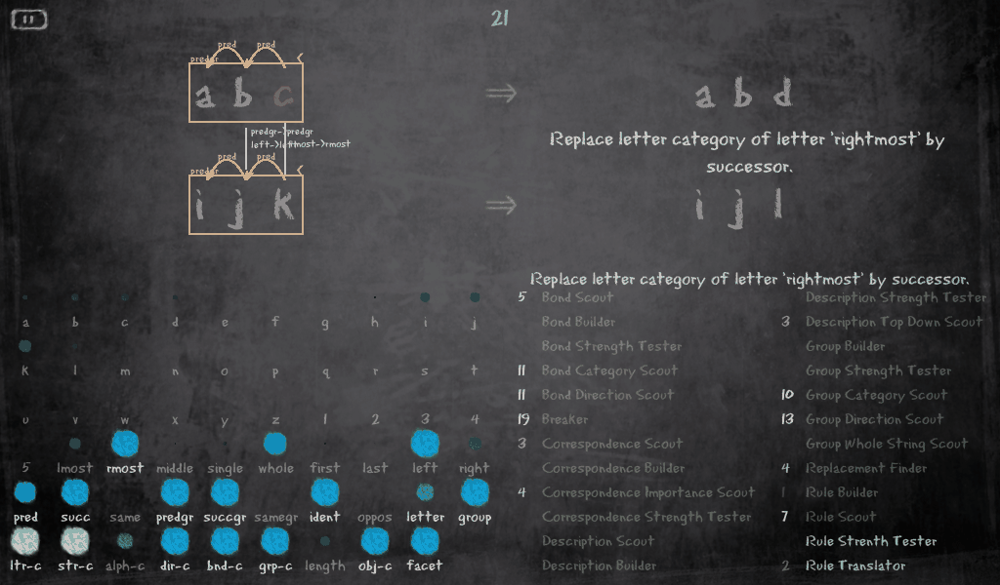
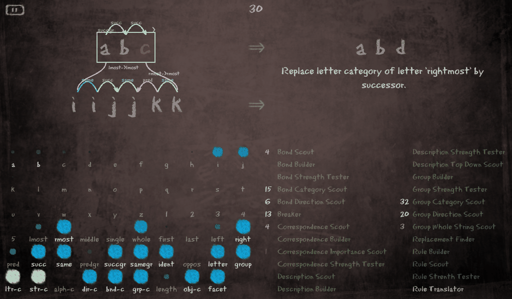
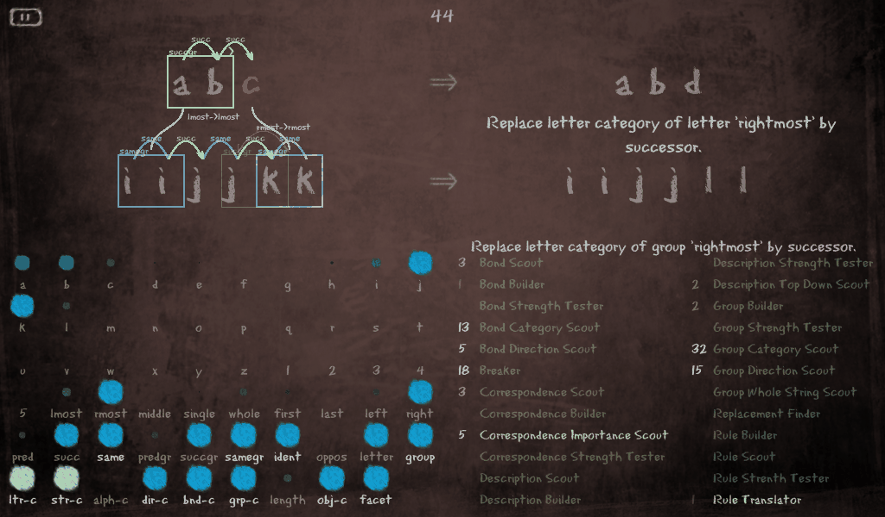
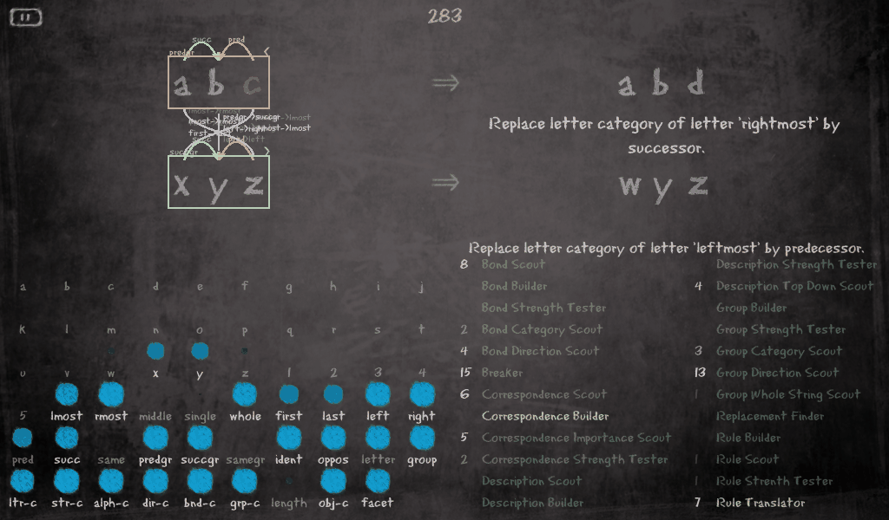

# Copycat in Python with an OpenGL blackboard: Joseph Aaron Hager's translation, running again

This is [Joseph Aaron Hager's](https://github.com/ajhager) translation of Melanie Mitchell's
Copycat from Lisp to Python, with his pyglet (OpenGL) client that draws the run on a
blackboard. Hager wrote it between 2008 and 2010, in Python 2, and moved it to Python 3 in
April 2017; this folder is his repository at its last commit,
[`ajhager/copycat@6ede75b`](https://github.com/ajhager/copycat/commit/6ede75b) (2017-04-10),
made to run on Python 3.12 and pyglet 2 in October 2026. His README is
[`README-upstream.md`](README-upstream.md); his licence, GPL v2, is `LICENSE.txt` and his
copyright headers are on every file.

Copycat solves letter-string analogies: *if `abc` changes to `abd`, what does `ijk` change
to?* Its architecture (a Slipnet of concepts, a Workspace of perceptual structures, a Coderack
of small agents chosen at random by urgency, and a temperature that says how settled the
Workspace is) is the one all the FARG programs share; Mitchell's dissertation, *Analogy-Making
as Perception* (1993), and chapters 5 to 7 of *Fluid Concepts and Creative Analogies* describe
it. Hager's `mmcat/` folder holds his notes on Mitchell's Lisp, file by file.



*The window at the end of `abc abd ijk`, seed 1. Top left, the initial string `abc` with its
changed letter in red; the modified string `abd` on the right; the target string `ijk` below,
and the answer `ijl` at the bottom right. Over the letters, the bonds found between them
(arcs labelled `pred`, with the arrowhead giving their direction) and the groups they were
gathered into (orange boxes, `predgr`); between the two strings, the correspondences (purple
curves, with the concept mappings that justify them: `predgr->predgr`, `left->left`,
`rmost->rmost`). The rule is written between the modified string and the answer, the
translated rule under the answer. Below, the Slipnet's concepts with their activation as blue
squares, and the Coderack's codelet types with the number of each waiting to run. The
blackboard's colour follows the temperature: red when hot, dark when settled.*

## What was found, and what was done

As published, the engine crashed on every problem with a snag (`abc abd xyz`, the famous one)
and on some seeds of every other problem, and the GUI did not open: Hager bundled a 2015
pyglet that imports a module Python 3.12 removed. The causes were a handful of Python 2
idioms that the 2017 move to Python 3 missed, two bugs independent of the version (a typo and
an inverted condition that let some runs go on for ever), one empty-average crash, and set
ordering by memory address that made the same seed give different runs in different
processes. All of them are fixed, each marked in the source (`PY3-FIX`, `BUG-FIX`,
`DETERMINISM-FIX`, `PYGLET2-FIX`) and listed in [`PORTING_NOTES.md`](PORTING_NOTES.md);
nothing was reformatted or restructured. The bundled pyglet is gone; the GUI runs on the
current pyglet 2.

Hager's workspace view drew only the letters. It now draws the structures too, marked
`GUI-2026` in [`clients/opengl/workspace.py`](clients/opengl/workspace.py): bonds, groups,
correspondences with their concept mappings, the rule as soon as it is built, the translated
rule and the answer. The GUI only observes the engine: a run with the window is the run
`--quiet` prints for the same seed (`tests/test_gui_smoke.py` checks it).

## Running it

The engine is standard-library Python (3.10 or later; tested on 3.12). From this folder:

```sh
python3 Copycat.py --quiet abc abd ijk --seed 1
```

prints the rule, the answer, the final temperature and the number of codelets run. Without
`--quiet` it opens the window:

```sh
python3 -m venv ~/dev/copycat-opengl-venv && . ~/dev/copycat-opengl-venv/bin/activate
pip install -e '.[gui]'                 # pyglet 2
python3 Copycat.py abc abd xyz --seed 36
```

Press **Space** (or the button at the top left) to start and pause; **Ctrl-F** shows the frame
rate; **Escape** quits. The run proceeds at 15 codelets a second (`Window.speed`). The window
needs OpenGL and a display: on Linux, Mesa's software renderer is enough (`Xvfb` with
`+extension GLX` and `LIBGL_ALWAYS_SOFTWARE=1` for a headless machine); pyglet 2 needs no
`libGLU`, which pyglet 1.5 did and which current distributions no longer ship. On Wayland
desktops pyglet uses XWayland.

Tests (`pip install -e '.[test]'`, or just `pytest` and, for the GUI test, `pillow`):

```sh
python3 -m pytest tests/test_headless.py -q      # the engine, standard library: ~15 s
python3 -m pytest tests/ -q                      # plus the GUI smoke test on its own Xvfb (:93),
                                                 # skipped without pyglet or Xvfb
```

## How it behaves

Measured on the fixed engine, 50 seeds per problem, nothing tuned (the sweep took 35 s; the
longest run was 19,584 codelets):

| Problem | Answers (of 50) | Mitchell's program, most frequent first |
|---|---|---|
| `abc abd ijk` | ijl 48, ikl 2 | ijl, nearly always |
| `abc abd xyz` | xyd 38, yyz 4, wyz 4, xyy 3, xyz 1 | xyd, then wyz, yyz, dyz |
| `abc abd iijjkk` | iijjkl 26, iijjll 24 | iijjll by a wide margin, then iijjkl |
| `abc abd kji` | kjj 37, lji 11, kjh 1 | kjh, then lji, kjj |
| `abc abd mrrjjj` | mrrkkk 22, mrrjjk 22, mrrjkk 5 | mrrjjk, then mrrkkk; mrrjjjj rarely |
| `abc abd xyd` | xye 48, xyd 2 | |
| `aabc aabd ijkk` | ijkl 28, ijll 13, jjkk 8 | ijll |
| `abc abd cba` | dba 40, cbb 10 | |

(Mitchell's results are the bar graphs of *Analogy-Making as Perception*, chapter 4, and of
*Fluid Concepts and Creative Analogies*, chapter 5, 1,000 runs per problem.)
Hager's engine finds the right families of answers but is weaker than Mitchell's where groups
matter (`iijjkk`, `kji`, `mrrjjj`): it builds and keeps groups less readily, and it never gives
`dyz` or `mrrjjjj`. These are properties of his translation as he left it; no attempt was made
here to make the statistics match, only to make the program run and show its work.

## The pictures



*`abc abd iijjkk`, seed 4, 450 codelets in: the successor group over `abc` and its bonds; on
`iijjkk` the five bonds found so far (`same`, `succ`, `same`, `pred`, `same`, each arrowhead
giving the direction) but no group yet; two correspondences, `lmost->lmost` and
`rmost->rmost`; and the rule, already built. The run ends 200 codelets later with the sameness
groups `ii`, `jj`, `kk` and the answer `iijjll`:*



*The answer `iijjll`, the translated rule under it ("Replace letter category of group
'rightmost' by successor"), the built sameness groups `ii` and `kk` as bright boxes, and the
group `jj` still only proposed, faint.*



*`abc abd xyz`, seed 36: after hitting the snag (`z` has no successor, so `xyd`'s rival `xyz`
-> `xy?` fails), the program sees `xyz` as a successor group read from the right, maps `a`
onto `z`, and answers `wyz`.*

## Layout

```
Copycat.py                 the command line (Hager's; --quiet for headless)
copycat/                   the engine: run.py, coderack/, slipnet/, workspace/, toolbox.py
clients/opengl/            the pyglet client: __init__.py (window), workspace.py (letters and
                           structures), slipnet.py, coderack.py, data/ (blackboard, font, icons)
mmcat/                     Hager's notes on Mitchell's Lisp, by file
tests/                     test_headless.py (engine), test_gui_smoke.py (window on Xvfb)
docs/                      screenshots
PORTING_NOTES.md           every change to Hager's code, with its reason
README-upstream.md         Hager's README as found
```

## Known limits

- Hager's engine is not an event-for-event replica of Mitchell's program (unlike this
  repository's Numbo and Metacat ports, there is no oracle to compare it with), and its
  answer statistics differ from hers, as the table shows.
- The GUI has no way to type a problem or a seed; they are command-line arguments. Hager's
  own to-do list for the client is at the top of `clients/opengl/__init__.py`.
- When many correspondences are built between long strings their labels can crowd each other.
- Only letters changing into letters are handled (Hager's `ReplacementFinder`); problems
  with more than one changed letter stop the program, as his code says.
