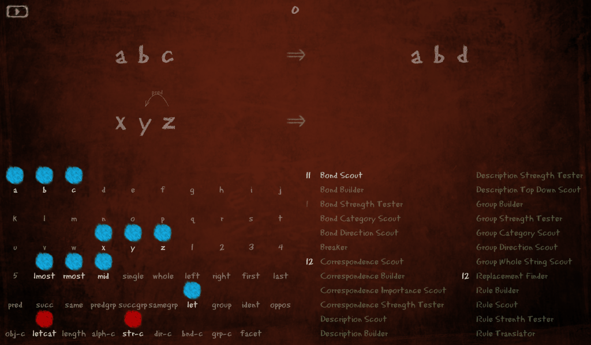
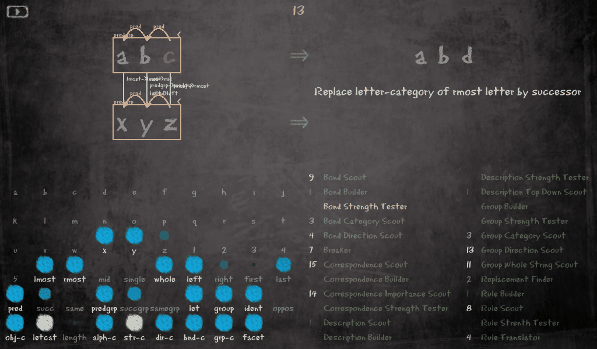
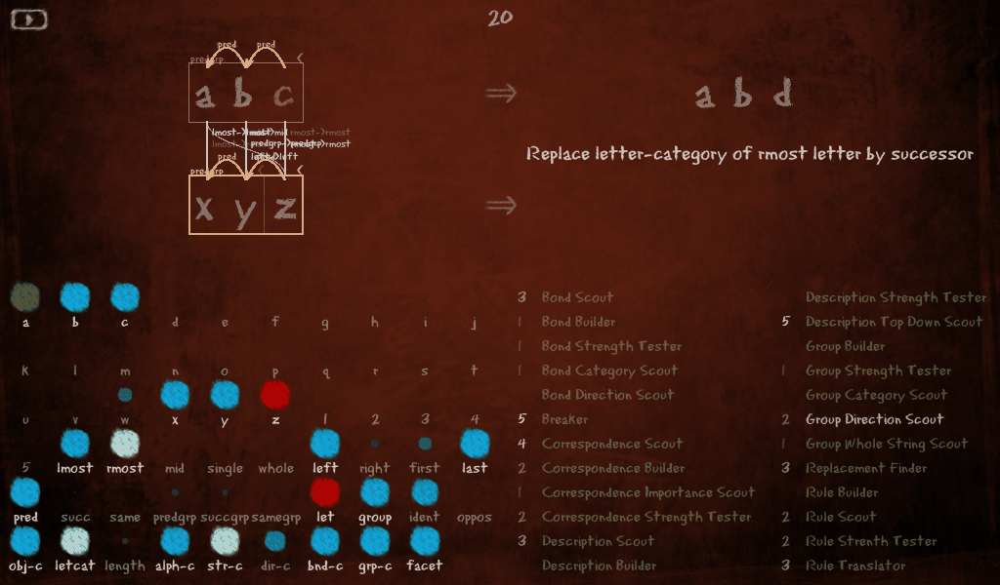
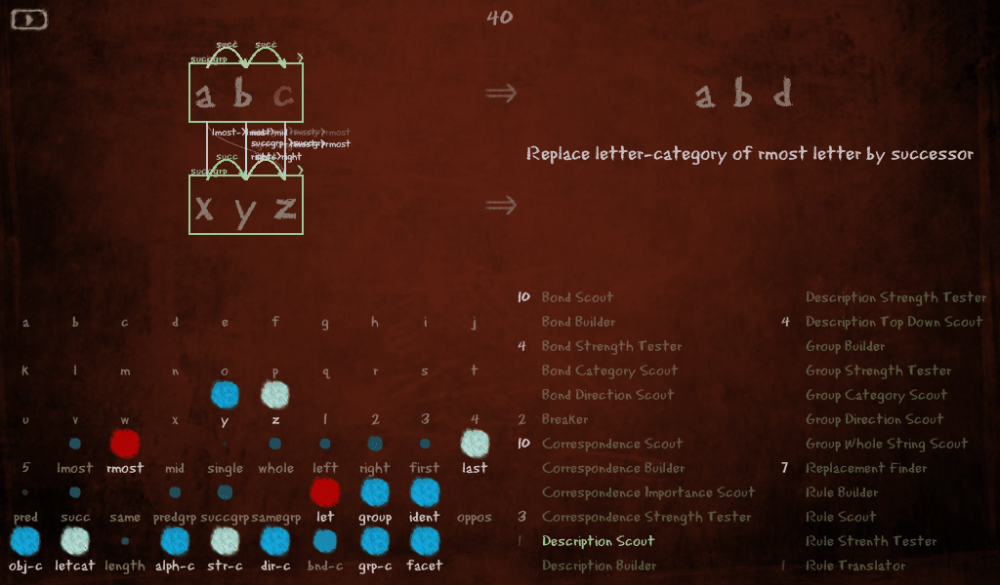
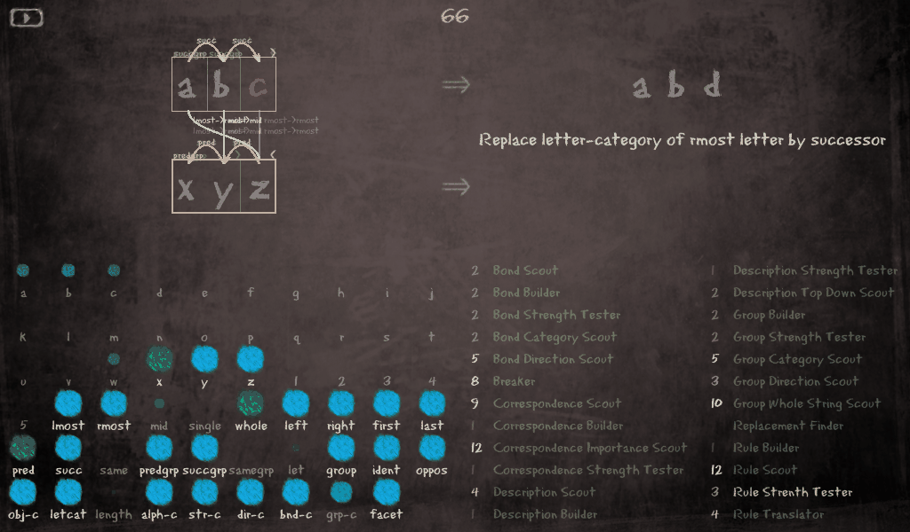
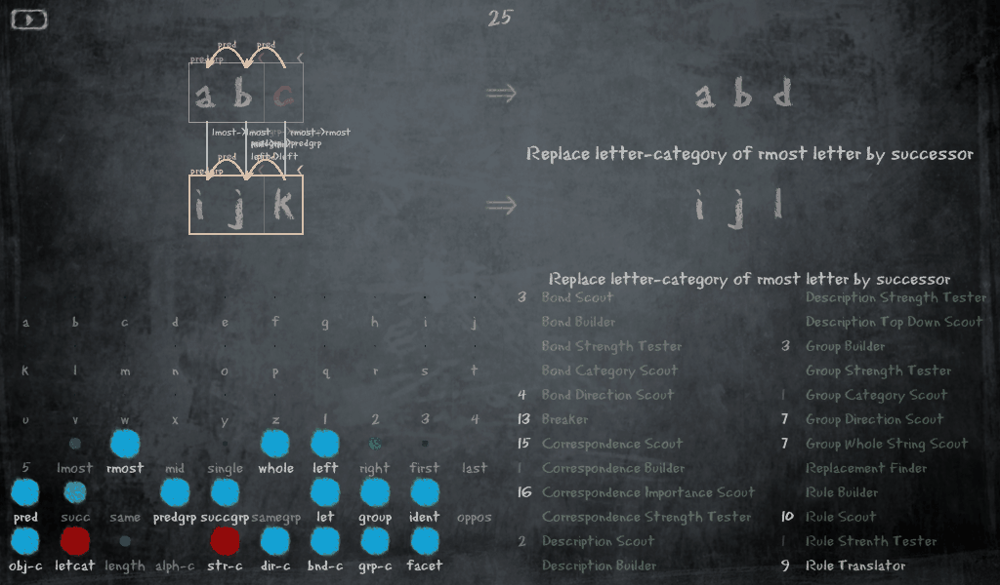
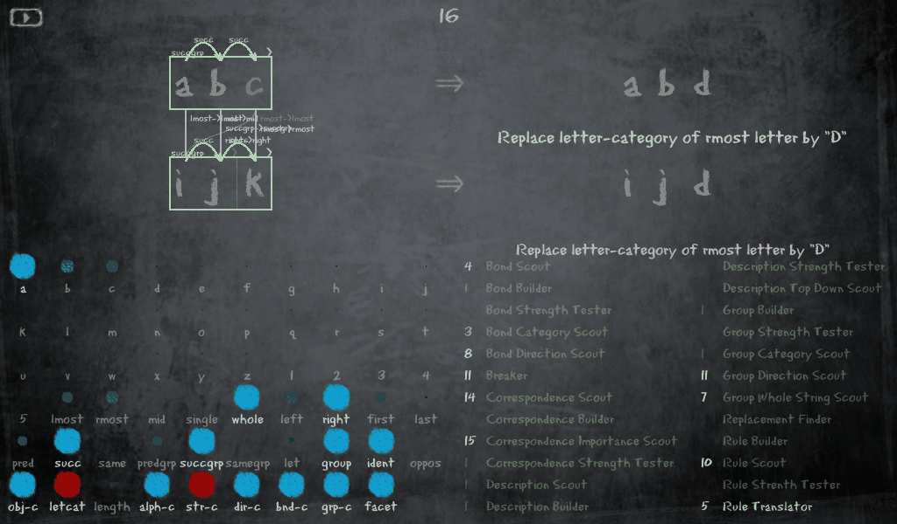
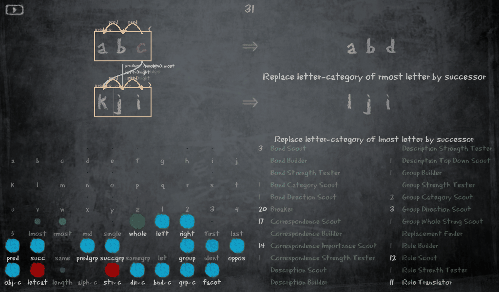
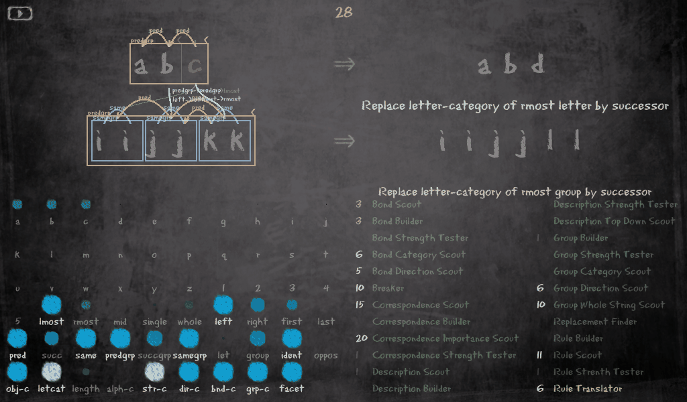
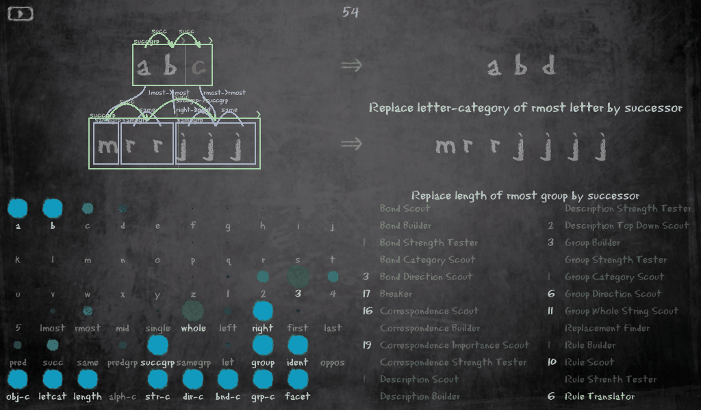

# Mitchell's original Copycat, seen through Hager's OpenGL GUI

This folder joins two of the Copycat implementations archived beside it. The engine is
Melanie Mitchell's own Lisp of 1989–1993, running unchanged on SBCL in
[`../melanies-copycat/`](../melanies-copycat/). The window is Joseph Aaron Hager's pyglet
(OpenGL) client of 2009–2017, as repaired and extended in
[`../copycat-opengl/`](../copycat-opengl/), imported from there unchanged. Between them sits
a small bridge: Mitchell's program is run as a subprocess and made to write one JSON line
per codelet, and this package rebuilds the workspace, the Slipnet and the Coderack from those
lines in the shape Hager's drawing code expects.


*Mitchell's program at its answer to `abc → abd; xyz → ?` with seed 43, after 1,130
codelets: the famous `wyz`. The initial string `abc` is seen as a successor group running
rightwards and the target `xyz` as a predecessor group running leftwards, the two groups
correspond (`succgrp->predgrp`), `a` maps onto `z` and `c` onto `x`, and the rule "replace the
rightmost letter by its successor" has been translated into "replace the leftmost letter by
its predecessor". The board is dark because the temperature has fallen to 25. The whole run
is shown step by step below.*

## Contents

- [What is running](#what-is-running)
- [Quick start](#quick-start)
- [A run, step by step: how Mitchell's program finds wyz](#a-run-step-by-step-how-mitchells-program-finds-wyz)
- [More answers](#more-answers)
- [Reading the window](#reading-the-window)
- [Running](#running)
- [Seeds worth watching](#seeds-worth-watching)
- [How it works](#how-it-works)
- [Requirements and installing](#requirements-and-installing)
- [Tests](#tests)
- [Taking screenshots](#taking-screenshots)
- [Limits](#limits)
- [The three folders, provenance and license](#the-three-folders-provenance-and-license)

## What is running

Everything that happens is Mitchell's code. Her program chooses the codelets, builds the
structures, moves the temperature, hits the snags and finds the answer. The compatibility
layer that makes her Lucid Common Lisp and Flavors run on SBCL is described in
[`../melanies-copycat/README.md`](../melanies-copycat/README.md); her files are not edited
there either. The Lisp observer in [`lisp/trace-emitter.lisp`](lisp/trace-emitter.lisp)
(about 300 lines) is loaded after her code and attaches from the outside, so **nothing in her
files changes**: it re-wraps the Flavors method `(codelet :run)` through the compatibility
layer's method table, to remember which codelet ran, and wraps her `step-ccat` and `run-ccat`
functions with `sb-int:encapsulate`, to write a snapshot after each codelet and at the start
and end of the run. Her own printing is sent to standard error so that standard output
carries only the trace.

Hager's window, in turn, draws what it is given: his `clients/opengl/` modules are imported
as they are, and this package only supplies objects with the attributes they read. The
drawing of bonds, groups, correspondences and rules is the 2026 addition to his client
described in [`../copycat-opengl/README.md`](../copycat-opengl/README.md). The window's
caption says what it shows: *Copycat: Melanie Mitchell's original (SBCL), seen through
Hager's GUI*.

Three things to keep in mind when watching:

- **The run is already over.** SBCL loads her program in about a second and a half and runs a
  problem to the end in another second or two. The window replays the trace at its own
  pace (15 codelets a second by default), so pausing or changing the speed changes nothing
  in the run itself. A seed gives the same run every time.
- **It is Hager's picture, not hers.** Her Lucid graphics were not ported. Her windows drew
  the same kinds of structure, plus the replacements, the descriptions and a thermometer.
- **The counter at the top is not the codelet count.** It is the codelet count divided by
  her time step of 15 codelets, the unit at which her program updates the Slipnet and the
  temperature. The frame captions below give the codelet count.

## Quick start

With SBCL on `PATH` and pyglet 2 in a virtual environment (see
[Requirements and installing](#requirements-and-installing)), from this folder:

```sh
~/dev/copycat-opengl-venv/bin/python -m melanies_opengl abc abd xyz --seed 43
```

The window opens paused at codelet 0. Press **Space** (or the button at the top left) to
run, Space again to pause, **Escape** to quit.

## A run, step by step: how Mitchell's program finds wyz

`abc → abd; xyz → ?` is the problem Hofstadter and Mitchell wrote most about. The obvious
rule, "replace the rightmost letter by its successor", cannot be applied to `xyz` because `z`
has no successor; the program hits a *snag*, and what it does next is the point of the
problem. With seed 43 Mitchell's program takes 1,130 codelets, hits the snag three times
(at codelets 217, 576 and 804), and ends with `wyz`, the answer the book calls the most
elegant. These are frames of that run, captured from the window with
[`tools/capture.py`](tools/capture.py).



*Codelet 0. Nothing is built yet; a single bond is proposed (faint) between `x` and `y`. The
board is red because the temperature starts at 100. In the Slipnet, bottom left, the letters
`a`, `b`, `c`, `x`, `y`, `z` and the positions `lmost`, `rmost`, `mid` are fully active,
having been clamped by the initial descriptions; `letcat` and `str-c` (letter category and
string position category) are white, which is how Hager draws a clamped node. The Coderack,
bottom right, holds the first codelets: eleven bond scouts, twelve correspondence scouts and
twelve replacement finders.*



*Codelet 200, counter 13. The program has seen both strings as predecessor groups running
leftwards (`pred` bonds, the `predgrp` boxes), made the correspondences `lmost->lmost`,
`mid->mid` and `rmost->rmost`, and built the rule "replace the letter category of the
rightmost letter by its successor". The temperature is low and the board dark grey. The
answer builder is about to try the rule on `z`.*



*Codelet 300, counter 20: the snag. At codelet 217 the answer builder found that `z` has no
successor. Her program then sets the temperature to 100 (the board is red again), clamps the
descriptions of the letter that caused the trouble, `z`, `rmost`, `letter`, `letcat` and
`str-c`, and posts breakers and new scouts. The structures of the old view are still there
but will not survive: the high temperature makes every codelet far more willing to break
them.*



*Codelet 600, counter 40. Everything has been rebuilt the other way round: both strings are
now successor groups running rightwards (`succ` bonds, `succgrp` boxes) with the same three
position-to-position correspondences, and the rule is unchanged. This view leads to the
same snag, which it hits at codelet 576 and again at 804. The Slipnet shows the price of
each snag: `z`, `rmost` and `last` are clamped at full activation.*



*Codelet 1000, counter 66: the slip. The target string has been seen as a predecessor
group again while `abc` stayed a successor group, and this time the correspondences cross:
`a` has been mapped onto `z` with the concept mappings `lmost->rmost` and `first->last`,
`b` onto `y`, and `c` is proposed for `x`. By the end of the run the two whole-string
groups will correspond too, with `succgrp->predgrp` and `right->left`. Under these
slippages the rule translator turns "rightmost, successor" into "leftmost, predecessor".*


*Codelet 1,130, counter 75: the answer `wyz`, with the translated rule "replace the letter
category of the leftmost letter by its predecessor" under it. The final temperature is 25.*

In Mitchell's own 1,000 runs of this problem (FCCA chapter 5) the program answered `xyd` 771
times, `wyz` second with the lowest average temperature of any answer, then `yyz`, and
`dyz` rarely. This port gives, over 100 seeds, `xyd` 78, `wyz` 12, `yyz` 7, `xyz` 2 and
`dyz` 1 (`../melanies-copycat/RESULTS.md`).

## More answers

The other problems from her chapter, each at the moment of its answer, with the share of
runs that end this way over 100 seeds of the SBCL port.



*`abc → abd; ijk → ?` with seed 1: `ijl` after 389 codelets, temperature 13, the easy case.
Both strings are predecessor groups, the three positions correspond, and the rule
translates into itself. 97 runs in 100 end here.*



*The same problem with seed 14: `ijd` after 243 codelets. The program described the change
in `abc → abd` literally, "replace the rightmost letter by d", instead of "by its successor",
and copied the `d` across. Hofstadter's footnote in FCCA chapter 5 notes that the program
ends such runs at about the same temperature as the `ijl` ones; this one ends at 17. Two
runs in 100.*



*`abc → abd; kji → ?` with seed 12: `lji` after 467 codelets. `kji` runs the opposite way to
`abc`, and here the program has mapped the two predecessor groups onto each other with
`left->right`, so the rightmost letter of `abc` corresponds to the leftmost of `kji`, and
the translated rule replaces the leftmost letter by its successor. The other answers are
`kjh` (the rightmost letter's predecessor, 61 in 100) and the literal `kjj` (22); `lji` is
16 in 100.*



*`abc → abd; iijjkk → ?` with seed 1: `iijjll` after 428 codelets. The target string has
been chunked into three sameness groups (the `samegrp` boxes with their `same` bonds), the
groups bonded as successors and grouped as a whole, and the whole-string groups mapped
onto each other; the rule now says "replace the letter category of the rightmost **group**
by its successor", so both `k`s change. 80 runs in 100; most of the rest change only the
last letter, `iijjkl`.*



*`abc → abd; mrrjjj → ?` with seed 20: `mrrjjjj` after 820 codelets. The program has seen
`m`, `rr` and `jjj` as three groups of lengths 1, 2 and 3, bonded the lengths as successors,
and mapped the length dimension onto the letter dimension of `abc`, so the rule becomes
"replace the **length** of the rightmost group by its successor". The Slipnet's `length` node
is lit. This is the answer Hofstadter singles out as the insightful one; her program gave it
in 39 runs of 1,000, this port in 2 of 100 (seeds 20 and 66), the rest mostly `mrrkkk`.*

## Reading the window

Hager's window has four areas; they show Mitchell's structures as follows.

- **The strings** (top). The initial string and the modified string on the first row, the
  target string and, when found, the answer on the second. The letter her program marks as
  changed is red.
- **Bonds**: arcs over two neighbouring objects, labelled `succ`, `pred` or `same`, with an
  arrowhead for the direction. Faint while only proposed (her proposal levels 1 and 2),
  solid once built (level 3, her `%built%`).
- **Groups**: boxes round their letters labelled `succgrp`, `predgrp` or `samegrp` with `<`
  or `>` for the direction; nested boxes grow outwards, as in the `iijjkk` picture.
- **Correspondences**: curves from an object of the initial string to one of the target
  string, with up to two of their distinguishing concept mappings written beside the upper
  end, in her `cm-name` labels (`lmost`, `rmost`, `mid`, `whole`, `succgrp`, `predgrp`,
  `left`, `right`, …). A mapping such as `succgrp->predgrp` or `right->left` is a slippage.
- **The rule** between the two rows and **the translated rule** under the answer. Her
  `(rule :print)` text is long (*Replace letter with string-position-category "rmost" by
  letter with letter-category: successor of letter-category of letter with
  string-position-category: rmost*); the window shows a compact form of the same content
  (*Replace letter-category of rmost letter by successor*). The full text is kept in the
  adapter's `Rule.full`.
- **The Slipnet** (bottom left): her 59 nodes in her `*slipnet*` order, in Hager's grid of
  ten per row, drawn as circles sized by activation, white when clamped. Hager's own engine
  has the same 59 concepts, so none is missing; the labels are her `cm-name` where she gave
  one (`letcat`, `let`, `mid`) and Hager's abbreviations otherwise (`obj-c`, `str-c`,
  `ident`, `oppos`, `facet`).
- **The Coderack** (bottom right): the codelets waiting, counted by type, with the type that
  just ran drawn brighter. Her 24 codelet types map one to one onto Hager's 24 classes:
  `bottom-up-bond-scout` is *Bond Scout*, `group-scout--whole-string` is *Group Whole String
  Scout*, `important-object-correspondence-scout` is *Correspondence Importance Scout*, and
  so on (the table is `CODELET_CLASSES` in `melanies_opengl/trace.py`).
- **The board's colour** follows the temperature, red at 100 and dark grey near 0, and the
  **counter** at the top is the codelet count over her time step of 15.

## Running

Live, with the window:

```sh
~/dev/copycat-opengl-venv/bin/python -m melanies_opengl abc abd xyz --seed 43
~/dev/copycat-opengl-venv/bin/python -m melanies_opengl abc abd mrrjjj --seed 20 --speed 40
```

Options: `--seed N` (without it the run is seeded from the clock, as her `init-ccat` does),
`--speed N` codelets per second in the window (Hager's default is 15), `--every N` to keep
one trace line in N (the first and the last are always kept), `--sbcl PATH` if SBCL is not
on `PATH`. Keys in the window: **Space** run/pause, **Ctrl-F** frame rate, **Escape** quit.
Closing the window stops SBCL if it is still running.

Headless, to see the result or to record a run:

```sh
python3 -m melanies_opengl --no-gui abc abd ijk --seed 1                    # the summary
python3 -m melanies_opengl --no-gui abc abd xyz --seed 43 --record xyz43.jsonl
~/dev/copycat-opengl-venv/bin/python -m melanies_opengl --replay xyz43.jsonl   # watch it again, no SBCL needed
```

The headless summary prints the problem, the rule, the translated rule, the answer, the
temperature and the number of codelets; for `abc abd xyz --seed 43` it is `wyz`, 25, 1,130.
`--record` writes the trace as it is received (about 5 KB per codelet, so a 1,130-codelet
run is 5 MB; `--every 5` makes it a fifth) and works with the window too. A replay needs
neither SBCL nor the `melanies-copycat` folder, only the file.

## Seeds worth watching

Seeds are specific to this port of her program (SBCL's random generator seeded through
`sb-ext:seed-random-state`), and a seed gives the same run every time. From the 100-seed
sweeps in `../melanies-copycat/results/`:

| Problem | Answer | Seeds (codelets) |
|---|---|---|
| `abc abd xyz` | `wyz` | 43 (1,130), 33 (1,171), 62 (1,504), 58 (1,820), 54 (2,468); also 14, 18, 44, 57, 86, 92, 98, longer |
| `abc abd xyz` | `yyz` | 1 (1,015), 26 (2,087), 2 (4,812) |
| `abc abd xyz` | `xyd` | 36 (2,470) and most others |
| `abc abd ijk` | `ijl` | 1 (389) and almost all others |
| `abc abd ijk` | `ijd` | 14 (243), 62 (275) |
| `abc abd kji` | `lji` | 12 (467), 10 (524), 17 (572) |
| `abc abd iijjkk` | `iijjll` | 100 (338), 1 (428), 10 (656) |
| `abc abd mrrjjj` | `mrrjjjj` | 20 (820), 66 (1,240) |

A run of a few hundred codelets takes under a minute to watch at the default speed.

## How it works

```
sbcl --noinform --non-interactive --no-userinit --no-sysinit
     --load ../melanies-copycat/load.lisp --load lisp/trace-emitter.lisp
     --eval '(copycat::mo-run "abc" "abd" "xyz" :seed 43 :every 1)'
        │  stdout: one JSON line per codelet (docs/trace-format.md); stderr: her own printing
        ▼
melanies_opengl/lisprun.py      LispSource: the subprocess, a reader thread and a queue;
                                 live_run() waits for the first line, then the window polls
                                 so it never blocks; blocking_run() for --no-gui and tests;
                                 replay_run() reads a file; --record tees the lines
melanies_opengl/trace.py        TraceRun, Workspace, WString, Letter, Bond, Group,
                                 Correspondence, ConceptMapping, Rule, Slipnet, Slipnode,
                                 Coderack: exactly the attributes Hager's client reads
                                 (listed in the module docstring), rebuilt from each line
melanies_opengl/gui.py          a sys.path shim to ../copycat-opengl, then
                                 MelaniesWindow(clients.opengl.Window): the caption, and
                                 SBCL closed when the window closes
```

**The trace.** Each line is a complete snapshot, so nothing has to be accumulated to draw
it: the codelet count, the temperature, the codelet that just ran, the snag flags, the
three strings and the answer with every letter's descriptions, the bonds, groups and
correspondences of both strings with their proposal level (1 proposed, 2 strength-tested,
3 built) and, for correspondences, their concept mappings, the rule and the translated rule
as her `:print` methods print them, the 59 activations and clamp flags, and the Coderack's
counts by codelet type. The first line (`init`) adds the problem, the seed, her time step
and the node list; the last (`final`) carries the answer. The schema is in
[`docs/trace-format.md`](docs/trace-format.md). The emitter writes the JSON itself with a
handful of small functions, one per kind of object; nothing is pretty-printed.

**The adapter.** `run.step()`, which Hager's window calls at its chosen speed, applies the
next line. Structure objects keep their identity from line to line (they are cached by what
they are: string, span, category, direction), so his redraw-on-change test only fires when
a structure appears, disappears or gets built, not on every frame. Letters' flags (the
changed letter) are refreshed on every line because his view reads them live. Her 24
codelet names map onto his 24 class names, her bond and group category names onto his
colour table, and her node labels onto his grid.

**Why a subprocess and a trace rather than a Lisp GUI.** Her engine is Flavors objects and
globals; observing it from outside, with wrappers she never sees, keeps `melanies-copycat`
exactly what it is, a revival with her files unchanged, and lets any client that can read
JSON lines draw the run. The same trace could feed Hager's engine's tests, a web page or a
different GUI.

## Requirements and installing

- **SBCL** on `PATH` (or `--sbcl PATH`), and `../melanies-copycat/` where it is in this
  archive. Nothing else for the headless side: the adapter is standard-library Python 3.10
  or later.
- **pyglet 2** for the window, with OpenGL (Mesa's software renderer is enough; set
  `LIBGL_ALWAYS_SOFTWARE=1` on a machine without a usable GPU driver) and an X11 or Wayland
  display. pyglet 2 needs no GLU library, which pyglet 1.5 did.

From this folder:

```sh
python3 -m venv ~/dev/copycat-opengl-venv            # or reuse the one made for ../copycat-opengl
~/dev/copycat-opengl-venv/bin/pip install -e '.[gui,test]'
```

`pyproject.toml` declares no dependencies for the package itself; the extras are `gui`
(pyglet 2) and `test` (pytest and Pillow).

## Tests

```sh
python3 -m pytest tests -q                                   # emitter (needs sbcl) and adapter; the window test is skipped
~/dev/copycat-opengl-venv/bin/python -m pytest tests -q      # plus the window, on its own virtual display (Xvfb :94)
```

- `tests/test_emitter.py` runs SBCL on `abc abd ijk` with seed 1 and checks the lines are
  valid JSON, one per codelet, with nothing else on standard output, ending in the pinned
  answer `ijl` after 389 codelets at temperature 13; that `--every` thins the steps; and
  that a `--record` file is complete up to its `final` line.
- `tests/test_adapter.py` rebuilds the recorded fixture `tests/fixtures/ijk-seed1.jsonl`
  (every tenth codelet of that run, 150 KB) and checks the strings, the Slipnet, the shape
  of the structures, the stability of their identity across lines, that every codelet name
  is one of Hager's, and the compact rule text.
- `tests/test_gui_smoke.py` replays the fixture in the window on a virtual display and
  checks that bonds, groups, correspondences, the rule and the answer were drawn and the
  counter advanced. It is skipped without pyglet or Xvfb and never opens a window on the
  real display.

Thirteen tests, about six seconds with the window, four without.

## Taking screenshots

The pictures above were made with [`tools/capture.py`](tools/capture.py), which replays a
recorded trace in the window on whatever display is set, grabs the window when the codelet
count first reaches each number given, and once more at the answer, quantized to 256
colours:

```sh
Xvfb :94 -screen 0 1100x700x24 +extension GLX &
python3 -m melanies_opengl --no-gui abc abd xyz --seed 43 --record /tmp/xyz43.jsonl
DISPLAY=:94 LIBGL_ALWAYS_SOFTWARE=1 ~/dev/copycat-opengl-venv/bin/python \
    tools/capture.py /tmp/xyz43.jsonl docs/run-xyz43 1 200 300 600 1000
```

Before each grab the tool lets Hager's eased animations (the node sizes, the board's
colour) settle without stepping the run, so a frame shows the state at that codelet and not
a transition.

## Limits

- **Proposed structures** are drawn faint, with no distinction between her levels 1
  (proposed) and 2 (strength-tested).
- **Replacements** and **descriptions** are in the trace (every letter's descriptions) but
  Hager's client has no drawing for them, so they are not shown; nor are the bonds inside a
  group marked as such.
- **Concept-mapping labels crowd** on three-letter strings (visible in every `xyz` picture),
  a property of Hager's layout.
- **Her graphics were not ported**: this is Hager's picture of her run, not hers. Her
  windows (`../melanies-copycat/src/graphics-files/`, copied but not loaded) drew the same
  kinds of structure, plus the replacements, the descriptions and a thermometer.
- **The window shows what SBCL has already computed**, so `--speed` and the pause button
  change nothing in the run. A run with many snags can take ten thousand codelets, which is
  eleven minutes at the default speed; use `--speed`.
- Only the `abc → abd` family of problems with one changed letter has been tried through
  the window; her program's other problem types run, but their drawings have not been
  checked.

## The three folders, provenance and license

| Folder | What |
|---|---|
| [`../melanies-copycat/`](../melanies-copycat/) | Mitchell's Lisp on SBCL, headless; her files unchanged in `src/`, the shims in `compat/`, `RESULTS.md` against FCCA chapter 5 |
| [`../copycat-opengl/`](../copycat-opengl/) | Hager's Python translation of Copycat, repaired for Python 3.12, with his pyglet client now drawing the structures |
| this folder | her engine in his window |

The problems and the published figures are from Douglas Hofstadter and Melanie Mitchell,
"The Copycat Project: A Model of Mental Fluidity and Analogy-Making", chapter 5 of *Fluid
Concepts and Creative Analogies* (FCCA, 1995), and from Mitchell's *Analogy-Making as
Perception* (MIT Press, 1993).

Hager's client is under the GPL v2 (his `LICENSE.txt`, kept here), and so is this bridge.
Mitchell's code is distributed by her as is. Built on 2026-10-22 with the two folders above
as they were that day. The trace emitter, the adapter, the tests, the screenshots and this
README were written for this archive in one Claude Code session directed by Alex Linhares,
the same session that got her code running on SBCL and repaired Hager's client: the two
sibling folders were made first by one agent each, and this bridge by a third that had
seen both; the extended README and the recording fix came after, by hand.
