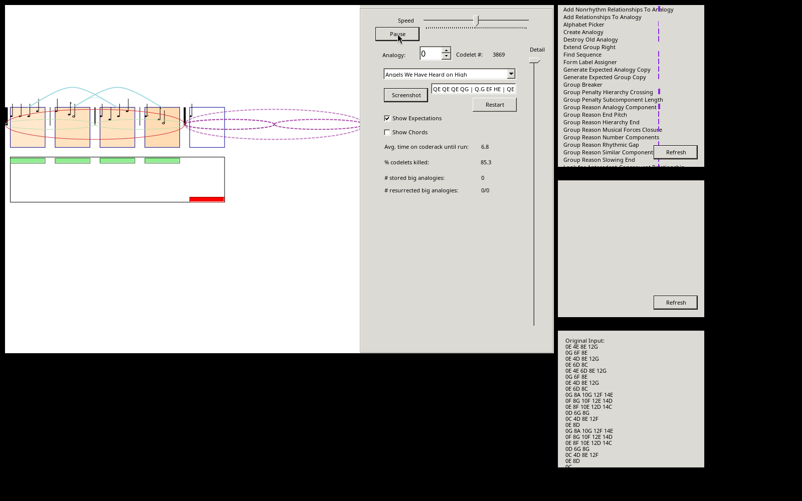
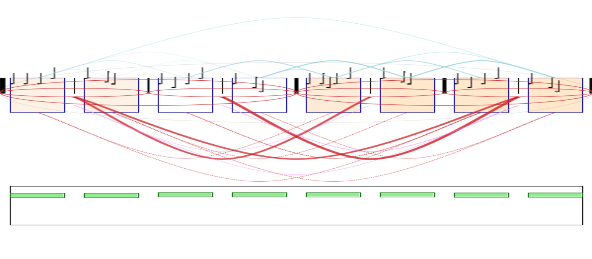

# Running Musicat (RhythmCat) on Linux

The archived code in [`../RhythmCat/`](../RhythmCat/) is Eric Nichols's Visual Studio 2010
solution: C#, .NET Framework 4.0, Windows Forms, no third-party libraries. It builds and runs
on Linux with Mono, without root, and without changing the archived files: the build works on
a copy, outside the repository.



*The GUI under Mono on Linux at codelet 3,869 of "Angels We Have Heard on High": the measures
as boxes, a four-bar group (red ellipse), links between measures (blue arcs), expectations for
the coming measures (dashed purple), the codelet list on the right.*

## Build

```sh
bash Software/Musicat/linux/build-linux.sh            # builds into ~/dev/musicat-build
```

What it does, and why each step is needed:

1. **Mono 6.12** from conda-forge, into a private environment (`mono-env/`); `xbuild` compiles
   the 2010 `.csproj` unchanged (0 errors).
2. **libgdiplus**, the library behind `System.Drawing` that WinForms needs. Neither the system
   nor conda-forge had it, so the script builds it from source
   (https://github.com/mono/libgdiplus) with X11 support, into the same environment. Without
   it the program stops with `DllNotFoundException: libgdiplus.so.0`; without its X11 part,
   with `EntryPointNotFoundException: GdipCreateFromXDrawable_linux`.
3. **Four Windows paths** in the code point at the author's machine
   (`C:\Users\epnichols\...\melodies.txt`, `C:\RhythmcatScreenshots\`, `C:\RhythmcatTesting\`).
   [`linux-paths.patch`](linux-paths.patch) (applied to the copy only) makes them relative to
   the program's folder; the script copies `melodies.txt` there and creates the two folders.

## Run

```sh
bash Software/Musicat/linux/run-musicat.sh
```

Pick a melody from the list, press **Restart**, then **Go** (Go alone, before a Restart,
leaves the run at codelet 0). Speed and detail are the sliders; **Screenshot** saves a PNG
into `RhythmcatScreenshots/`.

**Headless.** The program has a mode with no window that renders the final workspace to a
PNG:

```sh
bash Software/Musicat/linux/run-musicat.sh noGUI \
  "input=QE QE QE QG | Q.G EF HE | QE QD QE QG | Q.E ED HC | QE EE ED QE QG | Q.G EF HE | QE QD QE QG | Q.E ED HC" \
  png=angels.png width=1600 height=700 seed=1
```



*Eight bars of "Angels We Have Heard on High", headless, seed 1 (about a second): the bars
as boxes, groups as red ellipses, links between bars as blue arcs, and analogies between
groups as the thick red arcs below (bars 1-2 with 5-6, 3-4 with 7-8).*

The melodies' notation is in `melodies.txt` (Q quarter, E eighth, H half, W whole, a dot for
dotted, then the pitch; `|` separates measures). Other arguments: `inputExampleName=`,
`testFile=` and `resultFile=` run the ground-truth tests against the `rhythms.groundtruth*`
files.

Built and checked on Linux (Ubuntu, Wayland with XWayland) on 2026-10-14. This is RhythmCat,
the version archived here; Nichols's later Musicat code is at http://ericpnichols.com/musicat/.
