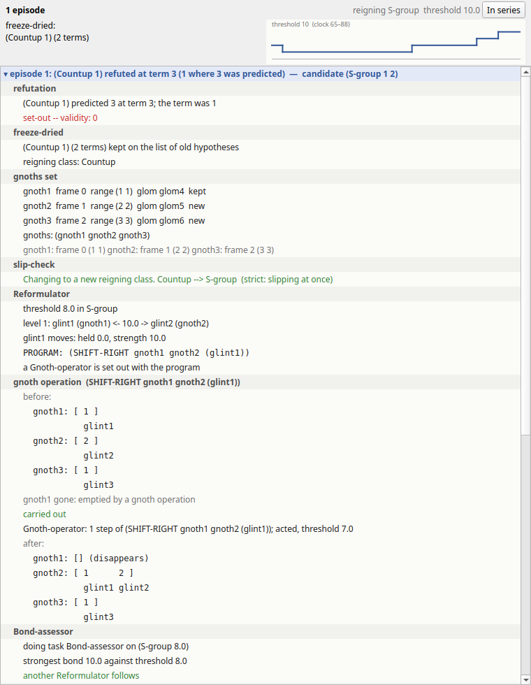
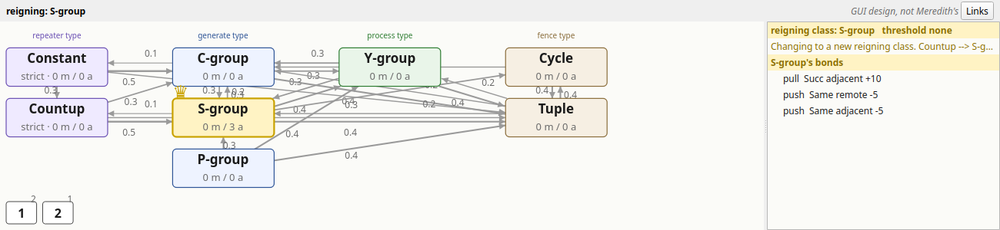

# Seek-Whence (Meredith, 1986), reconstructed in Python

Seek-Whence is Marsha J. Ekstrom Meredith's model of how people find patterns in sequences of
numbers. She built it in Douglas Hofstadter's group at Indiana University as her doctoral
thesis, *Seek-Whence: A Model of Pattern Perception* (Indiana University CS Technical Report
214, September 1986). You give the program the terms of a sequence one at a time, `3`, `7`,
`3`, ... It looks for structure among them, forms a hypothesis such as "a cycle of `3 7`",
checks each new term against it, rebuilds the hypothesis when a term refutes it, and, once it
is confident, shows you its guess at what comes next. You answer `ok` or `no`.

The original Franz Lisp program (about 5,400 lines) is lost. This folder holds a
**reconstruction from the specification**: the thesis, with Hofstadter's chapter 1 of *Fluid
Concepts and Creative Analogies* (FCCA) for the design intent. Every mechanism the thesis
describes is built and tested, with its pages cited in the code, and every choice the sources
leave open is a numbered, recorded decision. It comes with a command line that prints traces
in the style of Meredith's transcripts, and with a desktop GUI (PySide6) that draws every step
of a run.

This code lives in two places: as the folder `Software/SeekWhence/` of
[FARGonautica](https://github.com/fargonauts/FARGonautica), the archive of the Fluid Analogies Research Group's architectures,
and on its own at [fargonauts/Seek-Whence](https://github.com/fargonauts/Seek-Whence).


*The GUI at the moment of its guess on `3 7 3 7`, the first run in the thesis's appendix
[M86 p. 166]. The sequence and the guess are at the top centre, the cytoplasm (the program's
perceptual workspace) below them, the taskrack, socratoplasm and hypothesis on the right, the
platoplasm (its eight ideal concepts) and the console along the bottom, and the timeline
under everything.*

## Contents

- [What the program does](#what-the-program-does)
- [Quick start](#quick-start)
- [Installing](#installing)
- [Using the GUI](#using-the-gui)
- [Using the command line](#using-the-command-line)
- [Replaying the thesis's experiments](#replaying-the-thesiss-experiments)
- [How well it does](#how-well-it-does)
- [Running the tests](#running-the-tests)
- [How the reconstruction was made](#how-the-reconstruction-was-made)
- [What's in this folder](#whats-in-this-folder)
- [Further reading and credits](#further-reading-and-credits)

## What the program does

Seek-Whence describes a sequence with eight primitive concepts, which can nest inside one
another. A description is written as a *form*, `(type start length actual)`:

| Concept | What it describes | Example |
|---|---|---|
| Constant | one number repeated | `5 5 5 5` |
| Countup | counting up by one | `1 2 3 4` |
| C-group | a group of equal numbers | `3 3 3` |
| S-group | a group counting up | `1 2 3` |
| P-group | a group counting down | `3 2 1` |
| Y-group | a group up and back down (a mountain) | `1 2 3 2 1` |
| Cycle | a block repeated | `3 7 3 7 ...` |
| Tuple | a fixed block of numbers | `(3 7)` |

So `(Cycle 3 2 (3 7))` reads "a Cycle starting at 3, with 2 elements, which are `3 7`", and
`(S-group 1 (Countup 2))` describes `1 2 | 1 2 3 | 1 2 3 4 | ...`: S-groups starting at 1
whose lengths count up from 2.

The program works at three levels, with Meredith's names:

- **The cytoplasm** holds what it perceives in the terms: *glints* (the terms themselves),
  *sparks* (two terms picked to be compared), *bonds* (relations found between terms: same,
  successor, predecessor, adjacent or remote) and *gloms* (groups of terms held together).
- **The socratoplasm** holds *gnoths*: the program's current parse of the whole sequence into
  parts.
- **The platoplasm** holds the eight ideal concepts above, with links that say how easily one
  can slip into another.

Small *tasks* do all the work. They wait on a *taskrack* and are picked at random, weighted by
urgency, so the same sequence can be seen differently on different runs. When a term refutes
the hypothesis, the program *reformulates*: it checks whether to stay with the current type
or slip to another (the *slip check*), moves parts between gnoths (the *gnoth operations*),
and casts the parse into new candidate forms. If three casts fail, it *blasts* away its
structures and starts again from the terms.

## Quick start

From a clone of this repository (in FARGonautica, from `Software/SeekWhence/`), with Python 3.12 or later:

```sh
cd python && python3 -m seekwhence --seed 4 --terms 3 7 3 7 --answers ok
```

This runs the first appendix run of the thesis without asking you anything. It ends with
`outcome: ok after 4 terms, 51 tasks (seed 4): (Cycle 3 2 (3 7))`. The engine and the command
line need only the standard library.

To open the GUI, install PySide6 and start it (details in the next section):

```sh
cd python
python3 -m pip install -e '.[gui]'
python3 -m seekwhence.gui
```

## Installing

**Requirements.**

- Python 3.12 or later.
- For the GUI only: PySide6 6.6 or later (tested with 6.11). pip installs it.
- For the tests only: pytest, pytest-qt for the GUI tests, and optionally pytest-xdist to run
  them in parallel. The quotation check also uses
  `pdftotext` (poppler) when it is available and is skipped otherwise.

**Without installing anything.** The engine, the command line and the benches run straight
from `python/` with the system's `python3`:

```sh
cd python
python3 -m seekwhence --help
```

**In a virtual environment (recommended for the GUI).**

```sh
cd python
python3 -m venv .venv
source .venv/bin/activate                     # on Windows: .venv\Scripts\activate
python3 -m pip install -e '.[gui,test]'       # the GUI, plus pytest, pytest-qt and pytest-xdist
```

The install is editable (`-e`), so changes to the code take effect at once. It provides two
commands, `seekwhence` (the same as `python3 -m seekwhence`) and `seekwhence-gui` (the same as
`python3 -m seekwhence.gui`). The extras are:

| Install | What you get |
|---|---|
| `pip install -e .` | the engine and the `seekwhence` command (no dependencies) |
| `pip install -e '.[gui]'` | the GUI, which adds PySide6 |
| `pip install -e '.[test]'` | pytest, pytest-qt and pytest-xdist for the tests |
| `pip install -e '.[gui,test]'` | everything |

**Troubleshooting.**

- `python3 -m seekwhence.gui` without PySide6 prints what to install and exits. The engine,
  the command line and the engine tests don't need it.
- On Linux under X11, if Qt says it *could not load the Qt platform plugin "xcb"*, install
  the XCB cursor library (Debian and Ubuntu: `sudo apt install libxcb-cursor0`).
- On a machine without a display (a server, CI), use `--smoke` (below), or set
  `QT_QPA_PLATFORM=offscreen`.

## Using the GUI

```sh
cd python
python3 -m seekwhence.gui                               # opens with the last preset you used, or run 1
python3 -m seekwhence.gui --preset run3_121231234 --play   # the third appendix run, started at once
```

### A first run

1. Choose **Presets → run 1: 3 7 3 7**. The controls on the left show its terms, seed and
   answers.
2. Press **Play** (or the Space bar). The terms go in one at a time, and every event of the
   run is drawn: each spark, bond and glom in the cytoplasm, each task in the taskrack, each
   gnoth in the socratoplasm.
3. When the program has a guess, the guess panel says **I have a guess!**, shows the
   hypothesis and the predicted block, and waits. Press **OK** or **No**, or let the preset's
   scripted answer do it.
4. Drag the **timeline** at the bottom back to any moment of the run, and every pane shows the
   state at that moment.

Then try **run 3** (`1 2 1 2 3 1 2 3 4`). Its first hypothesis, `(Countup 1)`, is refuted by
the third term, and the **Reformulation** tab (beside Hypothesis) raises itself and shows the
episode step by step: the refutation, the slip check `Countup --> S-group`, the gnoth
operations as before and after pictures, the casts and the new candidate:



To give it your own sequence, choose **Presets → Type the terms yourself (interactive)**, then type terms
into the box under the sequence, one at a time or several at once (`1 2 2 3 3 3` is queued, one
per prompt), and answer its guesses with **OK** and **No**. The **Presets** menu also holds
the Blackburn dozen (the twelve test sequences of the thesis) and the other sequences the
thesis and FCCA name.

### The panes

Each pane is a dock: drag it, tab it with another, float it, or close it and bring it back
from the **View** menu.

| Pane | What it shows |
|---|---|
| **Sequence and input** | the terms, green when the hypothesis predicted them and red when one refutes it; the predicted continuation as ghost cells; the input box; the guess panel with OK and No |
| **Cytoplasm** | the terms on a baseline, bonds as coloured arcs below (blue Same, green Successor, orange Predecessor), gloms as outlines above, and the parse's pseudo-gloms in grey; zoom with + / − / Fit; layers for sparks, top-down gloms, values and names |
| **Socratoplasm** | the parse of the sequence and a card for each gnoth |
| **Hypothesis** | the form, its box tree, the predicted and entered terms, the validity, and the guess |
| **Reformulation** | a storyboard of each refutation, as above |
| **Platoplasm** | the eight ideal types with their slip links, the reigning class (with a crown) and the slip check's numbers |
| **Taskrack** | the tasks waiting, by type, with their urgencies, and the task just chosen |
| **Console** | the transcript exactly as the command line prints it, verbose or terse, with find and a command line (`show`, `show-hypothesis`, `show-seq`, `show-parse`) |
| **Event log** | every event with its clock, filterable by kind |
| **Timeline** | a slider over the whole run, with terms, guesses, refutations, slips and blasts marked |
| **Controls** | the preset, terms, seed, caps, answering mode, trace mode, run buttons and speed |
| **Stats** | the run's numbers: clock, tasks, terms, reigning class, threshold, hypothesis, validity, outcome |
| **Configuration** | every setting of the engine (Edit → Configuration); the values are defaults, and your edits apply to the next run |

The Platoplasm and Taskrack drawings have no figure in the sources, so they are labelled
*GUI design, not Meredith's*. The cytoplasm follows the style of the thesis's chapter 3
figures [M86 pp. 102, 106]. Here is the cytoplasm at the end of run 2, `3 7 3 3 7 3`, with the
dubbed Cycle glom, the remote Same bonds and the grey pseudo-gloms of the parse:


And the platoplasm during run 3, after the slip from Countup to S-group, which now reigns:



Clicking a glint, a bond, a glom, a gnoth, a type or a task selects it in every pane at once.
**Help → What am I looking at?** shows a table of the panes inside the program, and the full
user guide, with the thesis pages behind each pane, is
[`python/docs/gui/panes.md`](python/docs/gui/panes.md).

### Keys and menus

| Key | Action |
|---|---|
| Space | play / pause |
| Right | one event forward |
| Ctrl+Right | to the next task |
| Shift+Right | to the next term |
| Left | one event back |
| Esc | stop |
| Ctrl+N | new run |
| Ctrl+O / Ctrl+S | open / save a session |

| Menu | What's in it |
|---|---|
| Session | open and save sessions; save the transcript, or the events as JSON lines; quit |
| Edit | Configuration; copy the transcript |
| Run | play, step, step task, step term, run to end, stop, back, new run |
| View | show or hide each pane; cytoplasm layers; the layout commands below |
| Presets | the three appendix runs, typing your own terms, the Blackburn dozen and the other sequence lists |
| Help | What am I looking at?; About |

### Sessions, layouts and settings

- **Sessions.** Session → Save session writes the run's seed, configuration, inputs and
  events to a file. Open session runs it again and checks every event against the file, so a
  session is also a record that the run can be reproduced.
- **Layouts.** The window remembers its size, docks, inputs and speed between sessions.
  View → Reset layout goes back to the layout that ships with the code,
  `python/seekwhence/gui/default_layout.json`. View → Save layout as default for this code…
  rewrites that file, so a layout you like travels with the repository to every clone and
  fork. Commit the file to share it.
- **Settings.** The configuration's values are the reconstruction's defaults, each tied to a
  decision in `DECISIONS.md`. Edit them in Edit → Configuration; the next run uses them.

### Command-line options

| Option | Meaning |
|---|---|
| `--preset NAME` | `run1_3737`, `run2_373373`, `run3_121231234`, or a sequence such as `blackburn-1` |
| `--terms T ...` | your own terms instead of a preset |
| `--seed N` | the seed of the run's one random generator |
| `--answers A ...` | the answers to the guesses, in order (`ok` or `no`) |
| `--max-steps N` | stop after N tasks |
| `--play` | start the run at once |
| `--smoke` | run to the end offscreen, print the summary line, and exit (0 for an accepted guess, 1 otherwise, 2 for a usage error) |

The GUI only watches the engine: it draws no random numbers and changes nothing, so the same
seed gives the same run with or without it. `--smoke` shows this; it prints the same summary
line as the command line:

```sh
cd python && python3 -m seekwhence.gui --smoke --terms 3 7 3 7 --seed 54 --answers ok
cd python && python3 -m seekwhence --seed 54 --terms 3 7 3 7 --answers ok
```

Both end with `outcome: ok after 4 terms, 52 tasks (seed 54): (Cycle 3 2 (3 7))`.

## Using the command line

**Interactively**, as in the thesis's transcripts [M86 pp. 164-179]:

```sh
cd python
python3 -m seekwhence --seed 4
```

The program prints `please enter a term:`. Type one nonnegative integer at a time, or one of
`show` (the terms, bonds, gloms and gnoths), `show-hypothesis`, `show-seq`, `show-parse` or
`bye`. When it has a guess, it prints `I have a guess!`, the hypothesis and the next block of
terms, and asks `enter no if wrong, ok if right`. `ok` ends the run.

**Scripted**, with the terms and answers given up front:

```sh
cd python && python3 -m seekwhence --seed 1 --terms 1 2 1 2 3 1 2 3 4 --trace terse
```

This is the third appendix run. In the terse trace you can follow it: the first hypothesis
`(Countup 1)` is refuted, the program prints `Changing to a new reigning class. Countup -->
S-group`, tries `(S-group 1 2)` (whose guess is refused), and ends with
`outcome: ok after 6 terms, 192 tasks (seed 1): (S-group 1 (Countup 2))`.

| Option | Meaning |
|---|---|
| `--seed N` | the seed (default 0); the same seed gives the same output on any machine |
| `--terms T ...` | run without a user; console commands may be mixed in among the terms |
| `--answers A ...` | the answers to the guesses, in order; when they run out, a guess is judged against the scripted terms |
| `--trace verbose` / `terse` | `verbose` (the default) prints every `doing task` line, as runs 1 and 3 do; `terse` only what happens, as run 2 does |
| `--json FILE` | write every event as one JSON object per line |
| `--max-steps N` | stop after N tasks |

The exit status is 0 when a guess was accepted or you quit, 1 when the terms ran out or the
run hit its cap, and 2 for a usage error. [`python/README.md`](python/README.md), "How to read
a trace", explains a full trace line by line.

## Replaying the thesis's experiments

Two benches rerun what the thesis reports, over many seeds:

```sh
cd python && python3 -m seekwhence.bench appendix --seeds 5
cd python && python3 -m seekwhence.bench dozen --names blackburn-2 --seeds 3
```

- `seekwhence.bench appendix` replays the three appendix runs with Meredith's own inputs and
  answers (over 100 seeds by default) and scores each milestone of her printouts: the
  hypotheses, the refutations, the slip check's numbers, the casts and the guesses.
  `--side-by-side SEED` prints one seed's trace beside her printout.
- `seekwhence.bench dozen` feeds 45 sequences (the Blackburn dozen, the sequences the thesis
  reports solved, its typical problems, its unconquered sequences and Hofstadter's sampler in
  FCCA) one term at a time, and answers `ok` only when the guess predicts the true
  continuation. The full run (20 seeds, all 45 sequences) takes about five minutes.
  `--groups blackburn`, `--names blackburn-12`, `--seeds N`, `--terms N`, `--trace SEED` and
  `--markdown` narrow or reshape it.

## How well it does

Measured, not tuned: no sequence, term or seed is special-cased anywhere in the code.

| What | Meredith's program | This reconstruction |
|---|---|---|
| Run 1, `3 7 3 7` [M86 pp. 164-166] | one run: the Cycle, guessed at the fourth term | 35 seeds of 100 by her route; on most others the palindrome `(3 7 3)` is seen first and refuted, and with more terms 92 of 100 guess the Cycle |
| Run 2, `3 7 3 3 7 3` [M86 pp. 167-169] | one run: refutation, three Cycle casts, `(Cycle 3 3 (3 7 3))` | 30 seeds line for line; 97 of 100 end in an accepted guess |
| Run 3, `1 2 1 2 3 1 2 3 4` [M86 pp. 170-179] | one run: `(Countup 1)` refuted, the slip to S-group, `(S-group 1 (Countup 2))` | her whole route on 85 seeds of 100, and 95 reach her final guess |
| The Blackburn dozen [M86 pp. 6-7, 145-147], 20 seeds | solves 2, 8 and 12 | solves 2, 8 and 12 on every seed, and also 1 and 5, which hers could not; agrees with her verdict on 23 of the 26 sequences that have one |

The details, and every divergence with its cause, are in
[`python/RESULTS.md`](python/RESULTS.md), [`python/docs/appendix-runs.md`](python/docs/appendix-runs.md)
and [`python/docs/dozen.md`](python/docs/dozen.md).

**What it can't do.** The limits Meredith reports are reproduced, not repaired: Slip-scouts
are only skeletal, some reformulation moves are not implemented, there is no memory between
sequences, and the program never gives up on its own. Because the original code and its seeds
are lost, the appendix runs can't be replayed event for event; the reconstruction is judged
on the milestones, formats and numbers of her printouts. See "Limits" in
[`python/README.md`](python/README.md).

## Running the tests

```sh
cd python
bash run-tests.sh                     # engine and GUI, in parallel when pytest-xdist is installed
bash run-tests.sh --all               # the same plus the four slow tests
python3 -m pytest -q --ignore=tests/gui   # the engine only (about 30 s)
python3 -m pytest -q tests/gui        # the GUI only (skipped without PySide6 and pytest-qt)
```

With pytest-xdist (in the `test` extra) the whole default suite, about 1,630 tests, takes
about 45 seconds on a many-core machine; one at a time it takes about four minutes. Four
long runs (whole Blackburn sequences drawn by the GUI event by event) are marked `slow` and
left out unless you ask for them with `--all` or `--slow`. The GUI tests always run
offscreen, so no window opens. Besides the mechanisms, the tests
check the documentation against the program: the commands in this file and in
`python/README.md` run; every quotation followed by a page citation matches the text of the
cited page (with `pdftotext` and Meredith's sources; see "What's in this folder"); every decision number cited in the code exists in
`DECISIONS.md`; and the GUI changes no run (the same seed gives the same events with every
pane attached).

## How the reconstruction was made

No source code survives, so nothing could be ported. Instead:

1. **The specification.** The thesis, FCCA chapter 1 and Meredith's 2017 historical notes
   were distilled into [`python/SPEC.md`](python/SPEC.md): 15 sections and about 450
   quotations, each checked by a script against the cited page.
2. **The decisions.** Wherever the sources are silent (a number, an order, a tie-break),
   the choice is a numbered entry in [`python/DECISIONS.md`](python/DECISIONS.md) (D-001 to
   D-070), with a setting in `seekwhence/config.py`, and the code cites it as
   `DECISION D-NNN`.
3. **The build.** A Ralph loop (one fresh Claude Code session per work item, each followed
   by a regression gate) built the engine item by item; its task, plan and progress log are
   `ralph_loops/loop0003/` in the author's working copy of FARGonautica. A second loop,
   `ralph_loops/loop0004/`, built the GUI after FARGonautica's Numbo GUI, with its choices in [`python/GUI-DECISIONS.md`](python/GUI-DECISIONS.md) and its final
   review in [`python/docs/gui/review.md`](python/docs/gui/review.md).
4. **The conventions:** one seeded random generator, a fresh world for every run, small
   modules, plain classes, typed events that the trace and the GUI observe, and tests for
   every mechanism.

Unlike FARGonautica's Numbo and Metacat ports, there is no running original to compare
against event for event, so the comparison is with Meredith's transcripts and her reported
results.

## What's in this folder

| Path | What's there |
|---|---|
| [`python/seekwhence/`](python/seekwhence/) | the engine, the command line (`__main__.py`) and the benches (`bench.py`); [`python/README.md`](python/README.md) has the module map and the table of settings |
| [`python/seekwhence/gui/`](python/seekwhence/gui/) | the PySide6 GUI, with its own [README](python/seekwhence/gui/README.md); the Qt-free view models are in `models/` |
| [`python/tests/`](python/tests/) | the engine tests, and the GUI tests in `tests/gui/` |
| [`python/SPEC.md`](python/SPEC.md) | the specification, with page citations |
| [`python/DECISIONS.md`](python/DECISIONS.md) | the 70 decisions where the sources are silent |
| [`python/GUI-DECISIONS.md`](python/GUI-DECISIONS.md) | the GUI's design decisions |
| [`python/RESULTS.md`](python/RESULTS.md) | the results against Meredith's runs and reports |
| [`python/docs/`](python/docs/README.md) | the appendix-run and dozen reports, the citation audit, the GUI guide and review, and the screenshots |
| [`python/scripts/`](python/scripts/) | `docs_screenshots.py`, which regenerates the screenshots offscreen |
| [`python/tools/`](python/tools/) | the quotation and citation checkers |

Meredith's sources are in FARGonautica's `Literature/`: the
[thesis](https://github.com/fargonauts/FARGonautica/blob/master/Literature/Ph.D.%20Theses/Meredith-Seek.whence.pdf) and the
[historical notes](https://github.com/fargonauts/FARGonautica/blob/master/Literature/Meredith-Historical-Notes-on-Seek-Whence.pdf).
The quotation checks read them there. In the standalone repository, set `FARGONAUTICA` to a
clone of FARGonautica to run those checks; without it they are skipped. The FCCA quotations
also need a copy of the book: set `FCCA_PDF` to its path.

## Further reading and credits

- Marsha J. Ekstrom Meredith, *Seek-Whence: A Model of Pattern Perception*, Ph.D. thesis,
  Indiana University, Computer Science Technical Report 214, 1986 (cited `[M86 p. N]`).
- Douglas Hofstadter, "To Seek Whence Cometh a Sequence", chapter 1 of Douglas Hofstadter and
  the Fluid Analogies Research Group, *Fluid Concepts and Creative Analogies* (Basic Books,
  1995) (cited `[FCCA p. N]`).
- Marsha Meredith, historical notes on Seek-Whence, 2017 (cited `[MHN p. N]`).
- Seqsee (Abhijit Mahabal, 2009), Seek-Whence's successor in the same domain:
  https://github.com/amahabal/Seqsee. It was not used as a source for this reconstruction.

Seek-Whence is Marsha Meredith's design. Any error in this reconstruction is the
reconstruction's, not hers; where it departs from the thesis, `DECISIONS.md` says so.
