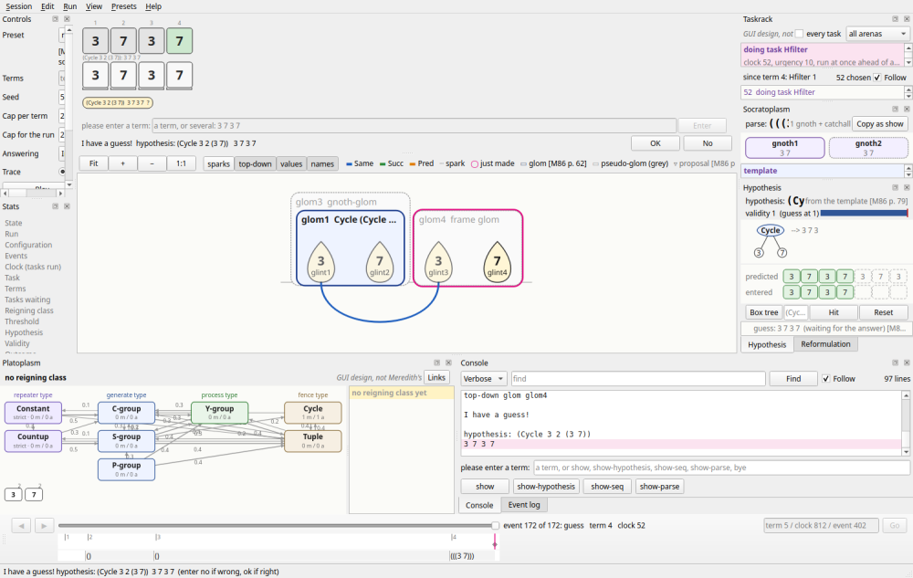
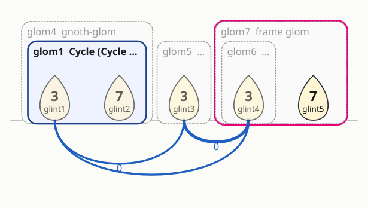

# seekwhence: Seek-Whence (Meredith, 1986) reconstructed in Python

## What Seek-Whence is

Seek-Whence is Marsha J. Ekstrom Meredith's model of pattern perception in integer
sequences (*Seek-Whence: A Model of Pattern Perception*, Indiana University Computer
Science Technical Report 214, September 1986, written in Douglas Hofstadter's group). The
program is shown the terms of a sequence one at a time (`3`, `7`, `3`, ...). As the terms
arrive it builds a structural hypothesis out of eight primitive concepts, for example
`(Cycle 3 2 (3 7))` for `3 7 3 7 ...` or `(S-group 1 (Countup 2))` for `1 2 1 2 3 1 2 3 4
...`, checks each new term against it, reformulates it when a term fails, and, once it is
confident, shows the user its guess at the next block of terms; the user answers `ok` or `no`
[M86 pp. 37-40]. Its architecture has three levels (the cytoplasm of glints, sparks, bonds
and gloms; the socratoplasm of gnoths; the platoplasm of ideal concepts), a taskrack of
small tasks chosen at random by urgency, templates, a hypothesis with a "box" that is hit
for each predicted term, and reformulation by gnoth operations and by slipping between
Platonic classes [M86 pp. 41-47, 87-126]. `SPEC.md` describes all of it with page citations.

No source code of the original survives (see `ralph_loops/loop0003/ANSWERS.md` in the
repository). This package is therefore a **reconstruction from the specification**, not a
port that can be checked against an oracle event for event, as the repository's Numbo and
Metacat ports are. The thesis is the specification, distilled with page citations into
[`SPEC.md`](SPEC.md); every choice the sources do not dictate is recorded in
[`DECISIONS.md`](DECISIONS.md) and referenced from the code as `DECISION D-NNN`; the
reconstruction's results against Meredith's three appendix runs and her reported results on
the "Blackburn dozen" are in [`RESULTS.md`](RESULTS.md). Python 3.12, standard library
only, all randomness through one seeded generator, no GUI.

## Status

**Complete: every mechanism the thesis describes is built and tested, and the program runs
as the three appendix transcripts show it.** The engine covers stage one (sparks, bonds, the
terraced scan of Glom-scouts, Glomtesters and Glommers, dubbing by the Plato-scouts,
templates, gnoths and the Hypothesizer), the hypothesis with its box tree, the Hfilter and
the guess, and stage two (the Gnoth-setter, slip-or-stay, the Reformulator and its
threshold, the nine gnoth operations and PROGRAMs, the Bond-assessor, the Gnoth-caster, the
skeletal Slip-scout and the blast). Every one of the 29 task types of SPEC 2.4's table has
its handler; every worked example in the thesis (the forms and their values, the field lists,
the stability arithmetic, the gnoth operations' before and after pictures, the casts) is a
test with its page in the docstring; the limitations Meredith reports are reproduced, not
repaired ("Limits" below).

How it compares with her program, measured rather than tuned (no sequence, term or seed is
special-cased anywhere; `RESULTS.md` has the tables and `docs/appendix-runs.md` and
`docs/dozen.md` the detail):

| What | Meredith's program | This reconstruction |
|---|---|---|
| Run 1, `3 7 3 7` [M86 pp. 164-166]: the Cycle hypothesis and the accepted guess `3 7 3 7` at the fourth term | one run | 35 seeds of 100 by her route; on the other 65 the palindrome `(3 7 3)` is glommed first (D-020), is refuted by the fourth term and, with more terms, 92 of 100 guess the Cycle |
| Run 2, `3 7 3 3 7 3` [M86 pp. 167-169]: the refutation, `gnoths:`, `slip-check: stayval: 0.0`, the three Cycle casts, `(Cycle 3 3 (3 7 3))`, the guess `3 7 3 3 7` | one run | 30 seeds line for line; 97 of 100 end in an accepted guess |
| Run 3, `1 2 1 2 3 1 2 3 4` [M86 pp. 170-179]: `(Countup 1)` refuted, `Countup --> S-group`, `(S-group 1 2)` and its wrong guess refused, `stayval: 15.0` / `best: (Y-group 4.0)`, `(S-group 1 (Countup 2))` and the right guess | one run | the whole route on 85 seeds of 100 (95 reach the final guess); her slip check's own numbers on 31 |
| The Blackburn dozen [M86 pp. 6-7, 145-147], judged by a user who knows the rule, 20 seeds | solves 2, 8 and 12 | solves 2, 8 and 12 on every seed, and also 1 and 5 (her program clung to a first hypothesis; here the blast ends the clinging); agrees with her verdict on 23 of the 26 sequences that have one |

The reconstruction was built item by item by a Ralph loop (`ralph_loops/loop0003/` in the
repository: `TASK.md`, `iterations.md`, `PROGRESS.md`); the module map below says which
item built each module.

## Installing and running

Nothing needs installing: the package is standard-library Python 3.12 and runs from this
folder. Optionally, `python3 -m pip install -e '.[test]'` installs it with `pytest` (the
only test dependency) and a `seekwhence` command equal to `python3 -m seekwhence`.

Interactively, as in the thesis's transcripts [M86 pp. 164-179]:

```sh
python3 -m seekwhence --seed 4
```

The program prints `please enter a term:`; type one nonnegative integer at a time, or
`show` (the terms, bonds, gloms and gnoths), `show-hypothesis`, `show-seq`, `show-parse`, or
`bye`. When it has a guess it prints the next block of terms and asks `enter no if wrong, ok
if right`; `ok` ends the run with `bye`, anything else sends it on (D-053, D-054).

## The command line

Without a user, the terms and the answers are scripted:

```sh
python3 -m seekwhence --seed 4 --terms 3 7 3 show-hypothesis 7 --answers ok
python3 -m seekwhence --seed 1 --terms 1 2 1 2 3 1 2 3 4 --trace terse --json /tmp/run.jsonl
```

| Option | Meaning |
|---|---|
| `--seed N` | the seed of the run's only random generator (default 0); the same seed gives the same output in any process |
| `--terms T ...` | run without a user: the terms, and any console commands among them, are fed on request; the run ends when a guess is accepted or the terms run out |
| `--answers A ...` | the answers to the guesses, in order; when they run out a guess is judged against the scripted terms, `ok` when its block agrees with them as far as both go (D-033) |
| `--trace verbose` (default) / `terse` | `verbose` prints the `doing task` lines as runs 1 and 3 do; `terse` only the happenings, as run 2 [M86 pp. 167-169] |
| `--json FILE` | every event as one JSON object per line (`kind` first, printed text for structures) |
| `--max-steps N` | stop the run after N tasks (`Config.max_tasks`, D-011) |

A scripted run ends with one `outcome:` line, the reconstruction's own summary (`outcome: ok
after 4 terms, 51 tasks (seed 4): (Cycle 3 2 (3 7))`). The exit status is 0 when a guess was
accepted or the user quit, 1 when the scripted terms ran out or the run was capped, 2 for a
usage error (D-069). `python3 -m seekwhence --help` lists the options.

## How to read a trace

The trace imitates the transcripts line for line, so a run can be read beside Meredith's
printouts [M86 pp. 164-179] (SPEC 15.5 says what is and is not comparable). The first
command above gives, on seed 4, the lines below; the comments on the right are not printed.

```text
-> (startup)                                      the program starts; a blank line precedes every prompt

please enter a term: 3                            the term, echoed after the prompt (D-069)
doing task Sparkler-plus on (glint1 glint1 2)     one line per task run: its type and arguments; glint1
                                                  is the first term's glint, 2 the Sparkler-plus's number
doing task Dissolver                              a Dissolver with nothing to dissolve (D-024)
doing task empty-task                             the taskrack ran empty, so the user is asked (D-013)

please enter a term: 7
doing task Sparkler-plus on (glint2 glint1 10)
spark1 --- between glint2glint1                   a spark: two elements chosen for a bond test
doing task Tester                                 the Tester finds no bond between 7 and 3 (no line)
...
please enter a term: 3
doing task Bonder on (Same print-value (remote) glint1 glint3)
bond1 --- between glint1glint3                    the bond 3 ... 3 by remote sameness
doing task Glom-scout
Same -cover proposed --> glint3                   the scout's proposals (a cover and a fence)
Same -fence proposed --> glint3
doing task Glomtester on (Same fence glint1)
doing task Glommer on (Same print-value fence (glint1 glint2))
Glommer for Same print-value fence members: (glint1 glint2)     glom1 = (3 7) is made
doing task Plato-scout on (Cycle glom1)           glom1 is dubbed a Cycle (no line when it passes)
doing task Template-applier on (glom1 (Cycle 3 2 (3 7)))
create-template-glom (Cycle 3 2 (3 7))(glom1)     the template level takes over
top-down glom glom2
template made : (form (Cycle 3 2 (3 7)) state working coverage (1 2) glom glom2)
doing task Template-evaluator
check-cycle template (Cycle 3 2 ((3 7)))
doing task Hypothesizer
(Cycle 3 2 (3 7))                                 the hypothesis
doing task Gnoth-maker
top-down glom glom3                               the gnoth-glom over glom1
gnoths constructed
doing task Call-term                              the program asks for the next term (D-012)

please enter a term: 7
doing task Hfilter                                the term is checked against the hypothesis's box
new term being hypothesis-filtered through (Cycle 3 2 (3 7))
top-down glom glom4                               a glom over the confirmed frame (D-063)

I have a guess!

hypothesis: (Cycle 3 2 (3 7))
3 7 3 7                                           the box fired from the first term (D-033)

enter no if wrong, ok if right ok                 the answer, echoed
bye
```

After a refutation the lines are those of runs 2 and 3: `new term being hypothesis-filtered
through ...` with no confirmation, `set-out -- validity: 0` (in the terse mode only, D-055),
`glomN is not in cytoplasm` from a Dissolver, `doing task Gnoth-setter`, `gnoths: (gnoth1
gnoth2 gnoth3)`, the two-line `slip-check: stayval: S` / `best: (class p)` or `best: nil`,
`Changing to a new reigning class. Countup --> S-group` (the reconstruction's line, D-042),
`doing task Reformulator`, `doing task Gnoth-operator on ((SHIFT-RIGHT gnoth1 gnoth2 (glint1)))`,
`doing task Bond-assessor on (S-group 8.0)` with the threshold rising 8.0, 9.0, 10.0,
`doing task Gnoth-caster`, `casts: ((S-group 1 2) (S-group 1 1))`, the generalised form on its
own line and `new hypoth candidate (S-group 1 2)`; three failed casts in one episode print
`blasting away all gnoths and gloms` (the reconstruction's line, D-050) and stage one starts
again from the glints. `show` prints the terms, every bond (`bond1 Same print-value (remote)
-- (glint1 glint3)`), every glom (`glom1 (Same print-value fence) --> (3 7) terms 1 to 2`)
and the gnoths with their fields in the order of [M86 pp. 167-168, 175]. The task order and
the structure numbers vary with the seed and are not milestones; the lines, their formats
and the numbers the mechanisms derive are (D-055).

## Replaying the appendix runs

```sh
python3 -m seekwhence.bench appendix                       # the three runs over 100 seeds: outcomes, guesses judged, per-milestone rates
python3 -m seekwhence.bench appendix --runs run3_121231234 --side-by-side 30   # one seed's lines beside the printout's, milestone by milestone
python3 -m seekwhence.bench appendix --markdown            # the tables of docs/appendix-runs.md
python3 -m seekwhence.bench appendix --runs run1_3737 --golden 54   # the golden trace of a seed
```

Each run is replayed with Meredith's console inputs (terms and `show*` commands) and her
answers, in its printout's trace mode; every milestone of `tests/data/expectations.json` is
looked for within the turn it was printed in, exactly and loosely (structure numbers as
wildcards), and the first-appearance order of task types is scored (`seekwhence/milestones.py`,
D-055). `docs/appendix-runs.md` has the rates, two seeds beside the printouts and every
divergence with its cause.

## The Blackburn dozen and the other sequences

```sh
python3 -m seekwhence.bench dozen                          # all 45 sequences, 20 seeds, up to 16 terms each (about five minutes)
python3 -m seekwhence.bench dozen --groups blackburn p88   # by group: blackburn, p146, p88, p38, p150, fcca
python3 -m seekwhence.bench dozen --names blackburn-12 --seeds 50 --terms 14 --markdown   # the tables of RESULTS.md
python3 -m seekwhence.bench dozen --names blackburn-3 --trace 17   # one seed's whole session on a sequence
python3 -m seekwhence.bench dozen --json /tmp/dozen.json   # the surveys as JSON, per seed
```

Each sequence of `seekwhence/sequences.py` (the dozen [M86 pp. 6-7], the sequences the thesis
reports solved [M86 pp. 88, 145-146], its typical problems [M86 p. 38], its unconquered
sequences [M86 p. 150] and Hofstadter's sampler [FCCA pp. 53-54]) is fed one term at a time
from its true continuation; a guess is answered `ok` only when the hypothesis predicts the
whole known continuation (D-070). The report gives, per sequence, the seeds solved, the terms
and tasks a solution took, the forms accepted and refused, what the unsolved seeds end with,
and the blasts, beside Meredith's reported result; `RESULTS.md` has the tables and the
analysis, `docs/dozen.md` the full reports.

## The GUI

`python3 -m seekwhence.gui` (or `seekwhence-gui` once installed) opens a window where
you pick a preset or type the terms yourself, press Play, and watch the run one event at
a time: the glints, sparks, bonds and gloms of the cytoplasm, the gnoths and the parse,
the hypothesis with its predictions and its guess, the eight ideal types and the slips
between them, the taskrack, and the reformulation as a storyboard. It needs PySide6
(6.6 or later; tested with 6.11), an optional dependency: without it the engine, the
tests and the command line work as before, and `python3 -m seekwhence.gui` says what
to install.

```text
python3 -m pip install -e '.[gui]'          # the GUI (PySide6)
python3 -m pip install -e '.[gui,test]'     # and pytest, pytest-qt, pytest-xdist
python3 -m seekwhence.gui                   # or: seekwhence-gui
```



The window at the guess of run 1, `3 7 3 7` [M86 p. 166]: the sequence and the guess
panel over the cytoplasm in the centre, the controls and stats on the left, the taskrack,
the socratoplasm and the hypothesis on the right, the platoplasm and the console along
the bottom, the timeline under them. The panes, briefly (the user guide,
[`docs/gui/panes.md`](docs/gui/panes.md), describes each one with the thesis pages behind
it, and Help > "What am I looking at?" shows its table):

- **Sequence and input** (centre, top): the terms with their fate under the hypothesis,
  the predicted block as ghost cells, the input box, the guess panel with OK and No.
- **Cytoplasm** (centre): glints on a baseline, bonds as arcs below it coloured by type,
  gloms as nested hulls above it, pseudo-gloms in grey, in the style of the thesis's
  Ch. 3 figures [M86 pp. 102, 106].
- **Socratoplasm**, **Hypothesis** and **Reformulation** (right): the parse and the gnoths'
  cards; the form with its ovals, box tree, predictions and validity; the storyboard of
  each refutation (slip-check, moves, gnoth operations as before/after pictures, casts,
  the candidate or the blast).
- **Platoplasm** and **Taskrack**: the eight ideal types with their s-links, the reigning
  class and the slip-check; the tasks waiting by type with their weights and the task
  chosen. These two drawings have no figure in the sources and are labelled *GUI design,
  not Meredith's*.
- **Console** and **Event log** (bottom): the transcript exactly as the CLI prints it,
  verbose or terse, with a command line; every event with its clock, filtered by kind.
- **Timeline**: a slider over the run with the terms, guesses, refutations, slips and
  blasts marked, and the parse at each term boundary. When no run is live every pane
  follows it.
- **Controls**, **Stats** and **Configuration** (Edit > Configuration): the presets (the
  three appendix runs, the Blackburn dozen and the other lists), the seed, the caps, the
  answering mode, the trace, the run buttons and the speed; the run's numbers; every
  knob of the configuration, editable for the next run.

The cytoplasm at the end of run 2, `3 7 3 3 7 3` [M86 pp. 167-169]: the dubbed Cycle
glom, the remote Same bonds, and the grey pseudo-gloms of the parse:



Every event is drawn: after each one, every view is redrawn before the run goes on, and
the same seed gives the same run with or without the window (the GUI only observes the
engine; it draws no random number and changes nothing). Keys (the Run menu): Space
play/pause, Right step, Ctrl+Right step task, Shift+Right step term, Esc stop, Left one
event back. Session > Save session writes the run's seed, configuration, inputs and
events; Open session re-executes the file and checks every event against it. The
window's size, docks, inputs and speed are remembered between sessions (QSettings
`seekwhence`/`seekwhence-gui`); View > Reset layout restores the layout shipped with the
code, `seekwhence/gui/default_layout.json`, and View > Save layout as default for this
code… rewrites that file.

Options: `--preset NAME` (`run1_3737`, `run2_373373`, `run3_121231234`, or a sequence
such as `blackburn-1`) or `--terms T ...`, `--seed N`, `--answers A ...`, `--max-steps N`,
`--play` to start at once. `--smoke` runs the inputs to the end with every event drawn,
offscreen (no display needed), prints the CLI's summary line and exits with its status:
0 for an accepted guess, 1 otherwise, 2 for a usage error. It reads and writes no
settings.

```sh
python3 -m seekwhence.gui --smoke --terms 3 7 3 7 --seed 54 --answers ok
```

```
outcome: ok after 4 terms, 52 tasks (seed 54): (Cycle 3 2 (3 7))
```

The same run in the CLI ends with the same line:

```sh
python3 -m seekwhence --seed 54 --terms 3 7 3 7 --answers ok
```

```
outcome: ok after 4 terms, 52 tasks (seed 54): (Cycle 3 2 (3 7))
```

The GUI is the subpackage `seekwhence/gui/` (its [README](seekwhence/gui/README.md) maps
the modules; the Qt-free models are in `seekwhence/gui/models/`), built after the Numbo
GUI of this repository; the choices the design left open are in
[`GUI-DECISIONS.md`](GUI-DECISIONS.md). Its tests are `tests/gui/` (pytest-qt, offscreen;
skipped without PySide6). `scripts/docs_screenshots.py` regenerates the screenshots of
this file and of the guide, offscreen.

## Running the tests

From this folder:

```sh
python3 -m pytest -q
```

About 1,630 tests, engine and GUI (the GUI's skip without PySide6 and pytest-qt). The engine's
take about 30 s and need only `pytest`. `bash run-tests.sh` runs them in parallel when
pytest-xdist is installed (it is in the `test` extra): about 45 s on many cores, against
about 4 minutes one at a time. Four long runs, whole Blackburn sequences drawn by the GUI
event by event, are marked `slow` and left out by default: `bash run-tests.sh --all` adds
them, `bash run-tests.sh --slow` runs them alone (or `python3 -m pytest -m ""` and `-m slow`). Three test files guard the
documentation: `tests/test_quotes.py` runs `tools/check_quotes.py`, which checks every
quotation followed by a citation tag against the text layer of the cited page of the
sources (read in place; see `SPEC.md` for the tags) and needs `pdftotext` (poppler), so it
is skipped when `pdftotext` is missing; `tests/test_conventions.py` checks that every
`D-NNN` mentioned in the code is an entry in `DECISIONS.md`, that every `Config` field is
commented with a source tag or a decision number, and that every public module, class and
function docstring cites a source tag (`[M86 p. N]`, `[FCCA p. N]`, `[MHN p. N]`) or a
decision number; `tests/test_docs.py`
runs every command in this file's `sh` blocks (the bench commands cut to two seeds, the
interactive run fed run 1's terms, the `pip` and `pytest` lines skipped), and checks that
the module map names every module, the knobs table every `Config` field, the `DECISIONS.md`
index every entry and every knob, and the *Implemented in* lines of `SPEC.md` only files
that exist. `tests/test_config.py` checks that the knobs agree with `DECISIONS.md` and hold
the values the thesis gives. The multi-seed surveys are tested on small samples with
thresholds taken from the measured rates, so that a change in behaviour is noticed and never
asserted away; the golden traces in `tests/data/` are never
regenerated to make a failing test pass.

## Design in one paragraph

A run is one `World` object (the three arenas, the taskrack, the counters, the hypothesis, the
template, the reigning class, the freeze-dried forms, the threshold), made fresh for every run
from a `Config` and a seed, as the Numbo port makes a `World` per run. Tasks are plain functions on the `World`, one per task type of
the thesis, posted on the `Taskrack` with an integer urgency and chosen by one draw from the
run's `Rng` (D-007). The run loop runs tasks until a `Call-term` runs, the rack is empty or a
cap is reached, then asks the user (D-011, D-012). Every change the engine makes is published
as a typed event (frozen dataclasses of plain data); the text trace that imitates the
transcripts is one observer, the tests' recorders are others, and the engine never depends on
them (D-055). A `Session` feeds terms on request and takes answers to guesses from a script or
the terminal (D-069).

## Module map

Module names follow the thesis's own vocabulary and, where the 2017 notes name a file
(`bonds.l`, `gloms.l`, `gnoths.l`, `reforms.l` [MHN pp. 4-5]), its name. "Item" is the loop
session that built the module; `SPEC.md` gives the same map from the sections' side.

| Module | Responsibility | SPEC sections | Thesis pages | Item |
|---|---|---|---|---|
| `seekwhence/config.py` | `Config`, the one frozen dataclass of knobs ("The knobs" below); `IDEAL_TYPES`, `TASK_TYPES` | 2.4, 8.8, 14.6 | every field cites a tag or a decision | 05 |
| `seekwhence/rng.py` | `Rng`, the run's only random number generator | 2.3 | [M86 p. 42]; D-007 | 00 |
| `seekwhence/forms.py` | the form language: `Form` (four slots, D-001), `Shared` (an index or a path, D-002), `Wildcard` (the template's `n`), parse and print of s-expressions in the prose, program and `build-box` spellings, `value_text`, `flatten` | 4.3, 4.5, 6.1, 8.6 | 49-59, 74, 84, 161-166 | 06, 12 |
| `seekwhence/platoplasm.py` | ideal atoms; the eight ideal types, their hierarchy, generating and process functions, membership (`accepts`), purity, strictness; manifestation and actualization lists; `Hitting`, `hits`, `terms`: what a form returns when hit (the reference the boxes must agree with); the s-links and the pull-push tables read from `Config` | 4, 5.9, 11.1 | 48-59, 68-69, 90-91, 99-104 | 06, 11 |
| `seekwhence/boxes.py` | boxes, printstructures and firers; `build_box`, `show_box`, `ready`, shared printstructures (D-003, D-056) | 8.4-8.6 | 81-85, 161-163 | 07 |
| `seekwhence/hypothesis.py` | `Hypothesis`: form, box, validity; predict, reset, hits, postdiction, `frame_bounds` (the frame holding a position, D-004); the guess block; freeze-dried forms | 8.1-8.3, 10.2 | 79-85, 91, 99, 125 | 07, 14 |
| `seekwhence/events.py` | the typed events, one frozen dataclass per happening (from `RunStarted` and `TaskChosen` through `GlomMade`, `TemplateMade`, `HypothesisMade`, `GuessMade`, `GnothsSet`, `SlipChecked`, `GnothOperated`, `CastsMade`, `Blasted` to `RunEnded`), and the `Subject` that publishes them to observers; `Recorder` | 2.5, 15.5 | (engineering: the Numbo port's `observe.py`; D-055) | 08 |
| `seekwhence/trace.py` | `Trace`, the observer that writes the transcripts' lines (`-> (startup)`, `please enter a term: N`, `doing task X on (...)`, `sparkN --- between ab`, `bondN --- between ab`, `Same -cover proposed --> glint1`, `Glomtester failed glint2`, `Glommer for ... members: (...)`, `failed to glom (...)`, `create-template-glom F(gloms)`, `top-down glom glomN`, `template made : (...)`, `check-cycle template (...)`, messages); `args_text`, `task_line`, `item_text`; `verbose` for run 2's terse mode, `prompts` off when a `Session` prints the prompts; `JsonLines`, `event_record` for the JSON-lines trace (D-069) | 1.4, 15.1 | 164-179 | 08, 19 |
| `seekwhence/taskrack.py` | `Task` (number, type, args, urgency, arena, creation clock and term), `Taskrack` (post, one-draw weighted choice D-007, clean by type and age D-010), `ARENAS` (D-057) | 2.3 | 25-26, 41-42, 182 | 08 |
| `seekwhence/world.py` | `World`: the three arenas (`Arena` for the cytoplasm and socratoplasm, `Platoplasm`), the counters and names (D-014), the hypothesis, template, reigning class, threshold, freeze-dried list, the answerer, the cast-failure count; `post`, `clean`, `run_task`, `run_now`, `stale` (D-009), `enter_term`, `say` | 2.1-2.2 | 42-47 | 08 |
| `seekwhence/run.py` | `new_world` (handlers installed, observers subscribed, the answerer), `enter_term` (the cytoplasm's `new_term`, the term filtered past the template, then an Hfilter task once a hypothesis exists), `run_until_prompt` (until Call-term D-012, an empty rack with `empty-task` D-013, or a cap D-011), `call_term`, the `TASKS` registry | 2.3, 2.5, 6.3 | 41-42, 74, 125, 145 | 08 |
| `seekwhence/cytoplasm.py` | `Glint`, `Glom` (with pseudo-gloms), `Spark`, `Bond` with the thesis's fields; `make_glint` (manifestation of the ideal atom), `make_glom`; subglom, adjacency and ordering tests; `lineup`, `neighbours`, `elements`, `top_of`; `dissolve`, `burst`, `detach` (D-059); the `show` lines of bonds | 5.1-5.4, 5.10 | 60-65, 70 | 09 |
| `seekwhence/bonds.py` | `new_term` (the glint and what a term releases: Sparkler-plus with its number (D-015), plain Sparklers (D-016), the Dissolver on the ending focus (D-024)); Sparkler (D-025), Sparkler-plus, Tester (bond tests on print-value and span, D-018; the spark drawn and used up, D-058), Bonder (no duplicates; strengths, D-019; releases, D-016); the Dissolver task | 5.4-5.7, 5.10 | 61-65, 70 | 09 |
| `seekwhence/gloms.py` | Glom-scout (the draw, the three quicktests, the family label, D-020), Glomtester (the three extents over the lineup, `Glomtester failed`, D-021), Glommer (refinement, `failed to glom`, the active focus and its Sparkler-plus tasks, the inherited urgency), Glom-inspector (interest, D-022), Plato-scout and `dub` (structure `(form purity)`, manifestations, the Template-scout), Plato-evaluator (secondary purity, pure pieces, D-023), Burster (D-024) | 5.8-5.10 | 65-70, 165, 170, 173 | 10 |
| `seekwhence/templates.py` | `Template` (form, state, coverage, glom); units and `unit_match` (the wildcard), `loosenings`, `fit_lineup` (the lineup as repetitions of a form, D-026); `make_template` (top-down unit gloms, the template glom, the printed lines, D-061); Template-scout (D-060), Template-applier, Template-resolver (the blast, D-029), Template-evaluator (`check-cycle`, acceptance, D-027), Template-reviewer (D-028); `filter_term` (filtering past a template, extension of the template glom) | 6 | 73-76, 165, 167, 170-171 | 12 |
| `seekwhence/gnoths.py` | `Gnoth` (the fields of p. 78 and of `show`, `parse_print`, `show_lines`), `make_gnoth` (the gnoth-glom, actualization), the catchall (D-030), `destroy_gnoth`; Gnoth-maker (D-062); term, parse and structural equivalence with `deep_frame`/`shallow_frame` (D-051); `show_gnoths_lines`, `parse_text`; the Hypothesizer (`form_from_template`, `generalise`, the Tuple fall-back, D-031; the Call-term after both tasks, D-012) | 7, 8.1 | 76-79, 94-98, 165-168, 171 | 13 |
| `seekwhence/filtering.py` | the Hfilter (D-063): a new term against the box, validity, the catchall and its frame gloms, the guess (`I have a guess!`, `hypothesis:`, the block of D-033) and the user's answer through an `Answerer` (`ScriptedAnswerer`, `judge`, D-064), refutation (`set-out -- validity: 0`, the previous frame's caps dissolved, Sparklers, the Gnoth-setter, D-017) | 1.4, 8.3, 10.1 | 39-40, 81-82, 98, 166, 168-169, 171-172, 175-176 | 14, 21 |
| `seekwhence/slipping.py` | `layout` (the old hypothesis's frames over the terms, the cut-short frame, the final gnoth; D-036), the Gnoth-setter (freeze-drying D-035, the box destroyed, the reigning class, reuse and refilling of gnoths with `top-down glom` and `gnoths: (...)`, the reform cleaning D-010), `assess_bonds` (internal and external lists as `show` prints them), `gnoth_stability`, `staying_pressure`, `recent_tries` (D-041), `slipping_pressure`, `slip_check` and `slip_or_stay` (strict classes D-040, `slip-check` lines and the announced slip D-042, `change_class` with D-046) | 10, 11 | 90-92, 98-105, 168, 173-176 | 15 |
| `seekwhence/operations.py` | the nine gnoth operations as functions on the world's gnoths and gloms (`apply_operation`, `shift`, `split`, `capture`, `enclose`, `fracture`, `merge`, `no_op`): caps off (`uncap`), containing gloms dissolved (`uncover`), the new glom with its Plato-scout (`made_glom`), the fresh cap (`recap`); the printed forms (`operation_text`), PROGRAMs with `New` references (D-044) and `run_program`; the Gnoth-operator (`precheck`, the threshold, D-067) and the Capper (D-045); the shift's border rule (D-065), what an operation leaves behind (D-066) | 13, 14.1 | 108-124, 174, 177-178 | 16 |
| `seekwhence/reforms.py` | the Reformulator: `set_threshold` (D-046), `lasts`/`firsts` and `selection_order` (p. 107 as a test vector), `pull`, `holding`, `assess_pair` (the mover and the strength, D-043), `find_move` (level by level over the parse, D-068), `build_program` (a bare move or the PROGRAM with captures and `New` repairs, D-044), `find_no_op` (D-045); the Bond-assessor (`strongest_bond`, D-047) | 12, 14.1-14.2 | 105-109, 124, 174, 177-178 | 17 |
| `seekwhence/casting.py` | `cast_terms` (one gnoth's casts per class, D-048; term by term under a fence class, D-037), `generalise_casts` (parameter by parameter, Y-group elements, repeaters, concatenation), `promise_frame` and `cast_gnoths` (`Casting`: the printed `casts:` list, the form, the promising last gnoth), `record_casts` (the gnoths' `form` fields); `repeats_freeze_dried` (D-035), `adopt_candidate` (postdiction D-034, `new hypoth candidate`, the Call-term); `fail` (the count, D-050), `blast` (gnoths and gloms destroyed, glints and their bonds kept, stage one resumed), the Slip-scout (D-049) and the Gnoth-caster task | 9.5, 14.3-14.5 | 39, 91-92, 124-126, 168-169, 174, 178 | 18 |
| `seekwhence/session.py` | `Session` (one run through the console protocol: `enter`, `handle`, `run`, the `show*` commands, `outcome`, `summary`; an `answerer` factory for the bench), `Console` (prompts, a script or a stream, the echo), `ConsoleAnswerer` (scripted answers, then the judgement of D-033, then the user), `parse_line`, `glom_line` (D-069) | 1.4 | 37, 164-179 | 19 |
| `seekwhence/__main__.py` | the command line: interactive as in the transcripts, and `--terms`, `--answers`, `--seed`, `--trace`, `--json`, `--max-steps`; the exit status (D-069) | 1.4 | 164-179 | 19 |
| `seekwhence/milestones.py` | the milestones of `expectations.json` as the lines they require, matched within their turn in the exact and reached readings; the task-type order (D-055) | 15.1-15.5 | 164-179 | 20 |
| `seekwhence/bench.py` | `python3 -m seekwhence.bench appendix`: the appendix runs replayed over many seeds with Meredith's inputs and answers, the per-milestone rates, the guesses judged, a seed's side-by-side, the golden traces; `python3 -m seekwhence.bench dozen`: the catalogue's sequences over many seeds, each guess judged by the `ContinuationAnswerer` (a user who knows the rule, D-070), the solved rates, terms, tasks, forms and blasts, the comparison with the thesis's verdicts | 15.6-15.8 | 88, 145-153, 164-179 | 20-22 |
| `seekwhence/sequences.py` | the sequences the sources name, each with the rule that continues it, the terms the source prints, its citation and Meredith's reported result: the Blackburn dozen, the three related sequences of pp. 145-146, the p. 88 list, the typical problems of p. 38, the unconquered sequences of p. 150, Hofstadter's sampler (D-070) | 1.1, 3.4, 15.6 | 6-7, 38, 88, 145-147, 150; FCCA 53-54 | 22 |
| `tools/check_quotes.py` | the quotation checker (a verbatim copy of the loop's `scripts/check_quotes.py`; `tests/test_quotes.py` asserts the copy is identical) | citation conventions | | 00 |
| `tools/audit_transcript_citations.py` | checks every citation of a transcript page (164-179) against the transcriptions: the snippets of the claim before the tag looked up on the cited pages, verdicts EXACT / NEAR / ELSEWHERE / NOTFOUND / NOSNIPPET (`tests/test_docs.py` runs it; `docs/citation-audit.md` records the hand review) | 15 | 164-179 | 24 |
| `tests/data/run1_3737.txt`, `run2_373373.txt`, `run3_121231234.txt` | the three appendix runs, transcribed line for line from the page images, with page markers and Meredith's annotations | 15.1-15.4 | 164-179 | 04 |
| `tests/data/expectations.json` | the runs' milestones in order with their pages, the console inputs, the task types and counts; the Blackburn dozen with Meredith's results; the p. 88 list, the p. 147 summary, the problems of pp. 148-153 (`tests/test_data.py` checks it against the transcriptions) | 15 | 6-7, 88, 145-153, 164-179 | 04 |
| `tests/data/golden_run1_seed54.txt`, `golden_run2_seed54.txt`, `golden_run3_seed30.txt` | the whole traces of one seed per appendix run, compared line for line by `tests/test_appendix.py` (never regenerated to make a failing test pass) | 15.2-15.4 | 164-179 | 20, 21 |
| `tests/test_*.py` | one test file per module (`test_forms.py` for `forms.py`, ...), plus `test_data.py` (the transcriptions), `test_appendix.py` (the replays and the golden traces), `test_dozen.py` (the catalogue and a fast sample of the survey), `test_conventions.py`, `test_config.py`, `test_quotes.py`, `test_package.py`, `test_docs.py` (the documentation) and `test_publishable.py` (no reference to unpublished material) | | | 00-23 |
| `docs/appendix-runs.md` | the three appendix runs replayed over 100 seeds: the method, what items 20 and 21 changed, the per-milestone rates, seeds 54 and 30 beside the printouts, every divergence and its cause | 15 | 164-179 | 20, 21 |
| `docs/dozen.md` | the Blackburn dozen and the other sequences over 20 seeds: the method, the full reports, and the routes of the notable seeds | 15.6-15.8 | 6-7, 38, 88, 145-150 | 22 |
| `docs/citation-audit.md` | the citation audit: 36 sampled citations checked on the page images, every transcript citation checked by the tool and reviewed by hand, the eight corrections, and the other checks of item 24 (long functions, stdlib, one RNG, no sequence-specific code, run time) | | | 24 |

## The knobs

Every number the thesis does not give, and every one it does, is a field of
`seekwhence.config.Config`, a frozen dataclass made once per run; a run is reproducible from
its seed and its `Config` alone. Each field's comment in `config.py`
cites the page that gives its value or the decision that chose it, and `DECISIONS.md`'s index
lists the knob of every decision. Pass a changed `Config` to `run.new_world` or `Session` to
experiment; the command line exposes `verbose` (`--trace`) and `max_tasks` (`--max-steps`).

| Field | Default | Source or decision | What it does |
|---|---|---|---|
| `urgency_power` | `1` | D-007 | a task is chosen with probability proportional to urgency to this power |
| `urgencies` | a table of 27 task types | D-008 | the urgency of every task type but Sparkler-plus (D-015) and the Glomtester (D-020) |
| `cleaned_on_term` | `(Sparkler, Sparkler-plus, Tester, Dissolver)` | D-010 | the types removed from the rack, when posted before the previous term, as a term is entered |
| `cleaned_on_reform` | `(Reformulator, Gnoth-operator, Bond-assessor, Gnoth-caster, Slip-scout, Capper)` | D-010 | the types removed when a Gnoth-setter runs |
| `cleaned_on_hypothesis` | `(Template-scout, Template-applier, Template-evaluator, Template-reviewer)` | D-010 | the types removed when a hypothesis is made |
| `max_tasks_per_term` | `2000` | D-011 | tasks run between two prompts before the user is asked anyway |
| `max_tasks` | `200000` | D-011 | tasks run in the whole run before the outcome is `capped` |
| `verbose` | `True` | D-055 | print the `doing task` lines (runs 1 and 3) or not (run 2) |
| `sparkler_plus_urgencies` | `(10, 2)` | D-015 | the urgency, and the printed number, of a Sparkler-plus on two distinct real elements, and on a self-pair or a pseudo-glom [M86 pp. 164, 172] |
| `testers_per_spark` | `1` | D-016 | Testers posted per spark [M86 p. 64] |
| `sparklers_per_bond` | `2` | D-016 | Sparklers released by a new bond [M86 p. 65] |
| `glom_scouts_per_bond` | `2` | D-016 | Glom-scouts released by a new bond [M86 p. 65] |
| `sparklers_per_term` | `3` | D-016 | plain Sparklers posted when a term is entered |
| `sparklers_on_refutation` | `3` | D-017 | plain Sparklers set out when a term refutes the hypothesis [M86 p. 98] |
| `bond_type_weights` | Same 10, Succ 8, Pred 8 | D-019 | a bond's own strength is type times modifier times field |
| `bond_modifier_weights` | adjacent 1.0, remote 0.5 | D-019 | adjacent above remote [M86 pp. 64-65] |
| `bond_field_weights` | print-value 1.0, span 0.25 | D-019 | span bonds are weak [M86 p. 65] |
| `glom_bond_minimum` | `3` | D-019 | the least bond strength a Glom-scout or Glomtester follows; span bonds never cause glomming [M86 p. 62] |
| `glomtester_test_weights` | group 3, fence 2, cover 1 | D-020 | a Glomtester's urgency is test weight times family weight; the Glommer it sets out inherits it (D-021) |
| `glomtester_family_weights` | Same 3, pred-succ 2 | D-020 | sameness above successorship [M86 p. 66] |
| `sparklers_on_acceptance` | `2` | D-061 | plain Sparklers set out when a template is accepted [M86 p. 75] |
| `guess_validity` | `1` | D-032 | confirming terms before the guess; every transcript guesses after one |
| `guess_min_hits` | `3` | D-033 | the guess fires the box from the first term for at least this many hits and until every entered term is covered |
| `reject_freeze_dried_repeats` | `True` | D-035 | a candidate repeating a freeze-dried form that explained at least as many terms is rejected [M86 p. 91] |
| `s_links` | a table of 27 links | D-038 | the directed s-links with their slipperiness; the thesis gives three values [M86 pp. 90-91, 104] |
| `bond_values` | a table of 13 rows | D-039 | each class's pull (positive) and push (negative) bond types; the thesis gives four values [M86 pp. 101, 104, 175] |
| `strict_classes` | `(Constant, Countup)` | D-040 | a strict reigning class slips at once [M86 p. 99] |
| `stay_factor_per_try` | `0.5` | D-041 | the staying pressure is multiplied by this per recent try of the reigning class, the just-refuted hypothesis not counted [M86 p. 99] |
| `threshold_fraction` | `0.8` | [M86 p. 105], D-046 | the first threshold is this fraction of the reigning class's strongest pull |
| `slip_scout_factor` | `0.5` | D-049 | a Slip-scout repeats the slip check with the staying pressure multiplied by this [M86 p. 126] |
| `max_cast_failures` | `3` | D-050 | Gnoth-caster failures in one episode before the blast [M86 p. 92] |

## Limits

**Reproduced from the thesis, not repaired.** The limitations Meredith reports are kept
(TASK.md's rule): Slip-scouts are "only skeletally implemented" and here repeat the slip check
with a reduced staying pressure (D-049); divesting pushes, cosmetic reform and form polishing
are not implemented (SPEC 9.3, 13.6; a gnoth's `equivalence-type` is recorded and never used,
D-051); box hits are indivisible (SPEC 8.4); only glints are manifestations of ideal atoms
(SPEC 4.2); there is no memory between sequences; the program never quits on its own.

**Of the reconstruction.** The original's seed and code are unknown, so the appendix runs
cannot be replayed event for event: the package is measured on milestones, formats and the
numbers the mechanisms derive, never on task counts, task order or structure numbers (SPEC
15.5 item 16, D-055). Every number the thesis does not give is a decision with a knob; the
starting values are the simplest readings or engineering defaults, and are not tuned
to the transcripts or the dozen. Known divergences from the printouts, each recorded with its
cause in `docs/appendix-runs.md`: the palindrome `(3 7 3)` is glommed before the fence `(3 7)`
on about two seeds in three (the uniform scout draw, D-020); p. 174's PROGRAM wrapper
`(ENCLOSE gnoth1 nil)` round a top-level shift is not produced (D-044); the Hfilter prints the
form, not p. 176's `(1 2)1` (D-052); the Gnoth-setter's top-down gloms are pseudo-gloms no
Plato-scout visits (D-036); on about 15 seeds in 100 run 3's second episode blasts instead of
finding the shift the parse needs (D-043). Against her reported results the reconstruction
solves Blackburn 1 and 5, which her program could not, and does not solve `16 15 14 15 14 13
...`, which hers did "as well as possible" [M86 p. 88]; both are findings in `RESULTS.md`, not
bugs to hide. Every line the transcripts never print and the reconstruction adds is marked
in its decision (`Changing to a new reigning class.`, `blasting away all gnoths and gloms`,
the hint for an unknown console line, the `outcome:` summary).

## Relation to Seqsee

Seqsee (Abhijit Mahabal, 2009; https://github.com/amahabal/Seqsee, and PySeqsee) is
Seek-Whence's successor in the same domain, written in Hofstadter's group two decades later
with its own architecture and vocabulary, and maintained by its author. It is not stored in
this repository and is not a source for Seek-Whence's behaviour. TASK.md allowed it as an
engineering reference only; in the event no code, number or rule in this package was taken
from it (no decision in `DECISIONS.md` cites it), so the two programs can be run side by side
on the same sequences as independent models.

## The documents

- [`SPEC.md`](SPEC.md): the specification distilled from the thesis, FCCA chapter 1 and the
  2017 historical notes, in 15 sections with about 450 machine-checked quotations, each
  section cross-referenced to the modules that implement it.
- [`DECISIONS.md`](DECISIONS.md): the 70 decisions (D-001 to D-070) that answer every point
  the sources leave open, with an index giving each one's kind, knob and the modules that
  cite it.
- [`RESULTS.md`](RESULTS.md): the appendix runs and the Blackburn dozen, ours beside hers,
  and the findings from the stages as they were built.
- [`docs/`](docs/README.md): the appendix-run comparison, the dozen's full reports, the
  citation audit.
