# Tabletop (French, 1992), reconstructed in Python

Tabletop is Robert M. French's model of analogy-making in a microworld of table settings. He
built it in Douglas Hofstadter's group at Indiana University (about 1987-1992) and described
it in his book *The Subtlety of Sameness* (MIT Press, 1995), in chapters 8 and 9 of *Fluid
Concepts and Creative Analogies* (FCCA, 1995) and in a 1991 Cognitive Science Society paper.
French asks us to imagine "two people, Henry and Eliza, seated at a small table facing each
other" [F95 p. 25]. Henry touches an object on the table and says "Do this!", and Eliza must
respond by doing "the same thing" from her side of the table [F95 p. 25]. The program plays
Eliza. Its architecture is Copycat's: it "consists of three main components: the Slipnet, the
Workspace, and the Coderack" [F95 p. 55], with a Worldview of correspondences that don't
contradict one another, and a computational temperature that decides when a run ends.

French's program (over 26,000 lines [F95 p. 54]) is lost. This folder holds a
**reconstruction from the specification**, like FARGonautica's reconstruction of
[Seek-Whence](https://github.com/fargonauts/FARGonautica/blob/master/Software/SeekWhence/README.md).
Every module cites the pages it implements, every choice the sources leave open is a numbered
decision, and every experiment French reports is replayed by a bench, with our numbers beside
his. Through v2 no default was tuned to them; since v3 (2026-10-16) the defaults come from
cross-validated Bayesian optimizations against them, and since v4 (2026-10-17) 65 of them
are the second optimization's choice, whose held-out estimate does not beat v3's; the gains
and the losses are reported side by side. It comes with a command line that prints one line per codelet
and ends with French's own report of a run, with twelve benches, and with a graphical
interface, in PySide6, that shows a run as it happens: the table, the thermometer, the Slipnet,
the Coderack and the Worldview, as French's own screen showed them.

This code lives in two places: as the folder `Software/Tabletop/` of
[FARGonautica](https://github.com/fargonauts/FARGonautica), the archive of the Fluid Analogies
Research Group's architectures, and on its own at
[fargonauts/Tabletop](https://github.com/fargonauts/Tabletop). Everything it needs is inside
this folder; the source PDFs are found through environment variables or an enclosing
FARGonautica checkout (see [`python/README.md`](python/README.md), "The sources").

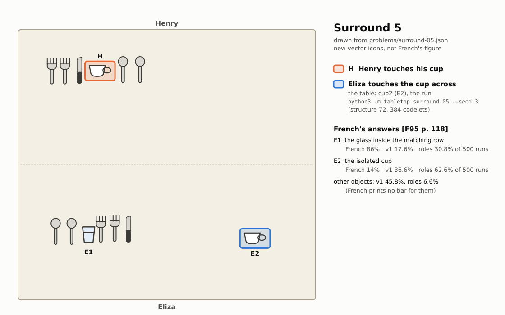

*Surround 5, the configuration French follows through his chapter 4 [F95 p. 118], drawn from
the digitized layout in `python/problems/surround-05.json` (the icons are new drawings, not
French's figure). Henry touches his cup (H), which sits in a row of silverware. On Eliza's
side, a matching row has a small glass where the cup would be (E1), and a cup stands alone at
the far right (E2). In this run (seed 3), Eliza touches the lone cup. French's program chose
the glass in 86 percent of its runs; this reconstruction chose it in 17.6 percent before
roles (v1), 15.2 with them (v2), 12.4 on v3's optimized defaults, 26.0 on v4's and 30.8 on
v5's engine, and takes the lone cup in 62.6 percent of its runs (v4 68.8) against his 14.*

**Status: complete, with a graphical interface.** The engine, the command line, the
benches, the results and the documentation are done, and the GUI ([Using the
GUI](#using-the-gui)) watches and drives runs, event by event, with sessions, an editor for
tables and a batch pane; its review against its design is
[`python/docs/gui/review.md`](python/docs/gui/review.md). The engine
runs every one of the 53 digitized configurations to an answer, its defaults are frozen, and
[`python/RESULTS.md`](python/RESULTS.md) puts every result set French reports beside ours.
The numbers are honest misses more often than matches ([How well it does](#how-well-it-does)):
the reconstruction finds French's run lengths and his qualitative behaviour on most of
chapter 2, but builds too little structure to reach his frequencies. The engine's events and
read-only state are documented in [`python/docs/engine-api.md`](python/docs/engine-api.md),
and the GUI is built on them alone: it changes nothing, and a run gives the same events with
or without it.

## Contents

- [What the program does](#what-the-program-does)
- [Quick start](#quick-start)
- [Installing](#installing)
- [Using the command line](#using-the-command-line)
- [Using the GUI](#using-the-gui)
- [Replaying French's experiments](#replaying-frenchs-experiments)
- [How well it does](#how-well-it-does)
- [Running the tests](#running-the-tests)
- [How the reconstruction was made](#how-the-reconstruction-was-made)
- [What's in this folder](#whats-in-this-folder)
- [Further reading and credits](#further-reading-and-credits)

## What the program does

### The domain

A table is set with cups, small and big glasses, plates, saucers, soup bowls, salt and pepper
shakers, knives, forks and spoons [F95 p. 26]. Henry sits at the top of the table and Eliza at
the bottom. Henry touches an object, and Eliza must touch the object that, from her side,
corresponds to it. Touching the very object Henry touched is always allowed [FCCA p. 377],
and it is the answer when nothing better is found. When the table is set symmetrically,
Eliza is expected to reach across to her own cup; when it is not, the pressures of the
configuration decide between literal sameness and the analogous object.

French's chapter 2 walks through nineteen configurations that pull in different directions,
and his chapter 5 measures the program's answers on thirty-five, in four families:

- *Surround*: the touched cup is inside a group of silverware. Should Eliza take the isolated
  cup across the table, or the glass inside the matching group?
- *Blockage*: an extra glass beside the obvious one. Does it block the analogy?
- *Buridan*: two equally good answers.
- *Figure/Ground*: Henry reaches across the table and touches one of Eliza's objects.

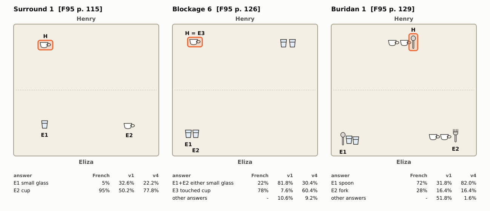

*Three of the 35 configurations of chapter 5, drawn from their files in `python/problems/`.
H is the object Henry touches; E1, E2 and E3 are French's labels for the answers he reports.
Under each table: how often each answer was given by French's program [F95 pp. 115, 126,
129], by this reconstruction before roles (v1, `python/results/v1/families.json`) and with
them on v5's engine (v5, `python/results/families.json`), 500 runs each. In Blockage 6 the touched cup
itself is French's answer E3.*

All 53 configurations were digitized from French's figures: the 34 behind chapter 5's 35
result sets (Buridan 1 was run by two versions of his program) and chapter 2's nineteen. How,
and how accurately, is in [`python/docs/problems.md`](python/docs/problems.md).

### The architecture

It is Copycat's, under French's names:

- **The Slipnet** holds 47 concepts (the object types, their categories, the relations and
  positions, and such abstract notions as *opposite* and the symmetries), joined by links
  whose lengths are conceptual distances. Activation spreads over the links and decays with
  each concept's depth. A highly active label node shortens the links it labels, so a
  slippage such as *left to right* becomes easy when *opposite* is active [F95 pp. 55-63].
- **The Workspace** is where perception happens. Objects are noticed region by region (the
  table has nine blurry regions); gestalt groups are found by proximity, and bottom-up groups
  by sameness or a shared category. *Correspondences* are built between an object or group on
  Henry's side and one on Eliza's, each with its slippages and a strength from French's nine
  static and three dynamic factors [F95 pp. 63-72].
- **The Worldview** is the set of correspondences the program currently believes in, which
  must not contradict one another. A newcomer that conflicts with it provokes a fight between
  the old Worldview and a rival one, rated by their strengths, their coherence and their
  parallelism; the losers fade rather than die [F95 pp. 70-75].
- **The Coderack** holds small codelets, each doing one thing (look at a region, test a
  group, build a correspondence, hold a fight, give the answer), chosen at random, weighted by
  urgency. A codelet's urgency is divided by ρ^generation (ρ = 3), so that follow-ups don't
  swamp their parents [F95 pp. 76-82].
- **Temperature** measures how well the Worldview is doing and how fast it is changing. It
  starts at 80, makes every choice more random when high and more deterministic when low,
  and decides when the *find-answer* codelets end the run [F95 pp. 90-94].

A run goes like this. At first, Henry's cup is the only thing known. Scouts look at the
regions around it and across from it, and groups are found. A correspondence from the touched
cup to a salient object on Eliza's side is proposed, tested and put in the Worldview, and
rivals fight it. The temperature falls as the Worldview settles. A find-answer codelet runs,
and Eliza touches the object at the other end of the touched cup's correspondence. The run
reports the object touched, the structure value of its Worldview and the number of codelets
run, as French's own program did [F95 p. 145].

## Quick start

From a clone of this repository (in FARGonautica, from `Software/Tabletop/`), with Python 3.12
or later and nothing installed:

```sh
cd python && python3 -m tabletop surround-05 --seed 3 --quiet
```

This runs the configuration of French's chapter 4, Surround 5 (pictured above), once, and
prints the first and last lines of the run:

```
tabletop surround-05  seed 3  profile standard  engine compiled  Henry touches cup1
Eliza touches cup2 (E2). Structure 72. Codelets 384. T 28.3.
```

Eliza touched the lone cup at the far right, French's answer E2 for this problem, the one his
program gave in 14 percent of its runs (the small glass in the row in front of her, E1, in
the other 86 [F95 p. 118]). Without
`--quiet`, the run prints one line per codelet (see [the command line](#using-the-command-line)).
Any problem name from `python3 -m tabletop --list` can be run, and the same problem, seed and
profile give the same run on any machine.

## Installing

**Requirements.**

- Python 3.12 or later. The engine, the command line and the benches use only the standard
  library at run time.
- To build the compiled engine, the one that runs by default and the reference (its runs,
  goldens and bench numbers are the package's): a C compiler (gcc or clang) and Cython 3
  (`pip install cython`). Build it once from `python/` with `python3
  tools/build_fast.py`; `pip install .` builds the same extension. Without a build every
  entry point stops at start with an error saying how to build; there is no fallback. The
  pure-Python engine, included as the readable specification, runs only on the explicit
  request `TABLETOP_ENGINE=python`.
- For the tests only: pytest, and optionally pytest-xdist to run them in parallel. The
  quotation checks also use `pdftotext` (poppler) and the source PDFs when they are found,
  and are skipped otherwise.
- For the GUI, and for regenerating the pictures on this page: PySide6 6.6 or later (tested
  with 6.11); pytest-qt for the GUI's tests, which skip without it.

**Without installing anything.** After the build above, everything runs straight from
`python/` with the system's `python3`:

```sh
cd python && python3 -m tabletop --help
```

**In a virtual environment.**

```sh
cd python
python3 -m venv .venv
source .venv/bin/activate                     # on Windows: .venv\Scripts\activate
python3 -m pip install -e '.[test]'           # pytest and pytest-xdist
```

The install is editable (`-e`), so changes to the code take effect at once, and it provides
the command `tabletop` (the same as `python3 -m tabletop`). The extras are:

| Install | What you get |
|---|---|
| `pip install -e .` | the engine and the `tabletop` command (no dependencies) |
| `pip install -e '.[test]'` | pytest and pytest-xdist for the tests |
| `pip install -e '.[gui]'` | PySide6 and pytest-qt: the GUI (`tabletop-gui`) and its tests |
| `pip install -e '.[docs]'` | PySide6, to regenerate the figures on this page |

**Offline.** An editable install needs setuptools for its build backend, which pip downloads
unless told not to. With no network, let the environment see the system's packages
(setuptools 61 or later must be installed) and skip the download:

```sh
cd python
python3 -m venv --system-site-packages .venv
source .venv/bin/activate
python3 -m pip install --no-index --no-build-isolation -e .
```

**Regenerating the pictures.** Every figure on this page is drawn by
[`python/scripts/docs_figures.py`](python/scripts/docs_figures.py) from the data in this
folder: the problem files, the bench records in `python/results/`, French's chapter 4
numbers in `python/tests/data/ch4.json`, and real runs of the engine. The script draws
offscreen with PySide6, so no window opens, and it gives the same pictures every time (fonts
apart). The package itself never imports PySide6; without it, the script says what to
install and stops. The GUI's screenshots are rendered the same way, offscreen from the quick
start's run, by [`python/scripts/docs_screenshots.py`](python/scripts/docs_screenshots.py).

```sh
cd python
python3 -m scripts.docs_figures                # all six figures, into python/docs/
python3 -m scripts.docs_figures --only temperature
python3 -m scripts.docs_screenshots            # the five GUI screenshots (needs the gui extra)
```

## Using the command line

```sh
cd python && python3 -m tabletop surround-05 --seed 3
```

prints one line per codelet, then French's report as the last line. `--table` first draws the
layout as a text map, with a legend that gives each object's id, type, position in table
units (110 by 100, from Henry's left corner), orientation and region:

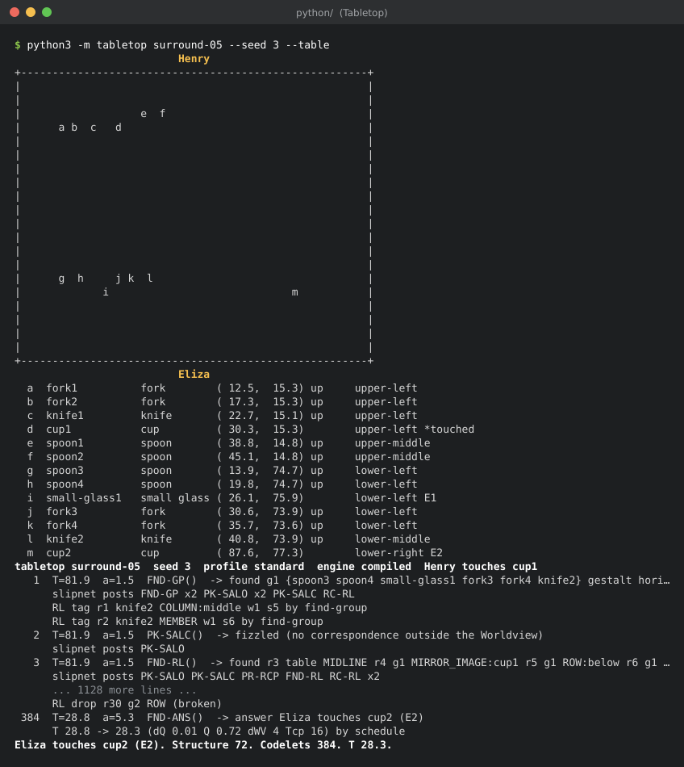

*The command line on Surround 5 with seed 3: the map, the legend, the first codelets and the
end of the run. The middle, and the ends of the longest lines, are cut in the picture; the
text follows in full.*

The first 46 lines of that run:

```sh
cd python && python3 -m tabletop surround-05 --seed 3 --table | sed -n 1,46p
```

```
                          Henry
+-------------------------------------------------------+
|                                                       |
|                                                       |
|                   e  f                                |
|      a b  c   d                                       |
|                                                       |
|                                                       |
|                                                       |
|                                                       |
|                                                       |
|                                                       |
|                                                       |
|                                                       |
|                                                       |
|                                                       |
|      g  h     j k  l                                  |
|             i                             m           |
|                                                       |
|                                                       |
|                                                       |
|                                                       |
+-------------------------------------------------------+
                          Eliza
  a  fork1          fork        ( 12.5,  15.3) up     upper-left
  b  fork2          fork        ( 17.3,  15.3) up     upper-left
  c  knife1         knife       ( 22.7,  15.1) up     upper-left
  d  cup1           cup         ( 30.3,  15.3)        upper-left *touched
  e  spoon1         spoon       ( 38.8,  14.8) up     upper-middle
  f  spoon2         spoon       ( 45.1,  14.8) up     upper-middle
  g  spoon3         spoon       ( 13.9,  74.7) up     lower-left
  h  spoon4         spoon       ( 19.8,  74.7) up     lower-left
  i  small-glass1   small glass ( 26.1,  75.9)        lower-left E1
  j  fork3          fork        ( 30.6,  73.9) up     lower-left
  k  fork4          fork        ( 35.7,  73.6) up     lower-left
  l  knife2         knife       ( 40.8,  73.9) up     lower-middle
  m  cup2           cup         ( 87.6,  77.3)        lower-right E2
tabletop surround-05  seed 3  profile standard  engine compiled  Henry touches cup1
   1  T=81.9  a=1.5  FND-GP()  -> found g1 {spoon3 spoon4 small-glass1 fork3 fork4 knife2} gestalt horizontal; jolt knife +19; jolt group +14; jolt horizontal +19; posted 9 (FND-GP SAM FD-NNBR x2 FD-END FD-MID PK-SALO x2 FND-RL); jolt column +19; jolt group +19
      slipnet posts FND-GP x2 PK-SALO x2 PK-SALC RC-RL
      RL tag r1 knife2 COLUMN:middle w1 s5 by find-group
      RL tag r2 knife2 MEMBER w1 s6 by find-group
   2  T=81.9  a=1.5  PK-SALC()  -> fizzled (no correspondence outside the Worldview)
      slipnet posts PK-SALO
   3  T=81.9  a=1.5  FND-RL()  -> found r3 table MIDLINE r4 g1 MIRROR_IMAGE:cup1 r5 g1 ROW:below r6 g1 COLUMN:left r7 g1 CORNER; jolt separator +19; jolt mirror symmetry +19; jolt row +19; jolt column +19; jolt corner +19; posted 2 (CMP-RL PR-RCP)
      slipnet posts PK-SALO PK-SALC PR-RCP FND-RL RC-RL x2
```

Each codelet line gives the codelet's number, the temperature `T`, the exponent `a` that the
temperature sets for the choices, the codelet's label from French's screen (`FND-GP`, find a
gestalt group; `PK-SALO`, pick a salient object; `CT-CP`, test a correspondence; `CP-COMP`,
let it compete; `FND-ANS`, find the answer; ...) and what it did. The indented lines say what
followed: the codelets the Slipnet posted, a change of temperature and why, the find-answer
schedule. Here the first codelet finds Eliza's row as a group and tags the knife it brings
into view with its column and as a member (two roles, D-085), and the third reads the
midline and the row as the mirror image of Henry's cup across it. For almost two hundred
codelets nothing enters the Worldview; at codelet 197 the correspondence from Henry's cup
to the glass in Eliza's row enters it without a fight, at codelet 206 a correspondence from
Henry's cup to the lone cup beats it, the glass comes back six times and loses, and the run
ends on the lone cup:

```sh
cd python && python3 -m tabletop surround-05 --seed 3 --table | tail -n 4
```

```
      RL drop r30 g2 ROW (broken)
 384  T=28.8  a=5.3  FND-ANS()  -> answer Eliza touches cup2 (E2)
      T 28.8 -> 28.3 (dQ 0.01 Q 0.72 dWV 4 Tcp 16) by schedule
Eliza touches cup2 (E2). Structure 72. Codelets 384. T 28.3.
```

[`python/README.md`](python/README.md), "How to read a trace", explains every kind of line.

The options:

| Option | Meaning |
|---|---|
| `PROBLEM` | a problem's name, from `--list` (`surround-05`, `blockage-06`, `buridan-01`, `ch2-fig11`, ...) |
| `--seed N` | the seed of the run's one random generator (default 1); the same seed gives the same run on any machine |
| `--profile NAME` | `standard` (the default: v4's defaults with v5's structural Blockage fix, D-115 to D-120), `human` and `buridan` (French's two calibrations), `french-faults` (his own faults restored, for diagnosis) |
| `--set FIELD=VALUE` | override a knob of the configuration for this run (`--set rho=2`); the trace's first line records it |
| `--quiet` | print the first and last lines only |
| `--json FILE` | write the JSON-lines trace, one record per event, to a file (`-` for stdout, alone) |
| `--batch N` | run N seeds derived from `--seed` and print a table of answers, frequencies, mean structure values and mean codelets |
| `--table` | print the layout as a text map with its legend, then run |
| `--list` | every problem with its objects, the touched object, French's answer labels, figure and page |

A batch of five runs:

```sh
cd python && python3 -m tabletop surround-05 --batch 5 --seed 1 --quiet
```

```
engine: compiled
answer           label   runs      %  structure  codelets
small-glass1     E1         2   40.0       69.6     291.0
cup2             E2         3   60.0       76.9     221.7
5 runs of surround-05, 0 capped, mean codelets 249.4
```

The exit status is 0 for a run and 2 for a usage error (an unknown problem, field or value).
[`python/README.md`](python/README.md) describes every option, the profiles, the knobs and
the JSON trace.

## Using the GUI

The graphical interface needs PySide6 (the `gui` extra; see [Installing](#installing)):

```text
cd python
python3 -m pip install -e '.[gui]'                 # PySide6 and pytest-qt
python3 -m tabletop.gui                            # or, once installed: tabletop-gui
python3 -m tabletop.gui --problem blockage-06 --seed 2 --play   # a problem, started at once
```

Choose a problem in the Controls pane or the Problem menu, press **Play** (or the Space bar),
and the run is drawn one event at a time: every codelet chosen, every group and
correspondence built, every change of the thermometer and the Slipnet. **Step** (Right)
shows one event, **Step codelet** (Shift+Right) runs to the end of the current codelet,
**Run to end** finishes the run, **Stop** (Esc) ends it, and when no run is live the timeline
along the bottom, **Back** (Left) and a click on a trace line scrub the whole run back and
forth. The window opens on the quick start's problem, Surround 5:

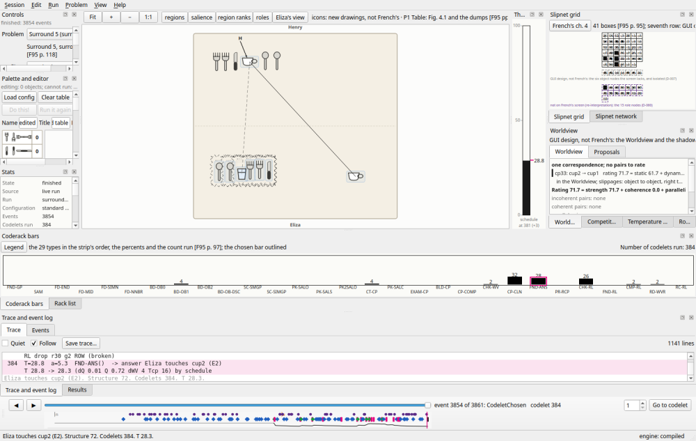

*The window at the last codelet of the quick start's run (Surround 5, seed 3, on v5's
engine): the table in the centre with Eliza's row as a group, Henry's touch (H) and the
correspondence from his cup to the lone cup, solid in the Worldview, with the one to the
glass in her row that lost dashed; the thermometer beside it at 28.3; the Slipnet grid on the right
over the Worldview, which the competitions, the temperature plot and the roles share as
tabs; the controls, the palette and the stats on the left, the Coderack bars and the trace
along the bottom, and the timeline under them. The layout is French's screen [F95 p. 96],
with the GUI's own panes as tabs.*

The panes follow French's screen dumps where he shows one, and say so: the table, the
thermometer, the Slipnet grid and the Coderack bars cite their figures, and the palette
follows his Figure 2.1. The temperature plot, the Slipnet network, the rack list, the
Worldview and the competitions have no figure in the sources and are labelled **"GUI
design, not French's"** in the pane, its tooltip and the guide. The icons are new drawings,
not French's.

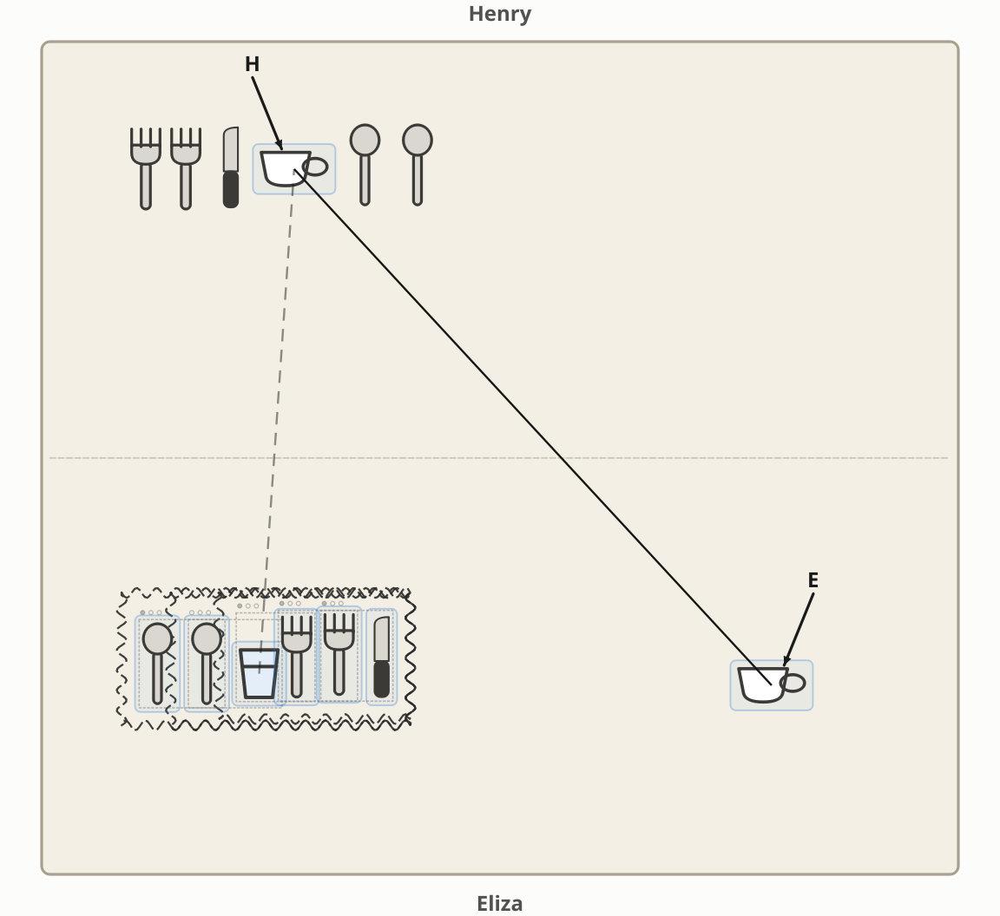

*The table at the answer of the same run, as French's screen drew it [F95 pp. 96-107]: the
group as a wavy box, the cup-to-cup correspondence as a solid line (it is in the
Worldview; a dashed line is outside it), the touch H and Eliza's answer E, the lone cup.*

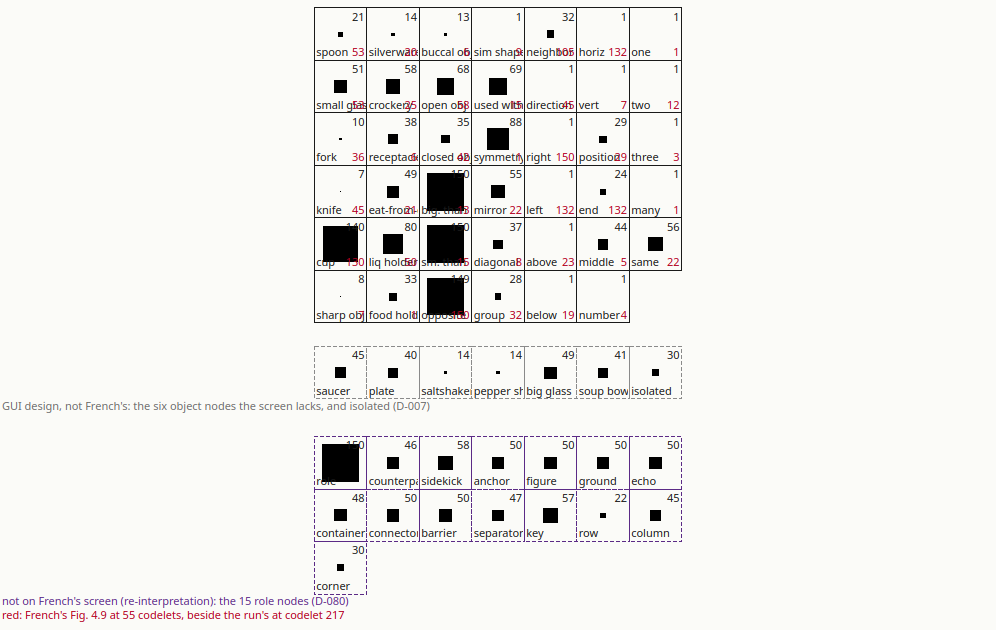

*The Slipnet grid at the first Worldview change (codelet 197), French's 41 boxes with the
activation as a black square and a number [F95 p. 95]; with "French's ch. 4" on, his
nearest dump's values (Figure 4.4, 22 codelets) are set in red beside ours. The seventh
row, the six object nodes his screen lacks, and the band of fifteen role nodes under it,
a re-interpretation (D-080), are the GUI's.*

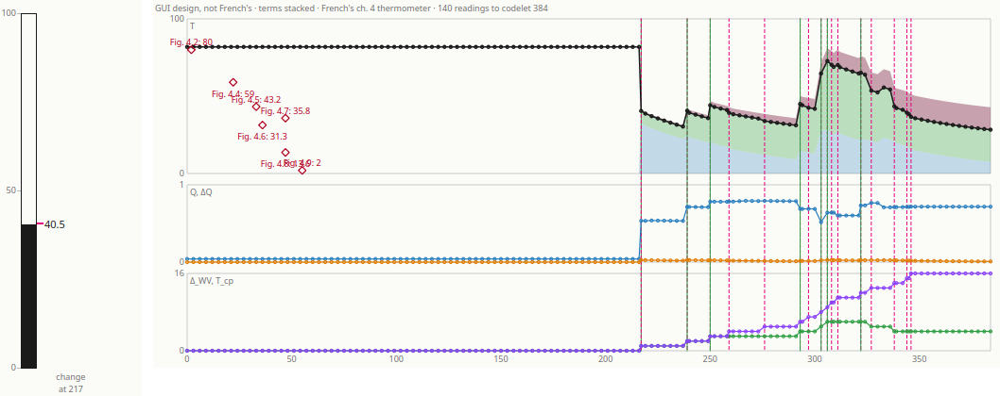

*The thermometer at the first Worldview change, when the temperature falls to 40.7 (on
v2's defaults it jumped to 96.8), and
the plot of the whole run with the three terms of French's formula [F95 p. 91] stacked
under the line and his chapter 4 readings as labelled points. The plot is GUI design, not
French's.*

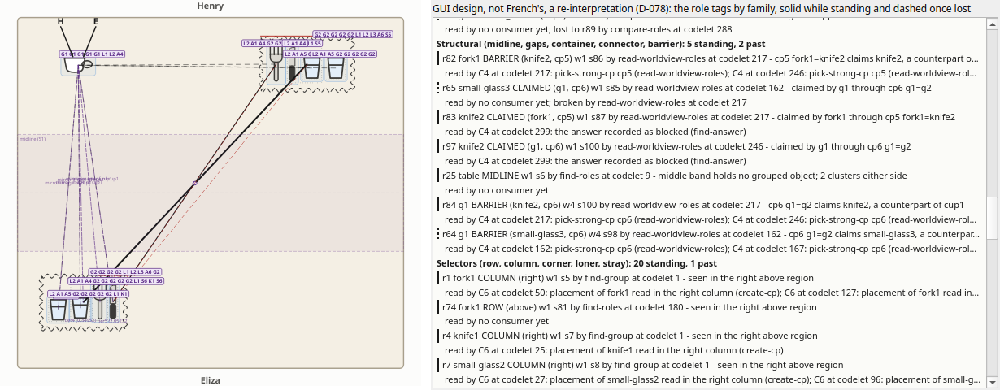

*The roles of a run of Blockage 7 (seed 1) at its end, the one picture not from the quick
start's run: the table with the **Roles** overlay on, each object and group badged with the
codes of its standing roles, the midline band, the point-symmetry axis the Worldview reads,
the touched cup's images and, on the lower left, the claim of the extra glass (a barrier)
on the glass across from the cup; beside it the Roles pane, scrolled to the structural
family: the midline, the extra glass and its group tagged BARRIER and the glass they claim
tagged CLAIMED, each with the codelet that read it, its evidence and its readers (the fight
consumer C4 posted; the answer recorded as blocked, so Eliza touches her own cup, French's
E3). Both are GUI design, not French's: the roles are a re-interpretation (D-078).*

Every pane is a dock: drag it, tab it, float it, or close it and bring it back from the
View menu; View > Reset layout restores the layout shipped with the code. Session > Save
session writes the run's problem, profile, edits, seed and events; Open session re-runs the
file and checks every event against it. Edit > Configuration shows every knob of the engine
with its page, editable for the next run; Edit > Edit table opens the palette, where a table
is set by dragging the icons and run with **Do this!**; the Results pane runs a batch and
sets French's numbers beside ours. The same seed gives the same run with or without the
window: the GUI only observes the engine and draws no random number. Help > "What am I
looking at?" shows a table of the panes inside the program, and the user guide, with
French's pages behind each pane, is [`python/docs/gui/panes.md`](python/docs/gui/panes.md);
the GUI's own decisions are [`python/GUI-DECISIONS.md`](python/GUI-DECISIONS.md), and its
review against its design is [`python/docs/gui/review.md`](python/docs/gui/review.md).
A worked example, three fights for the Worldview in one run of Figure 2.11, drawn by the
GUI, is [`python/docs/gui/worldview-fights.md`](python/docs/gui/worldview-fights.md).

`--smoke` runs a problem to the end offscreen, every event drawn, and prints French's report
line, the same last line as the command line's `--quiet`; it exits 0 for an answer, 1 for a
capped run, 2 for a usage error:

```sh
cd python && python3 -m tabletop.gui --smoke --problem surround-05 --seed 3
```

```
Eliza touches cup2 (E2). Structure 72. Codelets 384. T 28.3.
```

## Replaying French's experiments

Twelve benches rerun what French reports, over many seeds, and print our numbers beside his,
with a two-sample z and a chi-square. Through v2 nothing in them set a default; v3's and
v4's defaults come from optimizations against the same targets (D-114, D-115). Here is
one result set at French's own size, fifty runs (the lines that follow it in the output
repeat it as a summary):

```sh
cd python && python3 -m tabletop.bench families --problems surround-05 --runs 50 --quiet | sed -n 4,12p
```

```
### Surround 5 [F95 p. 118]

| Object Eliza touches | Frequency, French | Frequency, ours | z | Average structure, French | ours | No. of codelets run, French | ours |
|---|---:|---:|---:|---:|---:|---:|---:|
| E1 | 86 | 40.0 | -4.76 | 248 | 155.5 | 101 | 315.1 |
| E2 | 14 | 50.0 | +3.86 | 146 | 86.5 | 94 | 280.8 |
| other (cup1 1 fork4 1 spoon3 1 spoon4 2) | - | 10.0 | +2.29 | - | 172.0 | - | 379.6 |

50 runs of surround-05 under standard (bench seed 1, batch seed 14975722900606311642), 0 capped, mean codelets 304.4; chi-square 23.52 on 2 df, p = 0.000; French's n = 50.
```

French's structure values for this problem are on his own scale [F95 p. 118]. A few more, a
few runs each:

```sh
cd python && python3 -m tabletop.bench families --problems surround-05 --runs 3 --quiet
cd python && python3 -m tabletop.bench ch2 --problems ch2-fig03 --runs 2 --quiet
cd python && python3 -m tabletop.bench potelbat --problems surround-01 --runs 1 --quiet
cd python && python3 -m tabletop.bench temperature --problems surround-05 --runs 5 --quiet
```

The benches (`python3 -m tabletop.bench --list` lists them):

- `families` replays the 35 result sets of chapter 5 [F95 pp. 115-139] in French's own
  format: the object Eliza touches, its frequency, the average structure value and the
  number of codelets, his column beside ours. `fcca` does the same for the 18 sets reprinted
  in FCCA.
- `humans` sets our frequencies beside the 34 subjects' and Tabletop's second runs on the
  23 problems of Tables 5.1-5.3 [F95 pp. 143-144].
- `ch2` reads French's words about chapter 2's nineteen configurations as yes-or-no checks.
- `ch4` runs the chapter 4 configuration many times and compares the temperature, the
  Coderack's bars and the milestones with his nine screen dumps.
- `stated` turns 25 of his statements of what the program does into checks over the runs.
- `focus`, `rho`, `lesions`, `faults` and `temperature` probe the architecture: junk on the
  table, the urgency parameter, FCCA's lesions, French's seven faults restored, and the
  course of the temperature.
- `potelbat` is the brute-force baseline that FCCA describes.
- `robustness` runs random realistic tables, with every invariant checked after every
  codelet.

At French's size (he ran about fifty runs per problem) a family takes about a minute. The
committed results in `python/results/` were made at 500 runs per problem, and RESULTS.md's
tables are generated from them. [`python/README.md`](python/README.md), "Running the
benches", has every command and option.

## How well it does

The engine comes in five states, all measured at 500 runs per problem with the same seeds:
**v1**, the reconstruction as frozen (commit `e38d6e0`, its records kept in
[`python/results/v1/`](python/results/v1/README.md)); **v2**, the re-interpretation that
reads the part each object plays (the loner, the sidekick, the anchor, the mirror image, the
counterpart: D-078 on), on defaults set a priori in each decision and never tuned (its
records in [`python/results/v2/`](python/results/v2/README.md)); **v3**, the same engine on
the defaults a cross-validated Bayesian optimization chose (2026-10-16, D-114; its records
in [`python/results/v3/`](python/results/v3/README.md)); **v4**, the same engine on the choice
of a second optimization (D-115, 2026-10-17; its records in
[`python/results/v4/`](python/results/v4/README.md)); and **v5**, the default since 2026-10-17,
v4's defaults with the structural Blockage fix (D-116 to D-120: four mechanisms changed and
the proximity law bounded by French's Blockage 10, nothing fitted). Roles are part
of the engine and always on, so "before roles" is v1 and nothing else. Through v2 every
default was frozen before a bench ran at full size, no problem, object or seed is
special-cased, and the only two calibrations are the two French made himself, kept in their
own profiles. **v3** changed 67 defaults to the configuration the first optimization chose
against French's result sets and the human data (fold 1 trial 244): its held-out estimate of
the objective (J, a mean total variation from French's and the subjects' distributions,
lower is better) was **0.316 against v2's 0.468**. **v4** changed 65 of them again, to fold
1 trial 800 of a second optimization that also charged a configuration for ground lost on
any target: on all the data, where it was chosen, J falls from 0.263 to **0.211** (v2 0.464,
v1 0.473), **but its held-out estimate is not better than v3's: 0.257 against 0.248** on the
same folds, and the ground it loses on unseen problems is larger (a penalty of 0.036 against
0.021). The author made it the default knowingly. **v5** then changed the mechanism, not the
knobs: a study of why Blockage 2, 9 and 10 were lost found the touched object's correspondence
rated without its special status in exactly French's contest, a bonus that ratcheted every
rematch, and a proximity law that grouped glasses French says are never grouped; the fix won
Blockage 2 and 10 back (the blocked cup from 60 and 56 percent of runs to 19 and 10, his 12
and 0), kept Blockage 6-8 blocking, moved no Surround, Buridan or Figure/Ground set by more
than a total variation of 0.1, and ended the capped runs; J falls to 0.204 in sample (French's
sets nearer, the human data a little further). The full numbers, result set by result set,
are in [`python/RESULTS.md`](python/RESULTS.md): its §14 sets French | v1 | v2 | v3 | v4 |
v5 side by side with the study and the trade-offs, its §13 does the same for v4, its §12 for
v3, its §11 reads the roles
against v1 as gained and lost, never as a net number, and scores the predictions registered
before any role was built ([`python/docs/predictions.md`](python/docs/predictions.md)). The
roles' design, the families, the registry, the re-cast, the consumers and the measures that
keep them honest, is [`python/docs/roles.md`](python/docs/roles.md). The measures of
RESULTS.md's first section:

| What | French's program | v1 (`standard`, 500 runs per problem) | v2 (roles, a priori) | v3 (first optimization) | v4 (second optimization) | v5 (the structural Blockage fix, the default) |
|---|---|---|---|---|---|---|
| His main answer, 35 result sets [F95 pp. 115-139] | his frequency | within 15 points on 6 of 35 | 6 of 35 | 16 of 35 | 19 of 35; against v3 it moved beyond z = 2 on 18 sets, nearer his frequency on 16 and further on 2 | 18 of 35; against v4 it moved beyond z = 2 on 5 sets, nearer on 3 (Blockage 2, 9, 10) and further on 2 (Blockage 7, 8) |
| Directions within a family (where his frequencies differ by more than two standard errors) | 210 ordered pairs | the same way in 117 (56 percent), significantly reversed in 52 | 121 (58 percent), reversed in 46 | 162 (77 percent), reversed in 26 | 184 (88 percent), reversed in 12 | 196 (93 percent), reversed in 6 |
| The better-structured answer, 29 two-answer sets | the answer with the higher structure value | the same answer in 12 of 29; whether it takes longer agrees in 19 of 29 | 18 of 29; 20 of 29 | 27 of 29; 23 of 29 | 27 of 29; 23 of 29 | 26 of 29; 21 of 29 |
| Run length | 50-200 codelets | medians of 52-60 codelets per family; Surround 10 at 1.09 times Surround 5 (his 1.3 at most) | medians of 66-79; 1.03 times | medians of 123-154; 1.11 times | medians of 185-252; 1.06 times | medians of 190-260; 1.02 times |
| The 34 subjects, 23 problems [F95 pp. 143-144] | within ten points on 13 of 23 | within ten points on 0 of 23; rank correlation +0.39 with the subjects, +0.57 with his second runs | 0 of 23; +0.45 and +0.45 | 13 of 23; +0.29 and +0.64 | 13 of 23; +0.49 and +0.84 | 10 of 23; +0.41 and +0.87 |
| His statements of what the program does (25) | one run each | 16 agree, 7 disagree, 2 have nothing to read | 20 agree, 2 disagree, 3 have nothing to read | 20 agree, 4 disagree, 1 has nothing to read | 17 agree, 5 disagree, 3 have nothing to read | 19 agree, 3 disagree, 3 have nothing to read (Blockage 10's glasses never grouped, as he says, for the first time since v2) |
| Chapter 2's nineteen configurations, 66 checks from his words | his words | 57 of 66 agree | 58 of 66 | 54 of 66 | 55 of 66 | 57 of 66 |
| FCCA's lesions, 7 on 4 problems | not reported | 16 of 28 cells degrade as the theory predicts, 12 change nothing, 0 go the other way | 15, 13 and 0 | 16, 10 and 2 | 13, 15 and 0 | 12, 15 and 1 |
| 500 random realistic tables | not reported | every run ends with an answer, no invariant broken | the same, with the role pool's invariants checked too; 77 role tags read per run | one run capped; on 6 tables a CLAIMED tag outlives its broken BARRIER (a defect of v2's code that v3 exposes, RESULTS.md §12); 128 role tags read per run | 4 runs capped; the same defect on 7 tables (RESULTS.md §13); 143 role tags read per run | no run capped, no invariant broken (both defects fixed, D-119 and D-120); 146 role tags read per run |

What the roles changed on their a-priori defaults (v2, RESULTS.md §11): the answers French
prints no bar for fell on every Surround set and three Blockage sets, and the Worldview
held two or more correspondences more often (3.6 to 14.5 percent of runs); the isolated cup
of the Surround family (E2) was given more often; the glass in the matching group (E1), the
blocked cup of the Blockage family and the lone glass of Figure/Ground did not move. The
roles were read in most runs and too late for the answer on the sets that matter most.

What v3 changed (RESULTS.md §12): the runs became three times longer (236 codelets on
average over the target problems, against 72), the Worldview held two or more
correspondences in a quarter of the runs and a group-to-group correspondence in 17.5
percent (v2 3.6), and **Blockage 6-8 began to block**: Eliza touched her own cup in 70, 75
and 66 percent of runs, against French's 78, 76 and 62 (v2 9, 11 and 8). What it lost: on
Blockage 2, 9 and 10 the blocking was over-applied and French's answer fell to 31, 24 and 31
percent (his 88, 80 and 100; v2 80, 84 and 78).

What v4 changed (RESULTS.md §13): at the same mean run length on the target problems, the
mechanism is richer, with a Worldview of two or more correspondences in a third of the runs
(v3 23 percent), a barrier standing at the end in 13.5 percent and a symmetry axis in 16.9
(v3 7.2 and 9.0), the answers French prints no bar for down to 6 percent, and runs that end
colder (16 against 33). **Surround 5, 7 and 10 improved**, the glass in the matching group
now given in 26, 21 and 24 percent of runs (v3 12, 12 and 13; his 86, 80 and 73), and
Buridan comes nearer French on every one of its sets. **What it did not fix, or lost**:
**Blockage 2, 9 and 10 remain lost** (26, 27 and 34 percent against his 88, 80 and 100), the
touched cup still the most frequent answer there; **Blockage 6 dropped a little**, to 64
percent (v3 70, his 78); Surround 8 and 9 moved away from him; fewer of his statements hold
(17 of 22 against v3's 20 of 24); and with four or more junk objects on Surround 5, or one
cup alone on the table (chapter 2's Figure 2.2, 484 of 500 runs), runs reach the cap more
often than v3's. v3 and v4 also fit away French's own constants (the urgency parameter, the
law of temperature's exponents, the starting activations of his screen dumps) and bring
back parts of three of the faults he named in his program. The held-out variants bench
finds v4 as invariant as v3: no mirrored, side-swapped or rotated table differs from its
original beyond chance.

The chart below shows the first line of that table, French beside v1 and v5 (the pictures
of this section are drawn from `python/results/v1/` and `python/results/`; RESULTS.md §14
adds v2's, v3's and v4's columns). For each result set it takes the answer French's program gave most
often, and sets how often his program gave it beside how often this reconstruction gave it
before roles and gives it now. v1 gives French's main answer less often than he did in 33 of
the 35 sets; v5 comes within 15 points of him on 18.

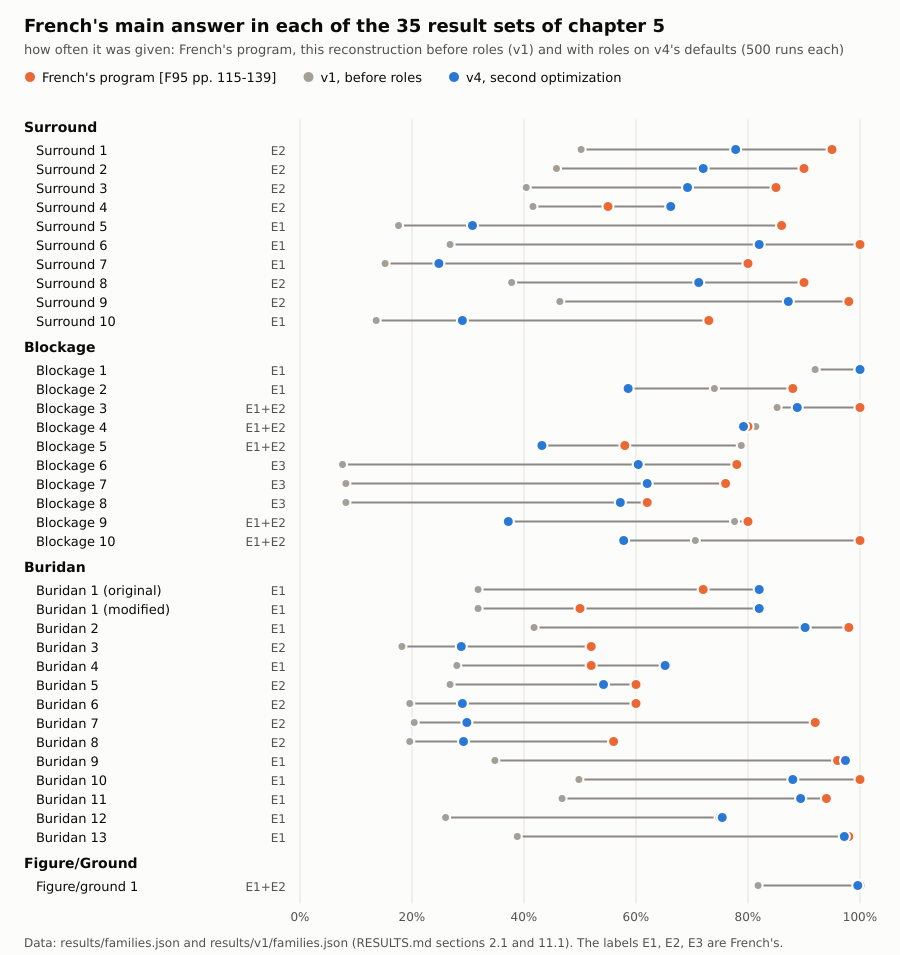

*French's most frequent answer in each of the 35 result sets of chapter 5: how often his
program gave it (orange, about fifty runs), how often this reconstruction gave it before
roles (grey, v1) and how often it gives it on v5's engine (blue), 500 runs of the
`standard` profile each. The data are `python/results/v1/families.json` and
`python/results/families.json`; RESULTS.md §14 has the table with v2, v3 and v4 beside them.*

Four result sets in full, every answer French reports plus the answers he prints no bar for:

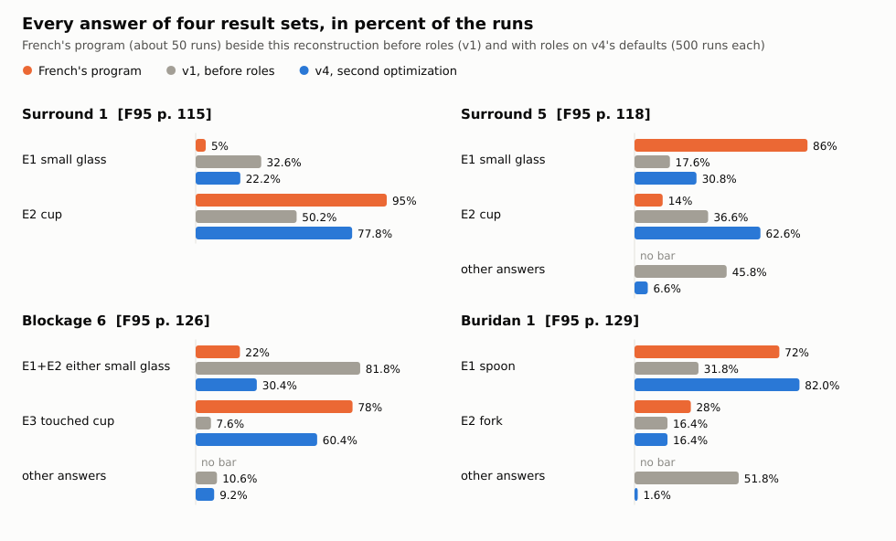

*Surround 1: French's program clearly prefers the cup, and v5 gives it in three runs of four
(v1 half). Surround 5: his program takes the glass in the matching group, which v5 gives in
30.8 percent of runs (v1 17.6, v3 12.4, v4 26.0), the isolated cup taking 62.6. Blockage 6: his
program mostly touched the cup itself, blocked by the extra glass, which v1 did in one run
in thirteen and v5 does in 60.4 percent (v3 69.6, v4 64.0). Buridan 1: half of v1's runs end on an
object French doesn't report at all; v5 takes his spoon in 82.0 percent.*

The temperature tells the same story from the inside. French shows the thermometer in the
screen dumps of his chapter 4 run; the `temperature` bench runs the same problem 500 times:

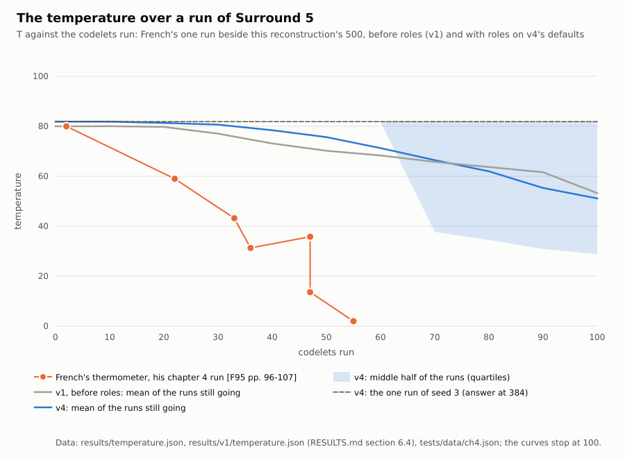

*The temperature against the codelets run on Surround 5. Orange: French's thermometer in the
dumps of his chapter 4 run [F95 pp. 96-107], two of which are at codelet 47. Blue: the mean
and the middle half of v5's 500 runs, counting at each point only the runs still going.
Grey: v1's mean over the same seeds. Dashed: the one run of seed 3 shown above, whose
temperature falls when its first correspondence enters the Worldview and rises when a second
one wins it. The data are `python/results/temperature.json` and
`python/results/v1/temperature.json` (RESULTS.md §6.4) and `python/tests/data/ch4.json`.*

French's temperature fell steadily as structure was built and fought over. v1's stays at 80
until the first correspondence enters the Worldview, jumps, and then decays, and the
find-answer codelets end the run while it is still in the fifties. v5 starts at 81.9, holds
there until the Worldview first changes, falls, and its runs end colder (20 on average over
the target problems, v4 16, against v3's 33 and v2's 51), still above the 2 at which French's
chapter 4 run ended.

**What it misses, and why** (v1 and v2; v3's, v4's and v5's trade-offs are above). The misses are few in
kind, and each is traced to a numbered decision (RESULTS.md §8 for v1, §11.8 for the roles). The chief one: the reconstruction builds almost no bottom-up groups
and no group-to-group correspondences before its runs end. So the structure French's program
built on the chapter 4 configuration (the spoon-spoon subgroups, their correspondence, the
fight that coherence decides) is reached in a fraction of a percent of runs. The answers that
need it (the glass on Surround 5, the blocking in Blockage, the preference in Buridan) are
missed, answers French prints no bar for take 40 to 50 percent of the runs, and the
temperature falls far less than his thermometer shows. The findings name the decisions this
points at (the raw urgencies and generations of the build chain, the find-answer schedule,
the temperature coefficients), with the knobs that let a reader try another reading without
touching the frozen defaults.

**What it can't do.** As in French's program, there is no learning across runs [F95 p. 41]
and no special mechanism that looks for blockages [FH91 p. 179]. Because his code and seeds
are lost, no run can be replayed event for event; the reconstruction is judged on his
reported frequencies, structure values, codelet counts, screen dumps and words.

## Running the tests

```sh
cd python
python3 -m pytest -q              # the default suite, python/tests/ (fast; no test over about 2 s)
bash run-tests.sh                 # the same, in parallel when pytest-xdist is installed
bash run-tests.sh --slow          # the slow suite, python/tests_slow/ (minutes); --all runs both
```

The default suite is about 1,400 tests, 870 for the engine and 530 for the GUI, and takes
about a minute and a half on one core (less in parallel, with pytest-xdist from the `test`
extra). The GUI's tests (`python/tests/gui/`) run offscreen, so no window opens, and skip
without PySide6. The slow suite (`python/tests_slow/`: the multi-seed surveys, the whole runs
through the window, the README's command blocks) is run on its own. The tests cover:

- French's worked examples and the arithmetic of his pages;
- every mechanism, with fixed seeds and with statistical tests over many seeds;
- the golden traces and fingerprints that pin the engine's behaviour;
- the conventions: standard library only, one random generator, every docstring cited, every
  decision defined;
- the standalone rules (below);
- the GUI: every pane's Qt-free model against the events of fixed runs, every view offscreen,
  and that a run through the window equals a plain run, event for event;
- the documentation itself: the commands in this file and in `python/README.md` run and print
  what is shown, the pictures exist and stay small, the table of knobs equals the code, and
  every quotation followed by a page citation is checked against the text of the cited page
  by `python/tools/check_quotes.py`, when the source PDFs and `pdftotext` are found.

What the quotation checker cannot read was audited by hand on the page images: a random
sample of 48 citations, every bar-graph value and ten layouts
([`python/docs/citation-audit.md`](python/docs/citation-audit.md)).

The folder is also checked as a repository of its own, the one `git subtree split` makes of
it. [`python/docs/standalone.md`](python/docs/standalone.md) records the procedure (the split
in a scratch clone, the tests with and without the source PDFs, the install in a fresh
virtual environment, every link read in both places) and its results, and
`bash python/tools/standalone_check.sh` repeats it from inside a FARGonautica checkout.

## How the reconstruction was made

No source code survives, so nothing could be ported. Instead:

1. **The specification.** French's book, FCCA's chapters 8 and 9 and the 1991 paper were
   read page by page into [`python/SPEC.md`](python/SPEC.md): seven sections and about 900
   quotations, each checked by a script against the cited page. The chapter 4 run was
   transcribed dump by dump ([`python/docs/ch4-run.md`](python/docs/ch4-run.md)), and every
   number French reports became data (`python/tabletop/reported.py`).
2. **The problems.** The 53 table configurations of chapters 2 and 5 were digitized from the
   figures. The method, the uncertainty and a cross-check against FCCA's redrawn figures are
   recorded in [`python/docs/problems.md`](python/docs/problems.md).
3. **The decisions.** Wherever the sources are silent (a weight, a schedule, a tie-break),
   the choice is a numbered entry in [`python/DECISIONS.md`](python/DECISIONS.md) (D-001 to
   D-077), with a knob in `tabletop/config.py`, and the code cites it as `DECISION D-NNN`.
4. **French's faults, fixed.** French names seven faults in his own program. Each is fixed by
   default, as a decision citing his page, and all seven can be restored with the
   `french-faults` profile, to see what they did.
5. **The freeze and the benches.** Every default was frozen (`python/config_defaults.lock`)
   before any bench ran at full size. The benches then put our numbers beside his, and every
   miss became a finding traced to a decision, never a reason to move a knob. The only
   calibrations are French's own two, kept as the `human` and `buridan` profiles, fitted
   after the freeze and logged.
6. **The build.** A Ralph loop (one fresh Claude Code session per work item, each followed
   by a regression gate) built it item by item; its task, plan, decisions and progress log
   are `ralph_loops/loop0005/` in the author's working copy of FARGonautica.
7. **The conventions:** one seeded random generator, a fresh world for every run, small
   modules with one job each, plain classes, typed events that the traces and the GUI
   observe, and tests for every mechanism.
8. **The GUI.** A second loop (`ralph_loops/loop0006/`) built the interface the same way,
   one pane per item, against the frozen engine: each pane is a Qt-free model tested
   against the events of fixed runs and a thin view over it, and a gate checks after every
   item that a run gives the same events with and without the window.

Unlike FARGonautica's Numbo and Metacat ports, there is no running original to compare
against event for event.

## What's in this folder

| Path | What's there |
|---|---|
| [`python/tabletop/`](python/tabletop/) | the engine, the command line (`__main__.py`), the benches (`bench/`) and the GUI (`gui/`, with its own [module map](python/tabletop/gui/README.md)); [`python/README.md`](python/README.md) has the module map, the table of knobs, the profiles and how to read a trace |
| [`python/problems/`](python/problems/) | the 53 configurations as JSON, with each object's provenance |
| [`python/tests/`](python/tests/) | the tests; `tests/data/` holds the chapter 4 run and the worked examples as data; `tests/gui/` the GUI's tests, offscreen |
| [`python/SPEC.md`](python/SPEC.md) | the specification, with page citations |
| [`python/DECISIONS.md`](python/DECISIONS.md) | the 77 decisions where the sources are silent, indexed by number and by kind |
| [`python/GUI-DECISIONS.md`](python/GUI-DECISIONS.md) | the GUI's decisions, `G-NNN`: every choice its design leaves open, and every place it follows the Numbo GUI |
| [`python/RESULTS.md`](python/RESULTS.md) | the results against French's, the findings and the calibration log |
| [`python/results/`](python/results/) | the benches' records at 500 runs, from which RESULTS.md's tables and the charts are generated |
| [`python/docs/`](python/docs/) | the digitized problems, the chapter 4 run, the trace format, the engine's API for observers and the GUI, how the folder was checked as a repository of its own, the GUI's user guide (`docs/gui/panes.md`) and the pictures on this page |
| [`python/scripts/`](python/scripts/) | `docs_figures.py`, which redraws the figures on this page, and `docs_screenshots.py`, which renders the GUI's screenshots |
| [`python/tools/`](python/tools/) | the quotation checker, the link checker and the standalone check, the figure-measuring and problem-rendering tools, the knobs-table generator |

## Further reading and credits

- French, R. M. (1995). *The Subtlety of Sameness: A Theory and Computer Model of
  Analogy-Making*. MIT Press. The specification (cited `[F95 p. N]`); in FARGonautica:
  [Literature/Tabletop-French-1995-The Subtlety of Sameness.pdf](https://github.com/fargonauts/FARGonautica/blob/master/Literature/Tabletop-French-1995-The%20Subtlety%20of%20Sameness.pdf).
- French, R. M., and Hofstadter, D. R. (1991). Tabletop: An Emergent, Stochastic Model of
  Analogy-Making. *Proceedings of the 13th Annual Conference of the Cognitive Science Society*
  (cited `[FH91 p. N]`). In FARGonautica:
  [Literature/Tabletop-French, Hofstadter-1992.pdf](https://github.com/fargonauts/FARGonautica/blob/master/Literature/Tabletop-French,%20Hofstadter-1992.pdf).
- Hofstadter, D. R., and the Fluid Analogies Research Group (1995). *Fluid Concepts and
  Creative Analogies*. Basic Books (cited `[FCCA p. N]`). Chapter 8 (the domain, its
  variants and the Potelbat baseline) and chapter 9 (the results reprinted, the lesions
  proposed); copyrighted, read in place, never copied here.
- Mitchell, M. (1993). *Analogy-Making as Perception*. MIT Press. Copycat, whose architecture
  Tabletop adapts; FARGonautica's
  [Copycat page](https://github.com/fargonauts/FARGonautica/blob/master/copycat.md) lists its
  implementations.
- The other reconstruction from a specification in FARGonautica, Meredith's
  [Seek-Whence](https://github.com/fargonauts/FARGonautica/blob/master/Software/SeekWhence/README.md),
  whose conventions this folder follows.

Tabletop is Robert French's design. The reconstruction was made by Alexandre Linhares with
Claude Code, from French's and Hofstadter's published work; their text is quoted only in
short, cited fragments, and the pictures on this page are new drawings made from the
digitized data, never copies of French's figures. Any error in the reconstruction is the
reconstruction's, not French's; where it departs from his account, `DECISIONS.md` says so.
