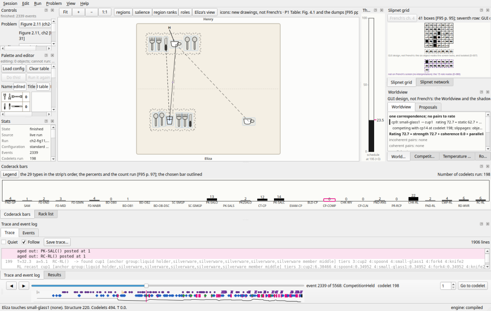
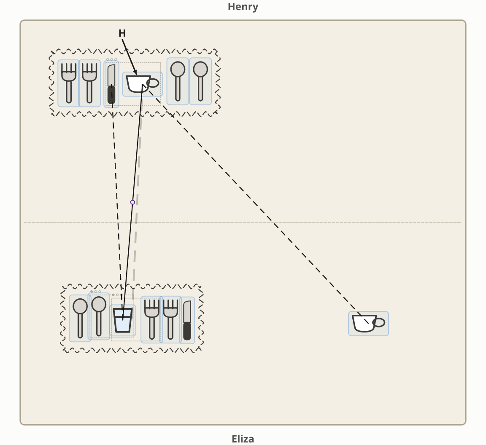
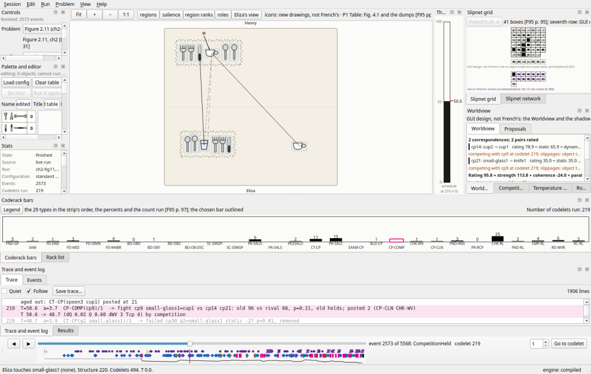
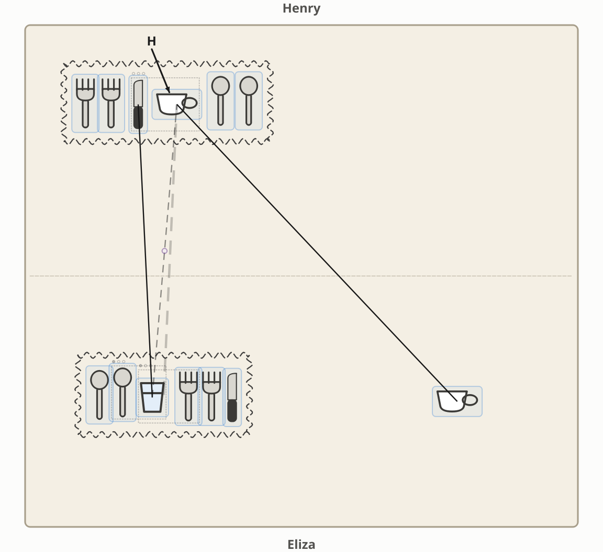
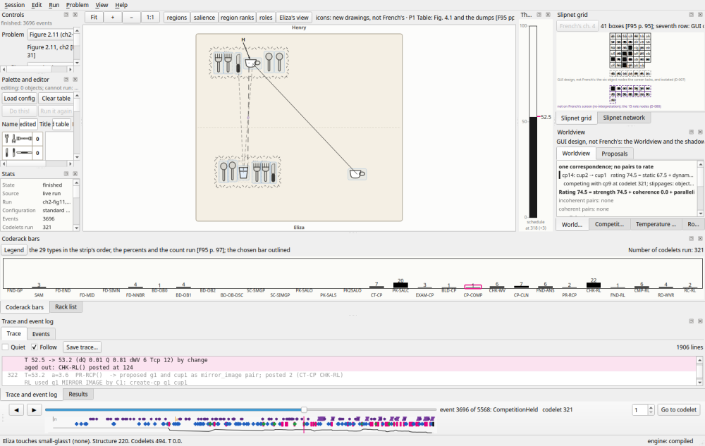
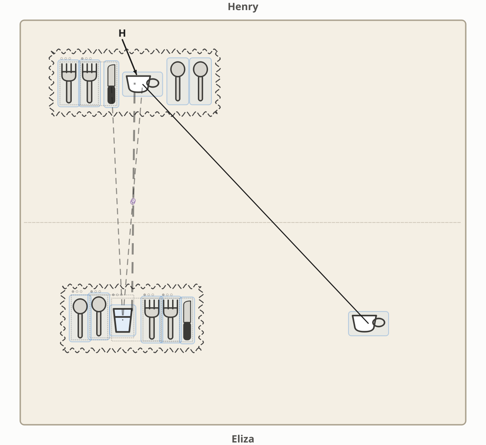

# A fight for the Worldview: Figure 2.11, seed 6

Three moments of one run, drawn by the GUI, in which the glass in Eliza's row and the lone cup
take the Worldview from each other. The table is French's Figure 2.11 [F95 p. 31], digitized
in `problems/ch2-fig11.json`: Henry's cup sits in a row of silverware; on Eliza's side a
matching row has a small glass where the cup would be, and a cup stands alone at the far
right. The run is `ch2-fig11`, seed 6, on the `standard` profile; the same seed gives the same
run on any machine (D-064), with or without the window.

```sh
cd python
python3 -m tabletop.gui --problem ch2-fig11 --seed 6 --play      # watch it
python3 -m tabletop ch2-fig11 --seed 6 | grep -n 'fight'           # the fights in the trace
python3 -m scripts.fight_screenshots                              # redraw these pictures
```

Both gestalt groups are found by codelet 59. By codelet 151 the glass-to-cup correspondence
(cp9, `small-glass1=cup1`) is in the Worldview, alone and unopposed. From codelet 198 the
cup-to-cup correspondence (cp14, `cup2=cup1`) and the glass-to-cup one fight for the
Worldview more than a dozen times. The run ends after 494 codelets with Eliza touching the
small glass. In the pictures a **solid line** is a correspondence in the Worldview and a
**dashed line** one outside it (French's convention [F95 p. 105]); the groups are the wavy
boxes; the Worldview pane at the right names the correspondence and the fight. The icons
are new drawings, not French's.

## Codelet 198: the cup beats the glass

The newcomer cp14, cup to cup, challenges cp9, glass to cup, and wins, 76 against 73 (the
chance of the rival was 0.56). The Worldview pane, sought to the event, reads "cp9:
small-glass1 → cup1, competing with cp14 at codelet 198".





## Codelet 219: the glass challenges, the cup holds

The Worldview is now the cup pair and a glass-to-knife correspondence (cp21,
`small-glass1=knife1`, which entered without a fight at codelet 201). The glass pair comes
back as the newcomer and loses, 68 against 96.





## Codelet 321: the glass wins back

After a group-to-group correspondence (cp43, `g2=g1`) has come and gone, the glass pair
beats the cup pair by one point, 75 against 74, and takes the Worldview. It holds it, through
eight more fights, to the answer.





To reproduce any of them on screen: open the problem, **Run to end**, and type the codelet
number into **Go to codelet** on the timeline, or click the fight's line in the trace.
