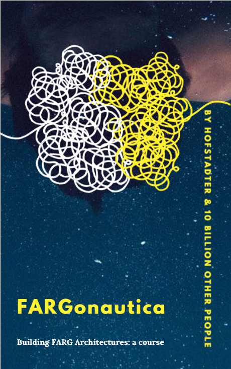

# REPOSITORY VERSION

As of October 2026, this repo is considered, in open-source fashion, to be in version 1.0.0.

# REPOSITORY GOALS
---

**Goals for version 1.0.0**, as written in 2017. Version 1.0.0 (October 2026) meets the first two, source code and literature; the course, that is the exercises and challenges below, is the goal for version 2.0.0:
- Each project should contain:
    - **Source code** of all major projects, complete and running
    - **Literature** of all major projects, complete with links to books
    - **Exercises** for undergraduate courses
    - **Programming challenges** large or small
    - **Research challenges** for graduate students (each challenge being able to lead to a publication, in principle)

So here is a table of what the course version could be:

| Project | Sourcecode | Literature | Exercises | Programming challenges | Research challenges |
|---------| --------- | ----------| ----------|  ----------| ----------|
| Seek-Whence & SeqSee | Yes | Yes | 15 | 3 | 2 |
| Numbo | Yes | Yes | 5 | 1 | 1 |
| Copycat & Metacat | Yes | Yes | 35 | 8 | 5 |
| Tabletop | Yes | Yes | 17 | 3 | 1 |
| Letter Spirit | Yes | Yes | 15 | 10 | 2 |
| Phaeaco | Yes | Yes | 15 | 10 | 3 |
| Musicat | Yes | Yes | 15 | 5 | 9 |
| Capyblanca | Yes | Yes | 15 | 4 | 4 |
| George | Yes | Yes | 25 | 3 | 8 |

Do you see how cool this could be?  Not only a library but also a course and a set of research questions... don't you wish your teachers, say, at kindergarten, had something like this?  And [here's where we are!](repo-version.md)

Long ways to go to get there, hah?  Please help; if you would like to contribute please see [how you can contribute to this repository](how-to-contribute.md). You do **not** necessarily have to be someone who has earned the Ph.D. working with Hofstadter:  Hofstadter
gracefully conceded the honorable title of "Associate FARGonaut" to me (Linhares), of which I am truly proud.  If you have ideas for
exercises, research questions, programming challenges, or something else altogether... please get in touch!  

Because when we get there, here's what we can do:

That's right: we can do a full-blown book/free e-book with *a course on the computer science of building FARG architectures*.  But two things:  First, this book would be the subject of *another* repository; and second, Don't worry about the details now... Whether or not Hofstadter will join... whether or not it will be published anywhere fancy: if you're like me and you feel that this is something that should exist, join us and let's make it happen!  

#1.0.0 (October 2026)
---
Here is how this repository stands:

- The first goal is met: every FARG architecture whose source code survives, or could be reconstructed from its thesis, is archived with instructions for running it, and runs on a current machine. Copycat runs from Mitchell's original Lisp on SBCL and inside Hager's OpenGL GUI. Metacat runs in Racket and Python, checked event for event against Marshall's Scheme. Numbo runs on SBCL and in Python from Defays's 1987 printout. Seek-Whence and Tabletop, whose Lisp is lost, are reconstructed in Python from the theses and the books, with every open decision written down. SeqSee has a Python port beside the Perl. Musicat builds and runs on Linux with Mono. Letter Spirit runs in the browser (Paul Geiger's JavaScript).
- The literature is collected: the theses, the papers, and the CRCC reports that cogsci.indiana.edu no longer serves.
- The course is the next goal: exercises and challenges exist for Copycat and Capyblanca only.

| Project | Sourcecode | Literature | Exercises | Programming challenges | Research challenges |
|---------| --------- | ----------| ----------|  ----------| ----------|
| Seek-Whence & SeqSee | Yes (Seek-Whence reconstructed in Python; SeqSee in Perl and Python) | Yes | 0 | 0 | 0 |
| Numbo | Yes (SBCL port and Python; runs) | Yes | 0 | 0 | 0 |
| Copycat & Metacat | Yes (both run: SBCL; Racket and Python) | Yes | **7** | **3** | **1** |
| Tabletop | Yes (reconstructed in Python; runs) | Yes | 0 | 0 | 0 |
| Letter Spirit | Yes (Scheme; runs in the browser in JavaScript) | Yes | 0 | 0 | 0 |
| Phaeaco | No (closed source) | Yes | 0 | 0 | 0 |
| Musicat | Yes (runs, on Linux too) | Yes | 0 | 0 | 0 |
| Capyblanca | Yes (Delphi) | Yes | **8** | **2** | **1** |
| George | No (never released) | Partially | 0 | 0 | 0 |

#0.2.1
---
Here is how this repository stands:

- We have received replies from emails, and they are all favorable.  Hence we should have the source-code of Seek-Whence and Letter-Spirit at this version.  Who knows?  We might even get George and Phaeaco and Tabletop one day?   

| Project | Sourcecode | Literature | Exercises | Programming challenges | Research challenges |
|---------| --------- | ----------| ----------|  ----------| ----------|
| Seek-Whence & SeqSee | Yes (Seek-Whence coming soon, SeqSee complete) | Yes | 0 | 0 | 0 |
| Numbo | Yes | FCCA | 0 | 0 | 0 |
| Copycat & Metacat | Yes | Yes | **6** | **3** | **2** |
| Tabletop | No | Yes | 0 | 0 | 0 |
| Letter Spirit | Yes | Yes | 0 | 0 | 0 |
| Phaeaco | No | Yes | 0 | 0 | 0 |
| Musicat | Yes | Yes | 0 | 0 | 0 |
| Capyblanca | Yes | Yes | **8** | **2** | **1** |
| George | No | Partially | 0 | 0 | 0 |

#0.0.8
---
Here is how this repository stands:

- What we yearn for has reached the outer limits of the googleverse.  We have collected the projects that are available across the web (i.e., anyone is able to get this material by googling for it). Our yearnings now take us to the email spamming phase of authors of other projects.

- version 0.0.9 (coming up shortly)
     - This version will include the key references of the Copycat project:  anyone that reads those articles should have a great understanding of what the project is about, what are easy and hard problems, how the architecture is mostly organized and why perception and analogy are inseparable.
- version 0.1.0 (coming up soon)
     - This version will include exercises to be conducted on an undergraduate course, and challenges for graduates students that, if completed sucessfully, could lead to copycat-related original results worthy of publication in AI / cognitive science journals.

| Project | Sourcecode | Literature | Exercises | Programming challenges | Research challenges |
|---------| --------- | ----------| ----------|  ----------| ----------|
| Seek-Whence & SeqSee | Yes (SeqSee) | Yes | 0 | 0 | 0 |
| Numbo | Yes (Coming soon) | Yes | 0 | 0 | 0 |
| Copycat & Metacat | Yes | Yes | 0 | 0 | 0 |
| Tabletop | No | Yes | 0 | 0 | 0 |
| Letter Spirit | No | Yes | 0 | 0 | 0 |
| Phaeaco | No | Yes | 0 | 0 | 0 |
| Musicat | Yes | Yes | 0 | 0 | 0 |
| Capyblanca | Yes | Yes | 0 | 0 | 0 |
| George | No | Partially | 0 | 0 | 0 |
